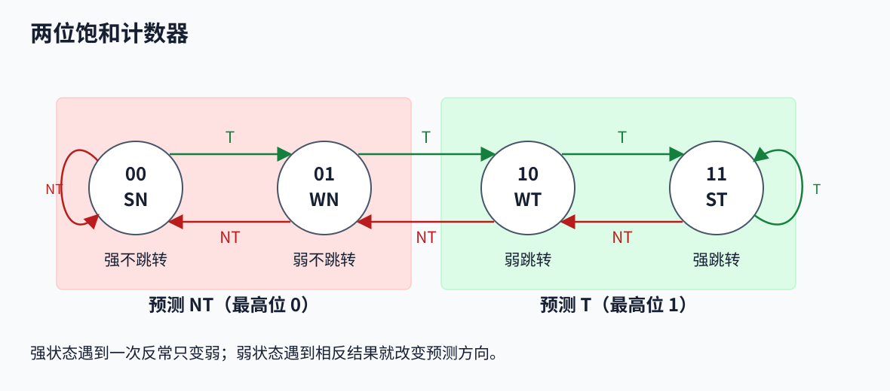
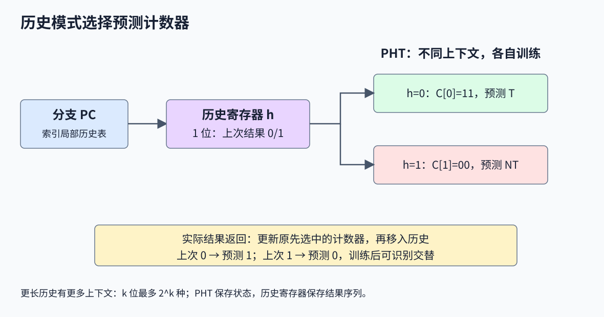
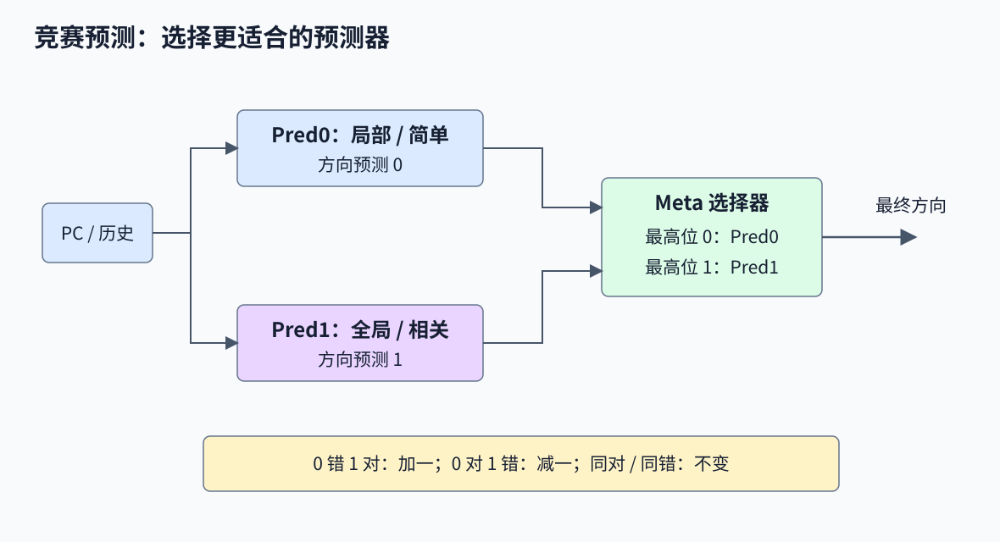

# 第 4 讲补充：分支相关性与混合预测

> 对应课件：`4-Supplement-BranchPrediction-教学网.pptx`，共 24 页。本篇补充不同 T/NT 周期的预测率计算、局部/全局相关性、历史寄存器与模式表、竞赛预测器。基础状态机见[第 4 讲](./04-分支预测与多发射处理器.md)。

## 1. 一位与两位预测器的共同前提

一位 BHT 用 PC 或其哈希选择表项，预测“本次与上次相同”，实际结果解析后覆盖这一位。索引宽度为 `k` 时可选 `2^k` 项；课件图中的指数与 `2K=2048` 的容量写法要区分。

两位方案每项保存饱和计数器 `00、01、10、11`，分别为 SN、WN、WT、ST。最高位给出方向：`00/01` 预测 NT，`10/11` 预测 T。实际 T 时饱和加一，实际 NT 时饱和减一。



计算准确率前，应给定实际方向序列、初始状态、是否重复执行及是否忽略表项冲突。源代码中进入 if 的方向不一定是 T，因为汇编也可能在条件为假时跳过代码。

## 2. 五次检查的循环

实际序列为 `T T T T NT`，每次退出后又重新进入同一循环：

| 方案与初态 | 第一轮的预测 | 第一轮准确率 | 后续稳定准确率 |
|---|---|---:|---:|
| 一位，初态 NT | NT、T、T、T、T | 3/5 = 60% | 60% |
| 两位，初态 WN | NT、T、T、T、T | 3/5 = 60% | 4/5 = 80% |

一位方案退出时变 NT，下次第一次 T 又猜错。两位方案在退出前达到 ST，退出只使它退为 WT，下一轮仍预测 T。因此对于形成稳定 Taken 状态、每轮有 `N` 次分支检查的长循环：

$$
A_{1bit}=1-\frac{2}{N},\qquad A_{2bit}=1-\frac{1}{N}
$$

这里的 `N` 是分支执行次数；第一次运行和极短循环不一定满足稳态公式。课件标出的 80% 对应训练后的两位表现。

## 3. 三个分支地址的预测率

课件使用程序：

```c
for (i = 0; i < 100000; i++) {
    if (i % 100 == 0) tick();
    if ((i & 1) == 1) odd();
}
```

三个示意分支分别位于 `0xDC08`、`0xDC44`、`0xDC50`。按课件的跳转方向解释，前两个分支以 T 为主，第三个交替：

| 地址 | 实际方向的规律 | 一位稳态错误数 | 一位准确率 | 两位典型稳态准确率 |
|---|---|---:|---:|---:|
| DC08 | 长循环回跳，约 99999 次 T 后一次 NT | 每 100000 次 2 错 | 99.998% | 99.999% |
| DC44 | 每 100 次有一次反常 NT | 每 100 次 2 错 | 98.0% | 99.0% |
| DC50 | T、NT 严格交替 | 每 2 次 2 错 | 0% | 最好 50%，取决于初态和相位 |

前两行的一位“2 错”采用重复运行的稳态口径：反常本身错一次，恢复通常方向时再错一次。若只执行一次长循环且初始已经预测 T，可能只在退出错一次，应按实际边界计算。

### 3.1 两位计数器也不擅长交替

初态 SN，实际从 T 开始：

| 次序 | 预测前状态 | 预测 | 实际 | 更新后 |
|---:|---|---|---|---|
| 1 | 00 | NT | T | 01 |
| 2 | 01 | NT | NT | 00 |
| 3 | 00 | NT | T | 01 |
| 4 | 01 | NT | NT | 00 |

状态反复在 `00/01` 间变化，始终预测 NT，准确率为 50%。若初态为 WN 且从 T 开始，则状态反复 `01 -> 10 -> 01`，每次方向都错，准确率甚至为 0%。因此“交替时两位一定 50%”不成立，课件表述是最好 50%。

迟滞适合“多数时候保持一种方向、偶尔反常”，不会自动学习交替规律。学习规律需要引入历史模式。

## 4. 局部相关性与全局相关性

| 类型 | 用于预测的信息 | 典型模式 |
|---|---|---|
| Local，局部历史 | 同一条静态分支以前几次的结果 | 循环退出、固定周期、交替 |
| Global，全局历史 | 最近若干条动态分支的结果，可来自不同静态分支 | 重复条件、条件蕴含、多个条件组合 |

全局历史只保存有限窗口，并非无限保存程序执行以来的所有分支。课件的 “all previous branches” 应按所选历史长度理解。

### 4.1 同一条件重复测试

```c
if (d == 0) b = 1;
/* 中间没有改变相关值 */
if (b == 1) { /* ... */ }
```

第一个赋值路径一旦执行，第二个条件必真。但若第一个条件假，不能仅据此断言第二个条件假，因为 b 可能原来就是 1。

跨函数也可能重复检查同一参数：

```c
void fill_foo(int *foo) {
    if (foo != NULL) *foo = 23;
}
if (foo != NULL) fill_foo(foo);
```

调用点检查与被调用函数检查相关。课件把调用写成 `fill_foo(&foo)`，与这里的 `int *` 参数及“检查同一个指针”不一致，以上修正为 `fill_foo(foo)`。

### 4.2 部分相关与多重相关

```c
if (cond1) { /* ... */ }
if (cond1 && cond2) { /* ... */ }
```

若 cond1 假，第二个条件必假；若 cond1 真，还要看 cond2。这是部分相关。

```c
if (cond1) { /* ... */ }
if (cond2) { /* ... */ }
if (cond1 && cond2) { /* ... */ }
```

若相关值期间未改变，前两个条件的结果共同决定第三个，是多重相关。实际预测历史仍编码汇编的跳转结果，需要考虑条件与 T/NT 的对应方式。

## 5. 历史寄存器和 PHT

两级预测包含不同用途的两层状态：

- 历史寄存器 BHR/GHR 保存最近 `k` 次实际方向的比特模式。
- 模式历史表 PHT 根据模式选择一个预测器状态，常用两位饱和计数器。

课件有些地方把“保存最近三个结果”写在 PHT 上。更精确的理解是：历史寄存器保存三位，PHT 对应有最多 `2^3=8` 种上下文。



预测与更新的简化步骤：

```text
1. 用 PC 找历史，或读取全局历史 h。
2. 根据 PC 和 h 选择 PHT 的一个计数器，读最高位给出预测。
3. 保存此次用到的上下文/索引。
4. 实际结果出来后，训练此次选择的计数器。
5. 把实际结果移入历史：h = ((h << 1) | outcome) & (2^k - 1)。
```

更新应对应原预测时的上下文；同时有多个未解析分支时，不能随意用后来已经变化的历史重新选训练项。真实实现可能还需要推测历史与恢复机制。

### 5.1 一位历史学会交替

采用两个计数器：`C[0]` 对应上次 NT，`C[1]` 对应上次 T。对于严格交替序列，训练后可得到：

| 上次方向 h | 接下来实际方向 | 对应计数器 | 预测 |
|---|---|---|---|
| 0 | T | C[0] = 11 | T |
| 1 | NT | C[1] = 00 | NT |

若两个计数器初始都为 `11`，第一次在 `h=1` 后出现 NT 时会猜错，使 `C[1]` 从 `11` 降到 `10`；下一次同样上下文又为 NT，再降到 `01`，之后逐步学稳。改进来自“为不同上下文保存不同预测”，而不是让一个计数器在所有上下文之间来回变动。

### 5.2 三位历史识别 0011 周期

课件列出的已学习映射为：

| 最近三次历史 | 下一位 |
|---|---:|
| 001 | 1 |
| 011 | 0 |
| 110 | 0 |
| 100 | 1 |

按旧到新的顺序移位，可沿 `001 -> 011 -> 110 -> 100 -> 001` 循环，产生 `(0011)*` 周期。没有访问到的上下文不能由这四项推断其训练结果。

这是三位历史能表达的例子，不代表该周期至少要三位；`00→1、01→1、11→0、10→0` 已表明两位历史也足够区分其相位。

## 6. 相关预测器的设计取舍

课件列出以下可变设计：

| 维度 | 选择及影响 |
|---|---|
| 历史寄存器数量 | 一个全局历史；每分支一份局部历史；若干分支共享一份历史 |
| 历史长度 | 更长可表达更远相关性，也增加状态、训练需求和干扰风险 |
| PHT 数量与索引 | 可共用模式表，也可分表，结合 PC/历史区分上下文 |
| 表项预算 | 更大表不保证更好，取决于工作负载、索引、别名与可用面积 |

例如 `M` 份 `k` 位局部历史、`B` 份各含 `2^k` 个 `b` 位计数器的 PHT，简化状态位数为：

$$
Storage=Mk+B\cdot2^k\cdot b
$$

不计标签、有效位和恢复信息。历史长度每增加 1，若直接完整枚举模式，PHT 容量就翻倍。

## 7. Tournament 混合预测器

不同分支和阶段的规律不同，可以同时运行 Pred0、Pred1，由 Meta-predictor 选择。课件示例为 PC 索引的局部预测器和利用最近 m 个分支的全局相关预测器。



选择表项可用两位或三位饱和计数器。最高位 0 选 Pred0，最高位 1 选 Pred1；实际结果出来后：

| Pred0 正误 | Pred1 正误 | Meta 更新 |
|---|---|---|
| 错 | 错 | 不变 |
| 错 | 对 | 加一，倾向 Pred1 |
| 对 | 错 | 减一，倾向 Pred0 |
| 对 | 对 | 不变 |

这里要分别训练“方向预测器自身”和“选择器”。两个方向预测器都可能继续学习；选择器则在能分出胜负时更新偏好。

常见组合有全局历史加局部历史、简单两位计数器加全局预测、短历史加长历史。名称“混合”描述组合方式，“两级”描述历史与模式状态的组织，两者可同时成立。

## 8. 历史结果和复习定位

课件的 SPECint92 历史曲线依次给出：一位约 80%、两位最好约 90%、两级最好约 96%、混合最好约 97%。这些数值不应代替对某一具体方向序列的逐次计算。

处理器和表项容量的旧例子与[第 4 讲第 5～7 节](./04-分支预测与多发射处理器.md#5-动态预测和一位-bht)相同；表中星号表示该实现还采用返回地址栈，不表示方向计数器多了一位。

页码定位：3～7 为一位预测复习；8～9 为三个地址的序列；10～14 为两位与交替模式；15～17 为两级和相关性；18～20 为 PHT 训练与模式；21 为设计维度；22～24 为混合预测。
