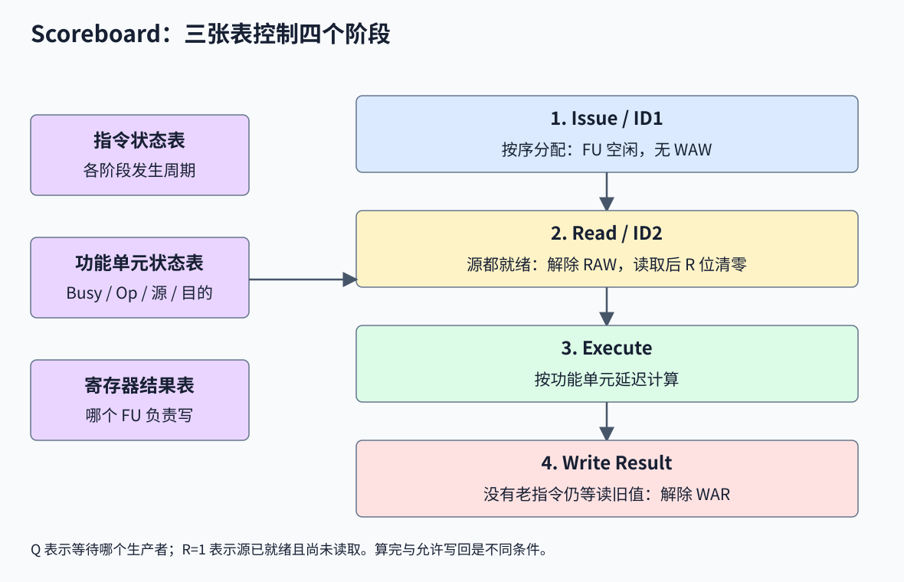
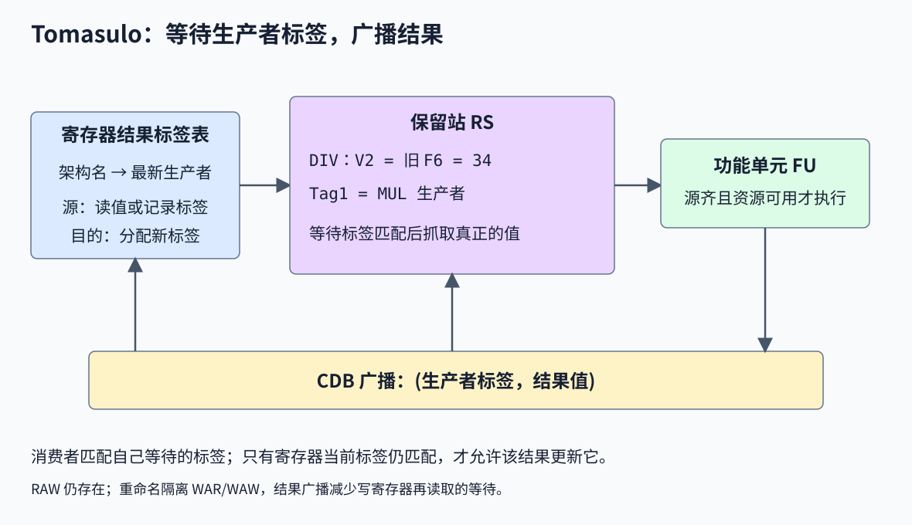

# 第 5 讲：动态调度与乱序执行

> 对应课件：`5-Dynamic-Scheduling-2026-教学网.pptx`，共 281 页。逐周期动画合并为完整时序表和关键状态变化，保留 Scoreboard、Tomasulo、ROB 的工作过程。开头重复的静态调度与第 4 讲关联，ROB 的完整数值例题与异常处理见[第五讲补充](./05-补充ROB与异常处理.md)。

## 1. 静态调度到动态调度

程序执行时间为：

$$
T=IC\times CPI\times CCT
$$

本讲通过重叠独立操作减少 CPI。编译器静态调度分析范围大，但不知道本次的 Cache miss、实际分支方向和操作数到达时间；硬件动态调度在有限窗口内根据运行状态重新安排执行。

主课件 3～14 页复习的内容已在[第 4 讲第 23～25 节](./04-分支预测与多发射处理器.md#23-函数内联和树高缩减)详细推导：

| 技术 | 保留的关键结论 |
|---|---|
| 树高缩减 | 三层串行加法可在结合律合法、资源足够时重组为两层；浮点重结合可能改变结果 |
| 全局/轨迹调度 | 基本块常约 5～20 条，跨块调度常见路径，其他路径需要合法补偿 |
| 补偿成本 | 常见部分占时间 80%、速度变 1.15 倍，整体约 1.117 倍；其他部分耗时增 30% 后约 1.046 倍 |
| 软件流水线 | 跨迭代重叠，序言和尾声对整个循环各支付一次；可与四倍展开结合 |
| 静态信息限制 | 全程 50% 的分支可能前半总 T、后半总 NT，平均 profile 隐藏了阶段性 |

这些优化不允许凭空越过副作用和异常。完整 CFG 可能含环，不能一律称作 DAG；C 表达式的结合结构也不等于所有操作数按左到右求值。

## 2. OoO 如何减少停顿

乱序执行（Out-of-Order，OoO/O3）让就绪的年轻指令绕过暂时等待的老指令，只要结果仍符合原程序语义。

课件的指令流为：

```text
A: R1 = Load 16[R2]
B: R3 = R1 + R4
C: R6 = Load 8[R9]
D: R5 = R2 - 4
E: R7 = Load 20[R5]
F: R4 = R4 - 1
G: BEQ R4, #0
```

真依赖包括 `A→B`、`D→E`、`F→G`。B 需要旧 R4，F 会写 R4，二者还有名称上的 WAR 约束；重命名可把 B 的旧版本与 F 的新版本分开。

A 遇到 Cache miss 时，B 要等待，但 C、D 及就绪后的 E 可能前进。课件示意比较为：

| 机器 | 图示执行时间 |
|---|---:|
| 1 路顺序 | 10 周期 |
| 2 路顺序 | 8 周期 |
| 1 路乱序 | 7 周期 |
| 2 路乱序 | 5 周期 |

这些数值依赖图中的延迟和可重叠条件，不能仅凭代码唯一推出。**发射宽度和乱序能力是两个维度**：单路也能乱序，多路也可能因顺序等待而空闲。

概念流程是先将多条指令放进窗口，再消除 WAR/WAW 名称依赖，随后在寄存器和内存依赖允许时执行。课件以百条以上的窗口说明潜在范围，实际容量随实现而变。

## 3. RAW、WAR、WAW

| 依赖 | 顺序关系 | 错误重排的后果 | 常见解决方式 |
|---|---|---|---|
| RAW，Read After Write | 老指令写，年轻指令读 | 读到过期值 | 等待真正生产者，结果转发 |
| WAR，Write After Read | 老指令读，年轻指令写 | 老指令读到未来值 | 保留老值或重命名 |
| WAW，Write After Write | 两条写同一架构目的 | 老结果晚到覆盖新结果 | 重命名、控制最终状态顺序 |

例子分别为：

```text
RAW: A: R1=R2+R3       B: R4=R1*R4
WAR: A: R1=R3/R4       B: R3=R2*R4
WAW: A: R1=R3/R4       B: R1=R3*R4
```

RAW 是值本身的真依赖；WAR/WAW 来自复用同一个名字。重命名不可能让消费者在生产者算出值前使用正确结果。

## 4. Map Table 和物理寄存器重命名

映射表记录“每个架构寄存器当前对应哪个物理版本”，Free List 提供可分配物理寄存器。处理指令时，**先按旧映射读取源，再给目的分配新位置并更新映射**，即使源和目的使用同一个架构名也如此。

为统一课件 20～23 页较混杂的编号，设初始 `r1→p1、r2→p2、r3→p3`，空闲为 `p4～p7`：

| 原指令 | 重命名后，目的在前 | 指令后的映射 r1/r2/r3 |
|---|---|---|
| `add r1,r2,r3` | `add p4,p2,p3` | p4 / p2 / p3 |
| `sub r3,r2,r1` | `sub p5,p2,p4` | p4 / p2 / p5 |
| `mul r3,r2,r3` | `mul p6,p2,p5` | p4 / p2 / p6 |
| `div r1,r1,4` | `div p7,p4,4` | p7 / p2 / p6 |

最后一条除法读取第一次 add 的 p4，而非它自己将写的 p7。旧版本仍可能被未完成指令使用，不能在映射覆盖的瞬间就随意回收；回收还需提交及恢复规则。

硬件按这次动态执行的指令实例分配版本，能处理运行时展开的路径和迭代。编译器也能静态重命名，课件“编译器不能做”应理解为不能完全代替这种运行时版本管理。

## 5. Scoreboard 的基本组织

Scoreboard（记分牌）集中记录指令、功能单元和寄存器状态，判断哪个操作可以安全前进。它可以顺序分配指令、乱序读取/执行/写回，但经典教学模型没有寄存器重命名，也不提供结果旁路。

课件以 1964 年 CDC 6600 引入记分牌。第 28 页的“16 个单元”不用于下面例题：本例明确采用一个整数/访存、两个乘法、一个加法、一个除法，共五个功能单元。历史实机组织与此教学模型不能混为一谈，可对照 [HASE 的 CDC 6600 模型与原理](https://www.icsa.inf.ed.ac.uk/research/groups/hase/models/6600/index.html)。

传统 ID 被拆出指令分配、发射及操作数读取。课件还在前面增加顺序进入 Instruction Buffer 的 Dispatch；缓冲满也是结构冒险。



### 5.1 三张状态表

| 表 | 记录什么 |
|---|---|
| Instruction Status | 各指令 Issue、Read Operands、Execute 完成、Write Result 的阶段或周期 |
| Functional Unit Status | 各功能单元是否忙、操作、目的、源寄存器、源生产者与读取状态 |
| Register Result Status | 每个架构寄存器目前由哪个未完成功能单元负责写入，空表示没有待写者 |

功能单元表共有九个基本字段：

| 字段 | 含义 |
|---|---|
| Busy/B | 是否被一条指令占用 |
| Op | 加、减、乘、除等操作 |
| dst/Fi | 架构目的寄存器 |
| src1/Fj、src2/Fk | 两个源寄存器名 |
| Q1/Qj、Q2/Qk | 将产生源值的功能单元，空表示不等待生产者 |
| R1/Rj、R2/Rk | 对应源已就绪且尚未被本指令读取 |

R 位不只表示“寄存器里有值”。源一旦被读入，本指令对应的 R 位就清零，这让后来的写者知道老读者不再需要保护旧寄存器值。

### 5.2 四阶段规则

| 阶段 | 允许前进的条件 | 解决的约束 |
|---|---|---|
| Issue / ID1 | 所需 FU 空闲，目的寄存器没有未完成写者；按程序顺序进行 | 结构、WAW |
| Read Operands / ID2 | 两个源都已就绪，读取到单元内部，清除已读标志 | RAW |
| Execute / EX | 已取得操作数，按该单元延迟计算 | 计算与资源占用 |
| Write Result / WB | 没有更老指令仍需从寄存器读取这个旧值 | WAR |

Issue 时即使源尚未就绪，也可以记录 Q 后等待。**RAW 通常阻止读操作数，而非一律阻止进入 Scoreboard。** 写回后更新寄存器，唤醒等待该 FU 的读者，并释放相应资源。

若年轻写者目的为 `d`，某个老指令的源仍满足 `src=d 且 R=1`，写者须等待。写回时还应只清除仍属于该生产者的寄存器状态，不能误清后来合法接管的状态。

## 6. Scoreboard 六指令完整例题

### 6.1 指令和机器条件

```asm
I1: L.D    F6, 34(R2)
I2: L.D    F2, 45(R3)
I3: MUL.D  F0, F2, F4
I4: SUB.D  F8, F6, F2
I5: DIV.D  F10, F0, F6
I6: ADD.D  F6, F8, F2
```

这是经典教学汇编，不把 `L.D/ADDD` 当作 RISC-V 的实际拼写，也不把 F0～F10 的教学寄存器编号套为原始 IBM 的四寄存器编码。

| 功能单元 | 个数 | 本例 EX 延迟 |
|---|---:|---:|
| Integer/Load | 1 | 1 周期 |
| Mult | 2 | 10 周期 |
| Add/Sub | 1 | 2 周期 |
| Divide | 1 | 40 周期 |

功能单元从发射一直占到写回；读操作数和写回各单列阶段。相应释放一般到下一周期才让新发射使用。同周期其他单元仍可工作，部分动画的 8a/8b 表示周期内先后展示，不算两整个周期。

### 6.2 最终时序表

| 指令 | Issue | Read | EX 完成 | WB |
|---|---:|---:|---:|---:|
| I1，LD1 | 1 | 2 | 3 | 4 |
| I2，LD2 | 5 | 6 | 7 | 8 |
| I3，MUL | 6 | 9 | 19 | 20 |
| I4，SUB | 7 | 9 | 11 | 12 |
| I5，DIV | 8 | 21 | 61 | 62 |
| I6，ADD | 13 | 14 | 16 | 22 |

该表直接对应课件第 119 页：EX 完成列表示结束时刻，不是开始时刻。比如 MUL 在第 9 周期读源，随后第 10～19 周期执行十拍。

### 6.3 结构冒险：第二条 Load

LD1 在周期 1 分配 Integer 单元，周期 4 写回才释放。LD2 即使与它没有寄存器真依赖，也不能使用同一非流水资源，故到周期 5 才发射。这是结构冒险。

SUB 占用 Add/Sub 单元直到周期 12 写回，因此末尾 ADD 到周期 13 才能发射。能有多个 FU 并行，不表示每类单元都能每周期接收新操作。

### 6.4 RAW：已进入单元，仍不能读源

周期 6 的 MUL 已进入 Mult1，但 F2 正由 LD2 生成；其 `Q1=Int、R1=0`。LD2 在周期 8 写回后，MUL 和 SUB 在周期 9 读取 F2。

DIV 在周期 8 已发射到 Div，等待 F0，由 `Q1=Mult1` 跟踪；F6 此时已就绪，但按照本例规则要等所有源齐备后一起读。因此它一直保留对旧 F6 的未读需求。

课件第 86 页图片写“DIVD cannot be issued: RAW”，与周期 8 的发射表不一致，应理解为“还不能读取操作数/开始执行”。

### 6.5 WAR：ADD 算完却不能写

DIV 是老指令，要读原 LD1 产生的 F6；ADD 是年轻指令，要把新结果写到 F6。

```text
周期 16：ADD 已算完，但 DIV 还没读 F6，ADD 必须保留结果并等待。
周期 20：MUL 写回 F0。
周期 21：DIV 终于同时读入 F0 与旧 F6，F6 的未读需求消失。
周期 22：ADD 才能写回新 F6。
```

这段额外等待不来自 ADD 自身的 RAW，而是年轻写覆盖老读的 WAR。由于 Scoreboard 没有复制每个值的独立版本，只能延迟写回。

### 6.6 示例中的其他依赖

I1 与 I6 都写 F6，存在 WAW，但 I6 发射时 I1 已结束，因此没有额外 WAW 停顿。真依赖为 `I2→I3`、`I1/I2→I4`、`I3/I1→I5`、`I4/I2→I6`。不能仅凭“同名”把每条可能依赖都算成真实发生的等待。

## 7. Scoreboard 的优势与限制

优势是集中记账相对直接，可以在一定范围内重叠独立指令。课件给出旧实现的量级说明：状态逻辑面积约一个浮点单元，FORTRAN 科学程序约 1.7 倍提升；这些属于历史背景，不能当作所有实现的固定比率。

限制包括没有旁路、有限窗口、结构或 WAW 阻塞顺序发射，以及 WAR 推迟写回。某条在队头不能发射的指令，还会阻挡其后本可独立前进的指令。增加单元、旁路和重命名分别改善不同瓶颈，不能混为一个机制。

## 8. Tomasulo 的标签与结果广播

Tomasulo 将等待信息分散在保留站（Reservation Station，RS），源就绪就存值，源未就绪就存生产者标签，利用公共数据总线（Common Data Bus，CDB）广播结果。

课件以 IBM System/360 Model 91 为历史例，对照 IBM 的 4 个浮点寄存器与 CDC 的 8 个、每条指令两个与三个寄存器字段，以及 IBM 的内存/寄存器操作。核心机制是硬件动态重命名及转发，不是年份或机器外观。



### 8.1 关键部件

| 部件 | 作用 |
|---|---|
| 指令队列/FPOS | 保存尚待按序派送的指令 |
| RS | 保存操作、源值或源标签，等待执行条件 |
| Load Buffers / Store Data Buffers | 缓冲访存地址、数据及依赖，作为访存调度的一部分 |
| Register Result Status | 记录某架构寄存器最新待写版本的标签 |
| CDB | 广播 `(生产者标签, 值)`，让所有匹配的消费者抓取 |

课件有一页误称 Command Data Bus，标准缩写展开为 Common Data Bus。“寄存器的 RS”实际指寄存器结果标签表，不表示每个寄存器都另有一个执行保留站。

RS 字段为 Busy、Op、V1/V2、Tag1/Tag2；Tag=0/空表示相应值已经就绪。对某个源通常是“有效值”和“待等标签”二选一，不需要 Scoreboard 那种未读旧寄存器的 R 标志。

Load Buffer 保存 Busy 和 Addr；Store Buffer 还需保存待写数据的值或其生产者标签，地址与数据也可能分别等待。

## 9. Tomasulo 三阶段

### 9.1 Issue：分配保留站并记录版本

1. 按程序顺序检查相应空 RS/Buffer；没有则停顿。
2. 对每个源，若寄存器没有待写者，读取当前值；若有待写者，记录其标签，或按实现取得已经可用的结果。
3. 给本指令一个 RS/Buffer 标签，更新目的寄存器的最新生产者。

即使两个源都已就绪，目的也仍要获得唯一的生产者身份。课件的“源就绪则不重命名”只是不用源标签等待，不应理解为目的不再进行版本管理。

更新目的前必须先读源映射，否则 `F6=F6+F2` 会误等自己的新结果。

### 9.2 Execute：源齐后占用可用单元

Tag1/Tag2 都为空且功能单元可用时执行。已经进入 RS 的指令可与年轻就绪指令以不同顺序启动；访存还需满足地址和内存顺序条件。

保留站数量、功能单元数量、功能单元延迟和启动间隔是不同参数。课件所谓“3 个 Add、2 个 Mult”在相关表中有时指 RS 槽位，不能自动当成五个独立物理执行器。

### 9.3 Write Result：广播并条件更新寄存器

```text
CDB 广播 (tag, value)
对所有消费者：若某源标签等于 tag，抓取 value 并清空该源标签
对架构寄存器：仅当当前结果标签仍等于 tag，才写值并清空标签
释放相应生产者资源
```

最后一个匹配条件防止老结果覆盖年轻版本：若 F6 已被更年轻指令重新命名，老生产者仍要广播给等它的消费者，但不再写 F6 的当前版本。

单 CDB 每拍通常只能广播一个结果，同拍多个完成者要仲裁并保留待广播结果。标签在仍可能被监听时不能提前复用。

## 10. Tomasulo 如何处理 WAR 与 WAW

### 10.1 WAR：消费者保存旧值或旧标签

DIV 发射时已经把旧 F6 的值保存在自己的 RS 中。年轻 ADD 后来写新 F6，不会改变 DIV 已保存的操作数，因此无需再等 DIV 读取寄存器。

如果老值尚未到达，DIV 保存的也应是老生产者标签；后来映射变化不会把它自动改成新生产者。

### 10.2 WAW：不同生产者是不同名字

```text
老指令：F0 = ...    标签 Pold
年轻指令：F0 = ...  标签 Pnew
当前结果表 F0 -> Pnew
```

Pold 完成时仍广播旧版本，但不能覆盖当前 F0 映射。等待 Pold 的消费者不受 Pnew 干扰。这里的标签可以是 RS 名，现代实现也可用物理寄存器等身份。

### 10.3 RAW 仍存在

消费者仍必须等正确生产者。转发让它无需“先写架构寄存器、再读出来”，但没有消除计算依赖。第 249 页对照表中“Renaming avoids RAW”明显不正确，Scoreboard 的 RAW 也不一定阻止发射，应按本篇各阶段规则理解。

## 11. Tomasulo 的同一组六指令

指令与第 6 节相同。课件简化为三个 Load Buffer、三个 Add RS、两个 Mult/Div RS，Store Buffer 在图中省略；Load 的示例执行为两周期，加减两周期、乘十周期、除四十周期。不能直接把这套资源与 Scoreboard 看成完全相同硬件。

### 11.1 最终时序

| 指令 | 按序派送 D | 执行区间 | EX 完成 X | CDB 写结果 W |
|---|---:|---|---:|---:|
| LD1 | 1 | 2～3 | 3 | 4 |
| LD2 | 2 | 3～4 | 4 | 5 |
| MUL | 3 | 6～15 | 15 | 16 |
| SUB | 4 | 6～7 | 7 | 8 |
| DIV | 5 | 17～56 | 56 | 57 |
| ADD | 6 | 9～10 | 10 | 11 |

两个 Load 可同时在途，不必等第一个写回才派送第二个。MUL/SUB 在周期 5 收到 LD2 的 F2，周期 6 开始。ADD 在周期 8 收到 SUB 结果，周期 9 开始。DIV 收到周期 16 的 MUL 结果，周期 17 开始。

### 11.2 按数值追踪操作数

课件设浮点寄存器初始为 0，示意内存 `Mem[R2+34]=34`、`Mem[R3+45]=45`：

| 指令 | 结果 |
|---|---|
| LD1 | F6 的旧版本 = 34 |
| LD2 | F2 = 45 |
| MUL | F0 = 45 × 0 = 0 |
| SUB | F8 = 34 − 45 = −11 |
| DIV | F10 = 0 / 34 = 0 |
| ADD | F6 的新版本 = −11 + 45 = 34 |

虽然 F6 最终碰巧仍等于 34，旧 Load 版本与新 Add 版本必须分清。不能因为数值相同，就省掉版本依赖检查。

### 11.3 周期 5 和周期 11 的关键状态

周期 5 左右，DIV 已保存旧 F6=34，另一源等待 MUL；ADD 即将进入另一个加法保留站并等待 SUB。到周期 11，ADD 就能写新 F6，而 DIV 仍在等 F0。Tomasulo 不再需要 Scoreboard 中 ADD 从周期 17 等到 22 的 WAR 阻塞。

按给定表，最后完成从 62 周期变为 57 周期，加速 `62/57≈1.088`。这只比较两套课件模型；其 Load 缓冲、旁路和资源也不同，不能据此把全部差值归因于单一重命名技巧。

## 12. 两种算法的对照

| 维度 | Scoreboard 教学模型 | Tomasulo 教学模型 |
|---|---|---|
| 依赖信息 | 集中在记分牌 | 分散在 RS、结果标签表 |
| 发射/派送 | 按程序顺序 | 按程序顺序进入 RS |
| 执行 | 就绪后可乱序 | 就绪后可乱序 |
| RAW | 等寄存器结果可读 | 等生产者标签，由 CDB 转发 |
| WAR | 延迟年轻写回 | 保存值/标签，版本隔离 |
| WAW | 阻止新目的发射 | 新目的获得独立标签 |
| 结构冒险 | FU/缓冲不足会停顿 | RS、FU、CDB 不足仍会停顿 |
| 精确异常和错误路径恢复 | 原模型未完整解决 | 不带 ROB 的基本模型也未完整解决 |

课件历史对照以最多约 5 个在途项和约 14 个缓冲项说明窗口差异，并列出 6 Load、3 Store、3 Add、2 Mult/Div 的资源口径。示例图为简化版，不能把这些数量全部当成单拍吞吐或同时执行的单元数。

“No issue”在对照表中不能理解为没有结构冒险。任何有限 RS、队列、功能单元或总线都可能成为瓶颈。

## 13. 为什么还需要 ROB

基本 Tomasulo 的临时名字与 RS 绑定，保留站往往要保留到广播；同时它允许乱序更新寄存器，难以处理精确异常和预测错误。

课件例子中，一条长 DIV 在最前，年轻 Load/MUL/SUB 已改写 F2/F0/F8。若 DIV 最后产生需要陷入的异常，原架构状态已丢失，就难以呈现异常指令之前的程序状态。具体 ISA 是否把除零定义为陷阱要另行确认，不能将该教学假设套到所有 RISC-V 运算。

ROB 将“结果暂存”和“正式生效”分开：按顺序分配 ROB 项，RAT 把架构目的映射为 ROB 标签，RS 等待并调度，CDB 把结果写 ROB，最后由队头按序提交到 ARF。


| 阶段 | 主要操作 |
|---|---|
| Issue | 检查 RS 和 ROB 空项，读取旧 RAT 的源，分配 ROB 目的标签，更新 RAT/tail |
| Execute | 等待操作数和 FU，执行；标签身份不必继续由 RS 名承担 |
| Write Result | CDB 广播、写自己的 ROB 值、置 Finished，按实现释放执行相关资源 |
| Commit | 仅队头已结束且没有应处理异常时，更新正式状态并前移 head |

ARF 是 Architected/Architectural Register File，保存已提交状态；RAT 保存最新已重命名状态，两者代表的程序进度不同。

课件历史表给出 MIPS R10K Active List 32 项、R12K 48 项、Alpha 21264 In-Flight Window 80 项、Pentium 4 ROB 126 μops。不同实现可使用 ROB、物理寄存器或其他结构，不能把“ROB 总把全部结果放在自己里面”当成唯一设计。

完整四阶段规则、六指令逐周期数值、统一 RS、多发射、精确异常、恢复和访存见[第五讲补充](./05-补充ROB与异常处理.md)。

## 14. 术语与做题顺序

Issue 在不同教材可能表示“按序分配 RS/ROB”，也可能表示“从调度器选就绪指令送 FU”。Dispatch、Complete、Writeback、Commit、Retire、Graduate 也有口径差异。课件最后“issue 顺序”指前端分配，不能用它否认后端选择执行的乱序。

解逐周期题可以按以下顺序：

1. 写清发射、执行、写回、提交的宽度及各自时序。
2. 写清单元数量、延迟、是否流水化、RS 数量和 CDB 数量。
3. 为每条指令标真正的源版本，检查结构、RAW、WAR、WAW 分别在哪一步阻塞。
4. 每拍按规定更新表项；明确本拍写回能否让消费者本拍启动，资源释放能否本拍复用。
5. 最后校验顺序执行的数值与寄存器结果，而非只比较结束周期。

页码定位：3～14 为静态复习；17～26 为 OoO、依赖与重命名；27～46 为记分牌规则和表；47～119 为 Scoreboard 动画；120 为总结；124～153 为 Tomasulo 机制；154～248 为 Tomasulo 动画；249 为对照；250～278 为 ROB；279～281 为术语与顺序。
