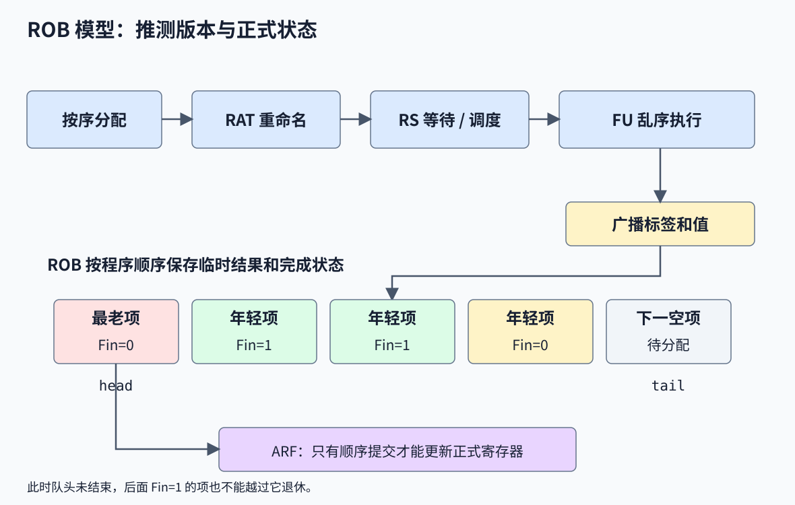
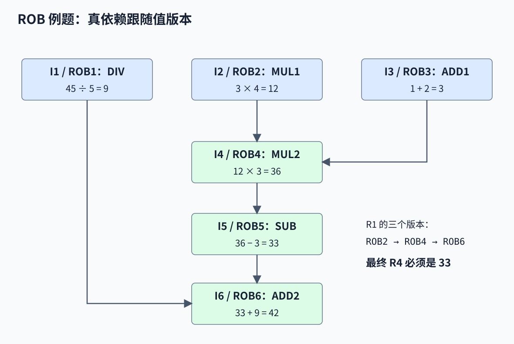
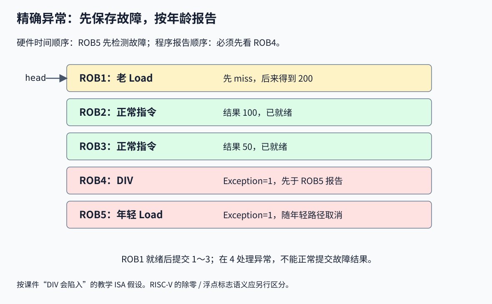
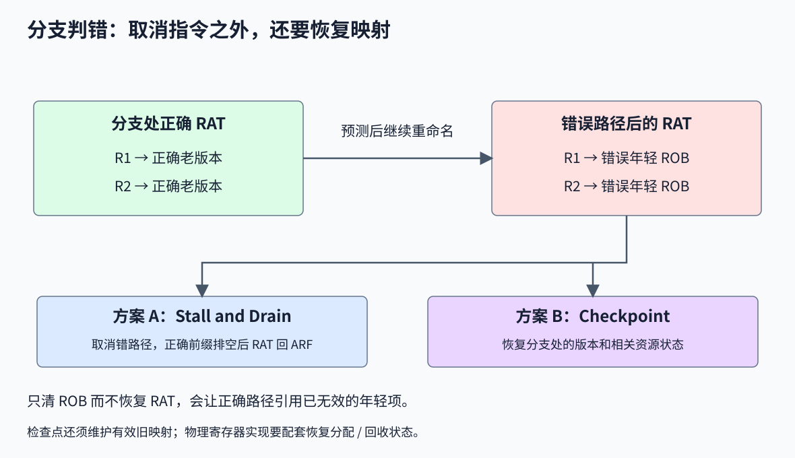
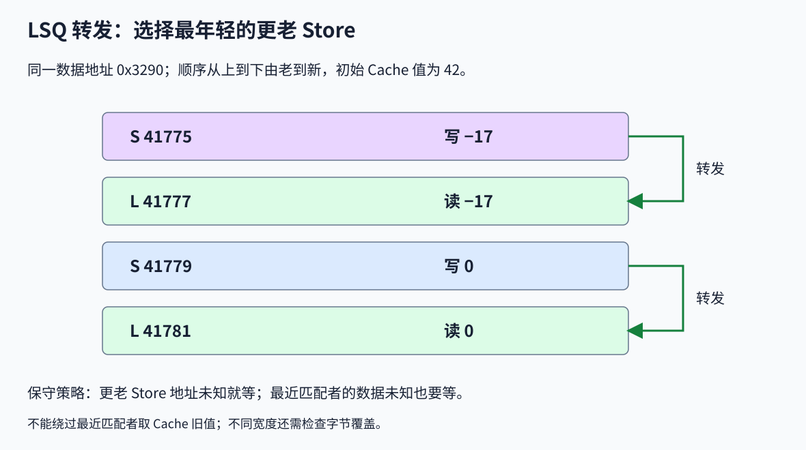
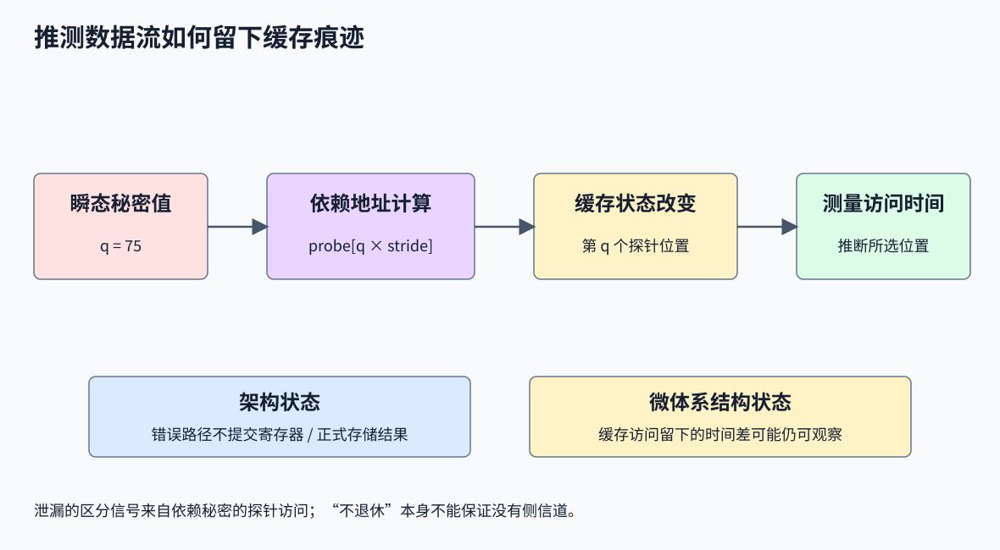
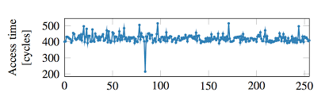

# 第 5 讲补充：ROB、精确异常与访存依赖

> 对应课件：`5-Supplement-ReorderBuffer-Exception-教学网.pptx`，共 146 页，同时承接主课件 250～281 页。本篇保留 ROB 数值例题、统一保留站、多发射、精确异常、错误恢复、LSQ，以及 Spectre/Meltdown 的课内原理。基础动态调度见[第五讲](./05-动态调度与乱序执行.md)。

## 1. 基本 Tomasulo 尚未解决的问题

基本 Tomasulo 用保留站身份作为临时目的名，消费者等待这个身份经 CDB 广播。保留站因此既管调度又承担重命名身份，通常要等结果广播才能完整释放；而调度所需的操作、源值与关联比较逻辑，在指令开始执行后已不必继续按原方式保存。

另一个问题是结果乱序写入架构寄存器：年轻指令可能先覆盖 F2/F0/F8，最前面的长 DIV 最后才发生需要陷入的异常。若没有旧状态，处理器就难以恢复到 DIV 之前。

ROB 的两个目标是把临时生产者身份从 RS 解耦，以及按程序顺序让结果正式生效。**调度、重命名和提交可以由不同结构负责。**

## 2. ROB、RAT、ARF 和 RS



| 结构 | 作用 |
|---|---|
| Instruction Status | 记录各指令处于 I、E、W、C 哪一步及发生周期 |
| RS，Reservation Stations | 保存操作、源值/源标签和目的标签，等待调度 |
| RAT，Register Alias Table | 架构寄存器最新版本的位置，指向 ARF 或尚未提交的 ROB 项 |
| ROB，Reorder Buffer | 按程序顺序跟踪未退休指令，保存临时结果、完成/异常等状态 |
| ARF，Architectural Register File | 已提交的正式寄存器状态，只由 Commit 更新 |

本文按课件的“ROB 保存值、提交时写 ARF”模型讲解。现代实现也可把值放在物理寄存器中，ROB 主要跟踪退休元数据，原则仍是把推测状态与已提交状态分开。

课件的历史组织例子为：MIPS R10K 的 Active List 32 项、R12K 48 项、Alpha 21264 的 In-Flight Window 80 项、Pentium 4 的 ROB 126 μops。不能把架构指令、微操作和各类窗口项不加区分地比较。

### 2.1 字段与指针

ROB 教学项含 Type、Dst、Val、Fin：

- Type：指令类型，决定提交时是写寄存器、处理 Store 还是其他行为。
- Dst：原来的架构目的，不是源标签。
- Val：尚未提交的结果。
- Fin/Ready：执行是否已经结束并可供退休逻辑检查。

异常处理还要保存异常原因、故障指令 PC，必要时保存故障地址等。Fin=1 不代表“可以无条件正常提交”，因为该项也可能标记异常。

ROB 按顺序分配，head 指最老未提交指令，tail 指下一分配位置。真实环形队列还需有效位、计数或其他机制区分满与空，不能只凭 head=tail 下结论。

RS 的字段为 `Op、Dst、T1、T2、V1、V2`，Dst 是 ROB 标签；每个源要么保存有效值，要么保存等待的标签。只要已经取得值，后来 RAT 改变不会重写这个源版本。

## 3. 四阶段规则

### 3.1 I：按序分配与重命名

1. 检查相应 RS 与 ROB 都有空项，任一不足就等待。
2. 从当前 RAT 读取源映射。源在 ARF 就取正式值；源在已完成 ROB 就可取临时值；源在未完成 ROB 就保留标签等待广播。
3. 在 tail 分配一项，记录原架构目的、类型和初始未完成状态。
4. RS 的目的写新 ROB 标签，再把 RAT 的架构目的映射到它，推进 tail。

**先读源，再覆盖目的映射。** 对 `R1=R1*R3`，源 R1 必须是老版本，目的才是新 ROB 项。ROB 满或 RS 满都可能阻止顺序分配，后面的独立指令也可能一起被挡住。

### 3.2 E：等待与执行

源全部到达且所需 FU 可用时开始计算。课件 Instruction Status 的 E 列表示开始执行周期，而主课件 Scoreboard 的 EX 列表示完成周期，比较表格前必须先统一口径。

ROB 提供独立标签后，RS 可以在完成调度后按具体设计较早释放；仍须有地方保留在途操作的 ROB 目的身份。课件数值例题为简化起见仍在 W 时释放相应 RS，不把“能早释放”当作其时序的既定假设。

### 3.3 W：广播临时结果

执行完成后的下一周期，按本例规则进行 CDB 广播；消费者匹配标签抓取值，生产者写自己的 ROB 项并置 Fin，释放相关资源。**此时 ARF 不变。**

新发射者也可能遇到“源已广播完、值还没提交”的情况，必须能从完成的 ROB/物理寄存器读取，不能只等已经过去的那一次广播。

### 3.4 C：顺序提交

只有 head 指向的最老项已经结束，并且没有需要优先处理的异常/恢复条件时，才允许正常提交。寄存器结果写 ARF，Store 按访存规则生效，然后释放相应 ROB 项并前移 head。

提交某个目的 d 时，只有 `RAT[d] == 本项标签` 才把 RAT[d] 改回 ARF；若已有更年轻写者，必须保留其映射：

```text
ARF[d] = 本项结果
if RAT[d] == 本项标签:
    RAT[d] = ARF[d]
else:
    保留指向年轻版本的映射
```

老结果仍要按顺序更新正式 ARF，但不能破坏 RAT 对年轻值的追踪。这是连续多次写同一个寄存器时的关键。

## 4. 六指令 ROB 数值例题

### 4.1 初值和顺序结果

| 寄存器 | R1 | R2 | R3 | R4 | R5 | R6 | R7 | R8 |
|---|---:|---:|---:|---:|---:|---:|---:|---:|
| 初值 | −23 | 16 | 45 | 5 | 3 | 4 | 1 | 2 |

```text
I1 DIV:  R2 = R3 / R4
I2 MUL1: R1 = R5 * R6
I3 ADD1: R3 = R7 + R8
I4 MUL2: R1 = R1 * R3
I5 SUB:  R4 = R1 - R5
I6 ADD2: R1 = R4 + R2
```

| 指令 | 正确源版本 | 结果 | ROB 目的标签 |
|---|---|---:|---|
| I1 | 初值 R3=45、R4=5 | 9 | ROB1，写架构 R2 |
| I2 | 初值 R5=3、R6=4 | 12 | ROB2，写 R1 |
| I3 | 初值 R7=1、R8=2 | 3 | ROB3，写 R3 |
| I4 | ROB2=12、ROB3=3 | 36 | ROB4，写 R1 |
| I5 | ROB4=36、初值 R5=3 | 33 | ROB5，写 R4 |
| I6 | ROB5=33、ROB1=9 | 42 | ROB6，写 R1 |



I1 的 R3/R4 必须是初始 45/5，不能被后面 I3/I5 的写入替换。I2、I4、I6 虽然都写 R1，但三个结果分别保存在不同 ROB 项，不会相互覆盖。

### 4.2 资源和时序

课件使用三个加/减 RS、两个乘/除 RS，乘除共享这类有限入口；DIV 延迟 40、MUL 延迟 10、ADD/SUB 延迟 2 周期。单拍顺序分配一条，W 后下一拍可使用释放的入口，单拍提交一条。

| 指令 | 分配 I | 开始 E | 执行结束，按延迟推算 | 写结果 W | 提交 C |
|---|---:|---:|---:|---:|---:|
| DIV | 1 | 2 | 41 | 42 | 43 |
| MUL1 | 2 | 3 | 12 | 13 | 44 |
| ADD1 | 3 | 4 | 5 | 6 | 45 |
| MUL2 | 14 | 15 | 24 | 25 | 46 |
| SUB | 15 | 26 | 27 | 28 | 47 |
| ADD2 | 16 | 43 | 44 | 45 | 48 |

该表对应第 68 页，并把结束与开始分列，避免不同课件的 E/EX 口径混用。

### 4.3 周期 4～13：两个瓶颈不同

DIV、MUL1 占满两个乘除入口，所以 MUL2 从周期 4 起不能分配。它挡在顺序分配队头，SUB 和 ADD2 也不能越过它。

ADD1 却已经开始计算，在周期 6 把 3 写进 ROB3。它不能立刻提交，因为队头 DIV 还没结束。这里是 **ROB 退休队头等待**，与 MUL2 的 **RS 结构冒险** 不同。

周期 13，MUL1 广播 12 并释放一个乘除入口，周期 14 MUL2 才能分配。其源 ROB2、ROB3 都已就绪，可以直接取得 12 和 3。

### 4.4 周期 15～28：等待版本而非寄存器名

MUL2 周期 15 开始，同时 SUB 分配，记录 `源1=ROB4、源2=3`。周期 16 ADD2 分配，记录 `源1=ROB5、源2=ROB1`。

周期 25 ROB4=36 到达，SUB 抓取后周期 26 开始，周期 28 把 33 写到 ROB5。ADD2 取得 33，但仍须等最前面的 DIV 给出 9。

此时 RAT 的最新映射包括 `R1→ROB6、R2→ROB1、R3→ROB3、R4→ROB5`。ARF 仍保存对应旧值，因为还没有一条指令提交。

### 4.5 周期 42～48：乱序结果按序生效

DIV 周期 42 写 ROB1=9，ADD2 周期 43 开始。退休则连续按程序顺序进行：

| 周期 | 提交项 | ARF 改变 |
|---:|---|---|
| 43 | DIV | R2 = 9 |
| 44 | MUL1 | R1 = 12；RAT[R1] 仍指向 ROB6 |
| 45 | ADD1 | R3 = 3；同拍 ADD2 写 ROB6=42 |
| 46 | MUL2 | R1 = 36；RAT[R1] 仍指向 ROB6 |
| 47 | SUB | R4 = 33 |
| 48 | ADD2 | R1 = 42；RAT[R1] 回到 ARF |

最后正式状态为：

```text
R1=42，R2=9，R3=3，R4=33，R5=3，R6=4，R7=1，R8=2
```

课件第 68 页 ARF 的 R4 仍印为初值 5，但前面已写 ROB5=33 且周期 47 提交 SUB，故应修正为 33。第 44 页“Try to Issue MULT#1”也应指第二条乘法 MUL2。

## 5. 统一保留站

按单元类别划分固定 RS 时，乘法密集程序可能乘法 RS 全满、加法 RS 空着；换一个加法密集程序又反过来。统一 RS 让不同类型共享条目，减少这类容量分配不均。

课件以五项池对比三个 Add 加两个 Mult 分站，并另画八项统一 RS、一个 Add FU 和一个 Mult FU 的示意。就绪 Add 竞争加法仲裁器，就绪 Mult 竞争乘法仲裁器，再从选中的条目读出并执行。

统一池不增加物理功能单元，也不消除所有结构冒险：池会满、执行器仍有限，关联唤醒、选择和通路还更复杂。若每拍给 N 个 FU 各送一条指令且每个 RS 读端口输出一条记录，就需要相应 N 条读取通路；这不等于寄存器文件只要 N 个源操作数读端口。

增加第三个乘除 RS 可让前面例题更早接纳 MUL2，但早分配不保证早执行，仍要等源和真实执行器。课件“所有指令可在第 6 周期发完”针对其额外资源假设。

## 6. 超过 1 IPC 的必要条件

乱序执行不自动等于宽发射。若前端每拍仅分配一条，或每拍仅写回/提交一条，持续平均吞吐仍可能受其限制。

| 环节 | 扩宽所需支持 |
|---|---|
| 取指、译码、分配 | 同拍处理多条，足够指令带宽、RS/ROB 入口 |
| 重命名 | 多路 RAT 读取和写入，处理同一组中的依赖 |
| 调度执行 | 多个就绪操作、足够 FU 与通路 |
| 写回 | 多结果带宽，或等价的多总线/分布式网络 |
| 提交 | 连续多项退休，足够状态与访存端口 |

课件用 Dual-Issue、Dual-Rename、Multiple CDB、Extra Ports 分别说明这些环节。前端和退休若长期供给不足，再多执行单元也无法维持高 IPC。

### 6.1 双路重命名的组内 RAW

初始 `R1→ROB21、R2→ROB17、R3→ARF3、R4→ROB22`，同拍准备分配 ROB23 和 ROB24：

```text
I1: add R1, R2, R3
I2: sub R4, R1, R4
```

正确重命名是：

```text
I1: ROB23 = ROB17 + ARF3
I2: ROB24 = ROB23 - ROB22
```

I2 的 R1 必须旁路到本拍 I1 的新目的 ROB23，不能继续用拍开始时的 ROB21。I2 的源 R4 必须是旧 ROB22，自己的目的才是 ROB24。

同拍两条都写同一架构目的时，也要维持程序顺序：较年轻者成为最终 RAT 映射。不能把多条指令完全独立并行查写 RAT。

### 6.2 多 CDB 的代价

多个完成者由仲裁器分配广播机会，每个等待源要与每条 CDB 的标签比较。若有 S 个 RS、每项两个等待源、B 条总线，标签比较的粗略数量为 `2SB`，实际还依赖分区和结构。

更多总线增加面积、连线、功耗和选择延迟。结果不能广播时必须保留，不能在周期结束时丢弃。

### 6.3 双路退休只取连续前缀

| 队头 | 下一项 | 本拍可退休 |
|---|---|---|
| 未完成 | 任意 | 0 条 |
| 已完成且正常 | 未完成 | 1 条 |
| 两项均完成且正常 | — | 可退休 2 条，仍需检查异常、分支及资源限制 |

不能越过未完成的队头，去退休后面的就绪项。ROB 读取、ARF 写入、Store 提交通路也要支持宽度。课件用 0.18 μm SRAM 的 16/32 端口版图强调多端口的面积开销，其图片不是吞吐提高倍数的证据。

## 7. 顺序与乱序的术语

本篇 Issue 指顺序分配 RS/ROB，Execute 及临时 Write 可以乱序，Commit/Retire 顺序进行。另一种命名把“从 RS 送 FU”叫 Issue，该步骤本来就可乱序。

ARF 对应最老未提交指令之前的已提交状态；RAT 对应最新已经重命名指令之后的推测版本。恢复时这两个时间点的区别非常重要。

## 8. 控制推测与数据推测

| 类别 | 推测什么 | 例子 |
|---|---|---|
| Control Speculation | 下一段控制流 | 分支方向、跳转目标预测 |
| Data Speculation | 数据相关条件 | 访存地址是否别名、某些设计中的值预测 |

课件已有寄存器版本与广播，但还需要考虑推测中的异常、分支错误，以及未明确的内存依赖。

## 9. 异常与中断

异常处理使控制流转入系统处理程序，处理后可能返回、重试、跳过或终止，具体由 ISA、异常原因和系统决定。

| 类型 | 与当前指令关系 | 课件例子 |
|---|---|---|
| 异步中断 | 来自外部事件，不由当前指令本身直接引发 | I/O、定时器、网络/磁盘到达 |
| 同步异常 | 与特定指令执行有关 | 系统调用、断点、页故障、权限/非法指令、某些算术异常 |

Trap、Fault、Abort 的分类及可恢复性随体系结构而异；复位和键盘组合键也不能当作所有 ISA 中完全相同的中断机制。

课件用五级教学流水线说明检测位置：IF 可能取指页故障/权限失败；ID 可发现非法指令；EX 可发现算术或地址问题；MEM 可发现数据访问故障；WB 图中无新增故障。每条指令可能在取指阶段出错，“操作本身不访存”不意味着不可能取指异常。

### 9.1 RISC-V 的算术异常口径

课件用除零和整数溢出陷入来说明故障恢复，不应原样套到 RISC-V：整数 `div/rem` 的除零和溢出有规定结果，不自动因其陷入；标准浮点 F 扩展把 NV、DZ、OF、UF、NX 累积到 `fflags`，不因设置这些标志自动产生浮点陷阱。[整数 M 扩展](https://docs.riscv.org/reference/isa/v20240411/unpriv/m-st-ext.html)和[浮点 F 扩展](https://docs.riscv.org/reference/isa/v20260120/unpriv/f-st-ext.html)规定了这些语义。

需要被精确维护的架构状态也包括浮点异常标志等，不仅是通用寄存器；错误路径不应把它们当作正式结果生效。

## 10. 精确异常

精确异常（precise exception）要求在架构上呈现：

1. 故障指令之前的所有指令已按序生效。
2. 故障指令之后的指令未改变正式程序状态。
3. 故障指令本身是否完成、保存哪个 PC、能否重试，由 ISA 和异常类型决定。

如果后执行完的年轻故障立即打断，就可能跳过尚未完成的老指令；如果错误预测路径上的故障直接暴露，程序会收到本来不应发生的异常。

“年轻指令未改变状态”指架构可见状态，不表示它在 ROB/RS 中不能有临时记录。后面侧信道部分还会说明，缓存等微体系结构状态可能留下影响。

## 11. 把故障当作一种结果保存

执行阶段检测故障时，把异常原因及相关信息写入该指令的 ROB 项，标记已结束，不立即让用户程序看到异常。正常值也先写 ROB，二者统一到顺序退休处裁决。



若该项来到队头且确实应生效，则暂停正常提交，进入异常处理；故障指令之后的项取消，恢复映射与取指。如果它先因老分支错误被取消，其异常也一起消失。

### 11.1 两个故障，谁先报告

课件的抽象 ROB 状态为：

| 项 | 目的/效果 | 执行状态 |
|---|---|---|
| ROB1 | R1 最后得到 200 | 老 Load 先 Cache miss，后来完成 |
| ROB2 | R3 = 100 | 已完成 |
| ROB3 | R1 = 50 | 已完成 |
| ROB4 | DIV，目的 R4 | 检测到除零，按该教学 ISA 假设是故障 |
| ROB5 | Load，目的 R6 | 更早在实际时间检测到页故障 |

尽管 ROB5 的页故障先被检测，仍要等 ROB1～ROB3 顺序处理。之后 ROB4 到队头，报告 ROB4 的除零，ROB5 作为年轻项被取消。处理后若重新执行并走到那个 Load，再判断它是否仍有页故障。

ROB4 不能把无效结果写入 R4 后才报告故障。第 105 页“4 commits”标注与 ROB4 已带故障不一致，正常退休应停在前三项，随后处理第四项异常。

Cache miss 是等待数据，Page Fault 是需要体系结构异常处理的事件，不应把二者当成同一类“没完成”。

## 12. 分支预测错误与 RAT 恢复

分支后错误路径上的指令可能把 RAT[R1/R2] 改成错误路径 ROB 标签。取消这些指令之后，**只清 ROB 不足以恢复 RAT**，否则正确路径可能继续引用已经无效的项。

恢复还要处理错误路径 RS、访存队列、推测历史和资源分配状态。老于分支、属于正确前缀的指令可以保留；错误路径 Store 不得已修改正式内存。

### 12.1 Stall and Drain

简单方案先取消分支之后的错误路径，暂停正确路径重命名，允许剩余的正确老指令执行并提交，直到 ARF 已表示恢复点的正确前缀。然后清理相应队列，使 RAT 全部指回 ARF，再恢复正确目标的分配。

优点是实现简单，缺点是排空等待导致分支气泡。课件“让所有指令完成提交”只能指保留下来的正确前缀，绝不能把已经判错的路径也提交。

### 12.2 Checkpointing

在分支处保存映射检查点；发现该分支预测错误时，丢弃其后错误指令及更年轻检查点，从正确检查点恢复 RAT，并从真实下一 PC 继续。



嵌套未解析分支需要区分各自检查点。若采用物理寄存器，还要配套回收状态；若检查点保存 ROB 标签，老项可能在之后已提交/释放，恢复时必须把这些映射正确解析到 ARF 或维护过的有效版本，不能恢复悬空标签。

ROB 提供顺序退休边界，不自动替代分支预测器、检查点和取指重定向。

## 13. 内存依赖为什么不能只查寄存器名

```text
STORE R4 -> 0[R7]
...
LOAD  R8 <- 0[R1]
```

若有效地址相同，Load 应读取老 Store 的值；若不同，则可能独立。R1 和 R7 是不同寄存器名，却可能保存同一个地址，寄存器重命名不能证明两次访存无关。

课件例子中，老 Load miss，ADD 得不到计算 Store 地址所需的值；年轻 Load 却先 hit。之后老 Store 地址解出，如果等于年轻 Load 地址，就会发现年轻 Load 取了旧数据。

内存消歧（memory disambiguation）要回答“我前面是否存在访问重叠地址的 Store”，而 Store-to-Load Forwarding 还要回答“应从哪一个老 Store 取得哪个字节”。这是两个相关但不同的问题。

课件用一个八操作示意比较无约束 OoO 的 `8/3≈2.67` 与严格按序访存的 `8/7≈1.14`，表示保守等待可能损失 ILP，不是允许忽略别名来换性能。

## 14. LSQ：顺序分配，按地址与年龄查找

Load/Store Queue（LSQ）记录访存指令的程序年龄、地址是否就绪、地址、数据是否就绪、数据和相关 ROB 身份，可分为 LQ/SQ 等组织。

课件采用保守策略：Load 等待所有更老 Store 地址已经计算完成，再判断是否可读。现代实现也可预测地址不冲突而提前执行，但必须检测后来发现的顺序违例并重放/恢复。

### 14.1 Load 应从哪里读

对简单同宽、同地址访存：

```text
查所有更老、尚未提交的 Store
  若存在地址未知项：按保守策略等待
  若存在同地址项：选择其中最年轻的一项
      数据就绪 -> 从该 Store 转发
      数据未就绪 -> 等待，不能绕过去取旧值
  若没有同地址项：从 Cache/内存读取
```

“最年轻的更老 Store”就是顺序程序中 Load 之前最后一次写。不能取最老匹配者，也不能取比这个 Load 更年轻的 Store。



不同宽度或部分覆盖时还要检查字节范围、对齐和数据合并，单纯比较地址相等不够。

### 14.2 课件 LSQ 表的全部数据

初始 Cache：`[0x3290]=42、[0x3410]=38、[0x3418]=1234、[0x3300]=1`。

| 类型 | PC | 序号 | 数据地址 | 应得到/写入的值 |
|---|---|---:|---|---:|
| L | 0xF048 | 41773 | 0x3290 | 42，从 Cache |
| S | 0xF04C | 41774 | 0x3410 | 写 25 |
| S | 0xF054 | 41775 | 0x3290 | 写 −17 |
| L | 0xF060 | 41776 | 0x3418 | 1234，从 Cache |
| L | 0xF840 | 41777 | 0x3290 | −17，从 41775 转发 |
| L | 0xF858 | 41778 | 0x3300 | 1，从 Cache |
| S | 0xF85C | 41779 | 0x3290 | 写 0 |
| L | 0xF870 | 41780 | 0x3410 | 25，从 41774 转发 |
| L | 0xF628 | 41781 | 0x3290 | 0，从 41779 转发 |
| L | 0xF63C | 41782 | 0x3300 | 1，从 Cache |

41777 不能取年轻 Store 41779 的 0；41781 则必须取 41779 的 0，而非更老 41775 的 −17。PC 是指令地址，Addr 是数据地址，Seq 表示程序年龄，三者不能混用。

### 14.3 Load/Store 的 I、E、C

| 阶段 | Load | Store |
|---|---|---|
| 分配 | 分配 ROB 和 LSQ 项，记录基址依赖 | 同样分配，地址和待写数据可分别有依赖 |
| 执行 | 计算地址，查 LSQ 后转发或读 Cache，把值写 ROB | 计算并保存地址和数据，等待依赖/异常完成 |
| 提交 | 正式写目的寄存器，按规则回收项 | 确认不会被取消后使写入生效，按规则回收 |

Store 的数据寄存器是源，不是一个要重命名写入的架构目的。课件把 Store 的 ROB 关联画得像 `ROB2→R3`，应理解为记录 Store 数据/状态，不可误当“Store 生产一个新 R3”。

课件简化为提交时写内存。真实机器可在退休后进入已提交 Store Buffer，再按内存模型与缓存协议排出；关键是错误路径不能产生不可撤销的架构存储效果。

## 15. 现代乱序处理器中的各部件

取指和分支预测提供推测流，ALLOC 分配资源，RAT 分配版本，RS 等待并选择，FU 计算并产生结果，ROB 控制退休与异常，LSQ 管理访存依赖。一个机制不能替代另一个：

- 重命名消除 WAR/WAW，不消除 RAW；课件第 115 页将 false dependencies 写成 RAW/WAW，应为 WAR/WAW。
- CDB 转发缩短值到达消费者的路径，不证明所有内存访问独立。
- ROB 保证顺序退休，不自动把错误路径缓存影响清除。
- LSQ 既约束程序内访问顺序，也为转发提供地址和年龄信息；跨核顺序还需遵守 ISA 的内存模型。

## 16. 架构回滚与缓存侧信道

课件最后讨论：推测结果没有提交，是否就完全无法观察？架构寄存器和正式内存可以恢复，但缓存、预测器等微体系结构状态可能改变。

时间侧信道通过执行时间差推断状态。课件用 Cache hit 约 80 时钟、miss 约 200 时钟做示意；这是示例，不是任意机器或缓存级别的常数。

若受害程序执行 `x=array[q]`，秘密 q 选择了不同缓存位置，观察各候选位置的访问时间就可能推断 q。课件例中推断为 7。正常读取已提交寄存器并不是这里的信息通道。

## 17. Spectre 与 Meltdown 的课内分类

| 名称 | 课件分类 | 核心区别 |
|---|---|---|
| Spectre Variant 1 | Bounds Check Bypass | 方向误预测暂时绕过边界/安全检查 |
| Spectre Variant 2 | Branch Target Injection | 影响间接跳转目标预测，暂时进入可泄漏信息的指令序列 |
| Meltdown，历史 Variant 3 | Rogue Data Cache Load | 易受影响实现中，权限受限的瞬态读取结果被后续操作编码到侧信道 |

这是课件采用的历史分类，不是所有已知推测执行问题的完整枚举。具备 OoO 本身也不意味着一定具备某个具体漏洞。

### 17.1 Variant 1 的数据流

课件示意代码为：

```c
if (x < array1_size)
    y = array2[array1[x] * 256];
```

例子要求能影响 x，受害路径会用它索引 array1，且随后有可观察的探针访问。先前有效输入使方向预测偏向进入条件体；某次越界输入到来时，预测路径可能在条件解析前暂时继续。



关键数据流为 `x -> array1[x] 的字节 q -> array2[q×stride] -> 缓存位置 -> 访问时间`。分支解析后取消寄存器结果，探针缓存痕迹却可能仍在。课件以 q=75 说明较快位置能暴露值。

真正用于区分 q 的主要是依赖 q 访问的 **array2 探针位置**，不能只说“array1[x] 被缓存，所以直接读到秘密”。课件的 256 是地址跨度，不等于每项必占一个物理页，也不能据此推算必然需要 256 页。



*图：横轴为候选位置，纵轴为访问时钟数。一个明显更快的位置说明依赖秘密的访问可能留下可区分痕迹；这张图与前面的 80/200 时钟示意不是同一次测量。*

原课件“只适用于这段代码”过于绝对：它是一个代表性检查与依赖访问模式，其他安全检查也可能形成类似瞬态数据流。[Spectre 原始论文](https://www.spectreattack.com/spectre.pdf)说明了更一般的条件与间接分支情形。

### 17.2 Meltdown 的课内示意

在受影响实现中，受权限保护的 Load 最终必须报告异常，但其瞬态结果可能先供年轻指令使用。若年轻指令根据秘密的一位选择 M0 或 M1 并读取，就把这位编码成缓存命中差异。课件先让候选位置处于非缓存状态，再按访问时间判断哪一个被触及。

如果 M0 更快，并且约定 0 选择 M0，则推断该秘密位为 0。课件“first bit/last bit”的用词不统一，只能按实际测试位与编码规则判断，不能凭名字推断位号。

需要明确：异常在退休边界正式交付前，年轻指令可能已有瞬态活动；并不是处理器跳进异常处理程序之后仍正常执行原来的下一条，也不是只要随便执行一个 fault 就会获得任意秘密。[Meltdown 原始论文](https://meltdownattack.com/meltdown.pdf)讨论的是特定实现对权限检查、瞬态值与可观察状态的处理。

## 18. 复习时的关键检查

| 题目给出的状态 | 应检查什么 |
|---|---|
| 同一寄存器有多个待写者 | 每个消费者等哪个旧/新版本，提交是否条件清 RAT |
| 某项 Fin=1 | 是否队头，是否带异常，是否允许本拍提交 |
| 年轻项先故障 | 先保存，按程序年龄选择真正应报告的异常 |
| 分支判错 | 取消哪一段、如何恢复 RAT/资源、正确老指令是否保留 |
| Load 地址就绪 | 老 Store 地址是否全知、最近匹配者是谁、数据是否就绪 |
| 同拍两条重命名 | 组内 RAW 与同目的写是否有顺序旁路 |
| 多结果同拍完成 | 广播带宽、仲裁和保留待写结果 |
| 结果不提交 | 架构状态受保护，不代表缓存等侧信道完全没有影响 |

页码定位：3～32 为 ROB 原理；33～68 为完整数值例；69～75 为统一 RS；76～88 为宽发射/重命名/写回/提交；89～91 为术语；93～106 为推测与精确异常；107～115 为恢复；116～126 为内存依赖和 LSQ；127～145 为侧信道与 Spectre/Meltdown。
