# 第 6 讲：Cache 与存储层次

> 对应课件：`6-Cache-2026-教学网.pptx`，共 77 页。合并 SRAM 访问、Cache 填充和 PLRU 的动画页，保留电路、映射、访问序列、性能数据和优化方法；删除通知、讲者宣传和无知识增量的过渡页。第 1～2 页的分支与 LR/SC 复习整理在末尾。文中的容量默认只计数据，KiB = 1024 B；地址默认按字节编址。

## 1. 为什么需要 Cache：存储墙与局部性

计算机由处理器、存储器和 I/O 组成，处理器内部又分为控制和数据通路。即使算术单元很快，取指、Load 和 Store 仍需要存储系统配合。处理器的执行速度与 DRAM 的访问延迟改进不同步，访存等待逐渐成为性能瓶颈，这就是 **Memory Wall，存储墙**。

课件用下列历史数值示意趋势。两行分别是“每条指令所需的处理器周期”和“一次 DRAM 访问所需的处理器周期”，并非当前处理器规格，也不能当作相同工作负载下的精确对比：

| 课件示意 | VAX / 1980 | Pentium Pro / 1996 | 2010+ |
|---|---:|---:|---:|
| Core：clocks per instruction | 10 | 0.25 | 0.042 |
| Memory：clocks per DRAM access | 6 | 80 | 1000 |

DRAM 的绝对延迟即使没有变差，CPU 周期变短后，同一次 DRAM 访问也会占更多 CPU 周期。Cache 的目标是让**大部分访问接近小而快的存储器速度，同时由大而便宜的存储器提供容量**。这依赖程序并非均匀访问整个地址空间：任一时刻通常只活跃使用其中一小部分。

| 局部性 | 含义 | 例子 | 硬件设计 |
|---|---|---|---|
| 时间局部性 | 最近访问过的内容可能很快再次使用 | 循环中的指令、`i = i + 1` 反复使用变量 | 保留最近使用的块 |
| 空间局部性 | 访问某地址后，附近地址也可能被访问 | 顺序遍历 `a[i]`、`a[i+1]` | 一次搬入包含相邻字的整块 |

例如 `for (i=0; i<n; i++) sum += a[i];` 同时具有循环指令和 `sum` 的时间局部性，以及数组的空间局部性。局部性是常见性质，并不保证所有程序和数据规模都能从 Cache 获益。

## 2. SRAM、DRAM 与存储层次

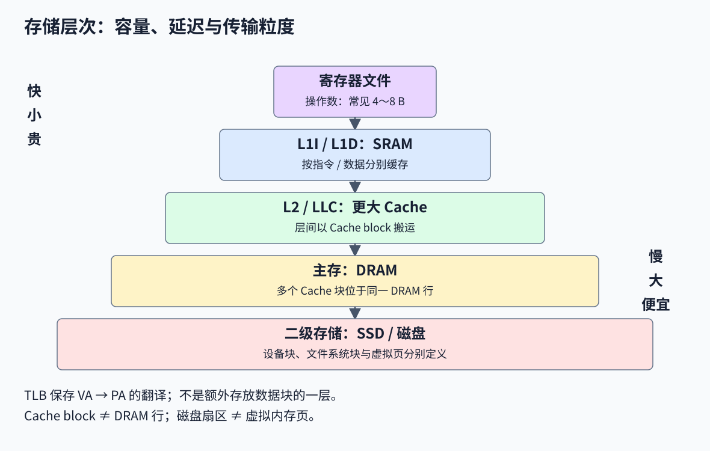

| 层次 | 常见技术/内容 | 课件中的周期量级示意 | 课件中的容量量级示意 |
|---|---|---|---|
| 寄存器文件 | 当前操作数 | 约半个至少数周期 | 数百 B |
| L1I / L1D | SRAM，分别存指令和数据 | 约个位数周期 | 数十 KiB |
| L2 | SRAM | 约十位数周期 | 数百 KiB |
| 主存 | DRAM | 约百位数周期 | MiB～GiB |
| 二级存储 | SSD、磁盘等 | 可达万周期及以上 | GiB～TiB |

这些是教学量级，不能代入任意型号。实际系统还可能有 LLC/L3 等层次。越远离处理器，通常容量越大、单位容量价格越低、延迟越高。课件的 Sandy Bridge 核心图用于说明 Cache 与执行、乱序调度和内存管理共同占用芯片面积，不应把局部图标注的面积当作整个处理器裸片面积。

| 性质 | SRAM：Static RAM | DRAM：Dynamic RAM |
|---|---|---|
| 典型单元 | 6 个晶体管，6T | 1 个晶体管和 1 个电容，1T1C |
| 存储方式 | 反馈电路维持两个稳定状态 | 用电容电荷表示数据 |
| 刷新 | 保持供电时无需 DRAM 式周期刷新 | 电荷泄漏，需要刷新 |
| 典型取舍 | 密度较低、单位 bit 较贵、速度快 | 密度高、单位 bit 较便宜、延迟较大 |
| 常见用途 | Cache | 主存 |

两者都是**易失存储器**，断电不保留数据。“Static” 不表示断电不丢失。“Random Access” 表示可直接按地址访问，不必像磁带一样顺序经过此前位置；实际 DRAM 延迟仍会受行命中、Bank、排队和刷新影响，并非所有地址访问永远等时。

课件给出的 SRAM/DRAM 单元面积比约 4～16、DRAM/SRAM 周期时间比约 8～16，均是工艺和组织相关的历史示意。功耗还取决于容量、访问活动和外围电路，不能只按 6T 与 1T 判断所有场景的总功耗。约 64 ms 的刷新窗口、约 1%～2% 活跃周期用于刷新的说法也有器件和温度前提。

课件备注以 DDR5-4800/5600 说明“速率”与“延迟”的差别：双倍数据率下，CK 约为 2400/2800 MHz，时钟周期约为 0.417/0.357 ns；示例 tRCD 约 15～20 ns。tRCD 只是一项时序，既不是完整随机访问延迟，也不能把数据传输率直接倒数后当成主存延迟。

## 3. 从 CMOS 反相器理解 SRAM 与 DRAM

MOSFET 是金属氧化物半导体场效应晶体管，可作开关或放大器。CMOS 电路组合使用 NMOS 和 PMOS。

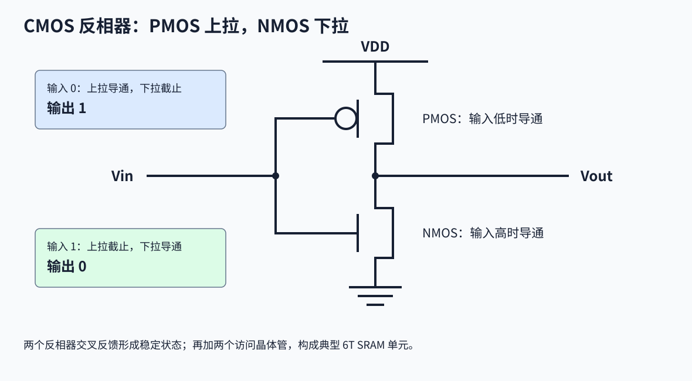

在基本 CMOS 反相器中，PMOS 接电源，NMOS 接地，两者栅极接输入、漏极连接为输出。输入低时，PMOS 导通、NMOS 截止，输出高；输入高时反之。因此输出为输入的逻辑反。

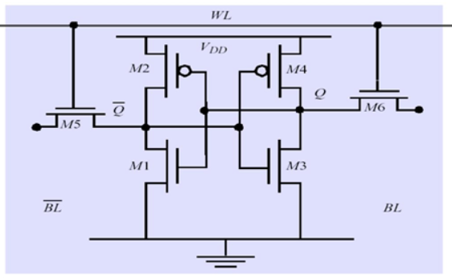

一个典型 6T SRAM 单元由**两个交叉耦合的 CMOS 反相器（4T）和两个访问晶体管（2T）**组成。两个内部节点分别保存互补值 Q、Q̅；反馈使一个节点为高、另一个为低的状态在供电时维持。

- **WL，Word Line，字线**控制访问晶体管，决定是否选中该行单元。
- **BL / BL̅，Bit Line，位线**连接读写外围电路。读出时感知位线差异；写入时驱动互补值，改变单元状态。
- 未被选中时，访问晶体管把内部反馈节点与位线隔开。读操作必须在不破坏稳定状态的条件下设计，并非把内部节点任意直接接到外部。

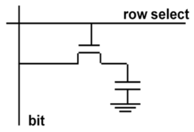

DRAM 用电容上的电荷保存一个 bit，WL 控制访问晶体管将电容接到 BL。读出时微小电荷变化由感应放大器放大，再恢复电容内容；电荷还会自然泄漏，因此即使软件不访问，也需定期刷新。单元简单使密度高，但外围感应、恢复、预充电等操作使访问流程比 SRAM 复杂。

## 4. RAM 阵列如何按地址访问

RAM 单元按行列组织：行译码器根据行地址选中一条 WL，位线把一行的数据连接到列选择和 I/O 电路，列地址再选出需要的 bit 或 word，缓冲器连接外部数据线。

以课件的 `2M × 16` 芯片为例：

$$
2^{21}\text{ 个字}\times16\text{ bit}=2^{25}\text{ bit}=4\text{ MiB}
$$

若按 16-bit 字寻址，逻辑上需要 21 位字地址，数据输入 `Din[15:0]`、输出 `Dout[15:0]` 各 16 位；Chip Select、Output Enable、Write Enable 控制片选、输出和写入。

DRAM 常分时复用外部地址引脚传送行、列地址，传统术语 RAS/CAS 分别关联行、列访问。课件说“地址分为两半”用于示意这种分解，实际行列位数不一定各占一半。**DRAM 的一行不是 CPU Cache 的一个块**，一个 DRAM 行通常包含多个 Cache 块。

## 5. 不同层次搬运什么，谁来管理

处理器每次可能只需一个字，但 Cache miss 时通常搬运整块，底层存储与虚拟内存又有自己的粒度。

| 边界/对象 | 课件示例粒度 | 主要管理者 |
|---|---|---|
| 寄存器与执行操作数 | 4～8 B 的 word | 编译器分配、处理器执行 |
| 处理器与一级 Cache | 按字节/字请求，命中后选出所需部分 | 处理器与 Cache 控制器 |
| Cache 层间/Cache 与主存 | Cache block，示例 8～64 B；课件另示意层间以 1～4 个块传输 | Cache 控制硬件 |
| 虚拟内存页 | 以页为单位映射、换入换出 | OS 与 TLB/页表遍历硬件 |
| 文件和存储设备 | 扇区、逻辑块、文件系统块等 | OS、设备、用户程序 |

课件把底层粒度简写为“1024+ B，disk sector = page”，这里应分开理解：**磁盘扇区与虚拟内存页不是同一概念，大小也不必相等**。ITLB/DTLB 缓存指令/数据的地址翻译结果，不是另一级存放指令或数据块的 Cache。

## 6. Hit、Miss 与 AMAT

对某一层 Cache，一次访问所需的块有效地存在于该层，称为 Hit；否则为 Miss，需要向下一级请求。

$$
\text{Hit Rate}=\frac{\text{命中次数}}{\text{访问次数}},\qquad
\text{Miss Rate}=1-\text{Hit Rate}
$$

- **Hit Time，命中时间 H**：查找数据阵列、检查有效位与 Tag、选择数据所需的时间。
- **Miss Penalty，缺失惩罚 P**：本层查找之后，为处理 miss、替换/回填和提供所需数据而额外支付的时间。

采用所有请求先支付 H、仅 miss 再支付额外 P 的串行模型：

$$
AMAT=H+mP
$$

若题目给的是“从发起访问到 miss 完成的总时间”，应先减掉已计入 H 的部分再当作 P，避免重复计算。H、P 必须同用 ns 或同用某一级处理器的周期。AMAT 是每次存储访问的平均时间；它与**每条指令的 CPI**分母不同。

## 7. Cache 如何影响执行时间

假设命中开销已经计入理想执行时间，且暂不考虑 miss 之间及 miss 与计算的重叠：

$$
\begin{aligned}
\text{Read Stalls}&=N_{read}\,m_{read}\,P_{read}\\
\text{Write Stalls}&=N_{write}\,m_{write}\,P_{write}+\text{Write-buffer Stalls}\\
CPI_{stall}&=\frac{\text{Total Memory Stall Cycles}}{IC}\\
T_{CPU}&=IC\,(CPI_{ideal}+CPI_{stall})\,T_{clk}
\end{aligned}
$$

前三个式子中的 P 用周期计。**总停顿周期必须除以指令数后才能加到 CPI 上**。在乱序、非阻塞 Cache 和多个 outstanding miss 的系统中，直接相加可能高估暴露给 CPU 的停顿，需要考虑重叠。

课件例题：理想 CPI 为 2，I-Cache miss rate 为 2%，D-Cache miss rate 为 4%，36% 的指令为 Load/Store，两个 Cache 的 miss penalty 都为 100 周期。

$$
CPI_{stall}=0.02\times100+0.36\times0.04\times100=3.44
$$

$$
CPI_{total}=2+3.44=5.44
$$

每条指令有一次取指，但只有 0.36 次数据访问。因此数据 miss 项必须乘 0.36，不能直接把 2% 与 4% 相加。

| 情形 | 理想 CPI | 每次 miss 周期 | 停顿 CPI | 总 CPI | 每条指令时间（原时钟周期为单位） | 停顿占比 |
|---|---:|---:|---:|---:|---:|---:|
| 原机器 | 2 | 100 | 3.44 | 5.44 | 5.44 | 63.2% |
| 同频，理想 CPI 降为 1 | 1 | 100 | 3.44 | 4.44 | 4.44 | 77.5% |
| 理想 CPI 仍为 2，频率翻倍 | 2 | 200 | 6.88 | 8.88 | 8.88 / 2 = 4.44 | 77.5% |

后两种改进的加速比均约为 `5.44 / 4.44 = 1.225`。翻倍频率时，假设主存缺失的绝对时间不变，所以以新 CPU 周期计的 penalty 翻倍。总 CPI 虽从 5.44 增到 8.88，执行时间仍下降，不能只比较 CPI 而忽略时钟周期。

课件把 5.44、4.44、8.88 也标成 `CPIstall`，这里统一为**总 CPI**。同频降低理想 CPI 时，停顿 CPI 并没有增加，只是停顿在总时间中的比例变大。

## 8. Cache 设计的四个问题与统一符号

1. **Placement**：一个主存块能放到 Cache 的哪些位置？
2. **Identification**：如何知道目标块已经在 Cache 中？
3. **Replacement**：可选位置已满时，替换谁？
4. **Write Strategy**：写命中和写缺失分别如何处理？

令 A 为字节地址，C 为 Cache 数据容量（B），B 为块大小（B），W 为相联度，S 为组数，n 为地址位数。对按低位选择组、各量为 2 的幂的常见教学模型：

$$
N=\frac{C}{B},\quad S=\frac{C}{BW},\quad
q=\left\lfloor\frac{A}{B}\right\rfloor
$$

$$
\text{Offset}=A\bmod B,\quad
\text{Set Index}=q\bmod S,\quad
\text{Tag}=\left\lfloor\frac{q}{S}\right\rfloor
$$

$$
b=\log_2B,\quad s=\log_2S,\quad t=n-s-b
$$

地址从高到低为 **Tag | Set Index | Block Offset**。若一字 4 B，Block Offset 又可拆为“块内字偏移”和最低 2 位“字内字节偏移”。有些课件只把块内字偏移叫 block offset；使用公式时要确认是否包含 byte offset。

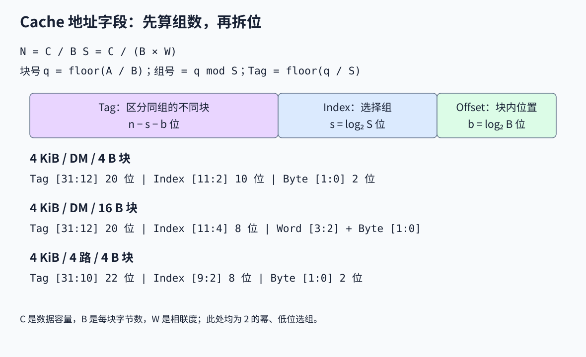

Cache 标称容量通常只计数据，不含 Tag、Valid、Dirty、替换状态和 ECC 等，因此 `C/B` 算出的是数据块数，不能直接当作总硬件存储位数。

## 9. 直接映射：一个块只有一个位置

Direct Mapped（DM）等价于每组 1 路。Index 选中唯一的行，比较请求 Tag 与行内 Tag，并检查 Valid：

$$
Hit=Valid\land(Tag_{request}=Tag_{stored})
$$

只有数据相似或 Tag 数值碰巧相同都不足以命中；Valid 为 0 的行不能命中。

课件的小例子：64 B 地址空间，地址 6 位；一块 1 字 = 4 B；Cache 共 4 行，数据容量 16 B。

| 字段 | 位数 | 地址位 |
|---|---:|---|
| Tag | 2 | [5:4] |
| Index | 2 | [3:2] |
| Byte Offset | 2 | [1:0] |

主存块号 0、4、8、12 都满足 `q mod 4 = 0`，映射到第 0 行，靠不同的 Tag 区分。缓存中并不保存完整地址，而是由行的位置隐含 Index，Tag 记录其余高位。

课件的另一个例子是 32 位字节地址、1K 字 Cache、一字一块：C = 4096 B，B = 4 B，1024 行。因此 Tag 为 20 位 `[31:12]`，Index 为 10 位 `[11:2]`，字节偏移为 2 位 `[1:0]`。

## 10. 逐次访问例题：一字块为何缺失 6 次

以下 `0, 1, 2, ...` 是**字编号 w**，字节地址是 `A = 4w`，不能直接把 w 当作字节地址。配置采用前述 4 行、一字一块的空 Cache。

| 次序 | 字编号 w | 块号 q | 行 q mod 4 | Tag | H/M | 访问后变化 |
|---|---:|---:|---:|---:|---|---|
| 1 | 0 | 0 | 0 | 0 | M | 行 0 放字 0 |
| 2 | 1 | 1 | 1 | 0 | M | 行 1 放字 1 |
| 3 | 2 | 2 | 2 | 0 | M | 行 2 放字 2 |
| 4 | 3 | 3 | 3 | 0 | M | 行 3 放字 3 |
| 5 | 4 | 4 | 0 | 1 | M | 字 4 替换字 0 |
| 6 | 3 | 3 | 3 | 0 | H | 字 3 仍在行 3 |
| 7 | 4 | 4 | 0 | 1 | H | 字 4 仍在行 0 |
| 8 | 15 | 15 | 3 | 3 | M | 字 15 替换字 3 |

8 次访问、6 次 miss、2 次 hit，miss rate = 75%。最后一行的替换也说明：即使其他行的数据不再有用，DM 仍只能使用目标块指定的位置。

## 11. 多字块与空间局部性

在 32 位地址、总数据容量 1K 字 = 4 KiB 的例子中，若一块改为 4 字 = 16 B，则只有 256 行：

| 字段 | Tag | Index | 块内字偏移 | 字内字节偏移 |
|---|---|---|---|---|
| 位数/范围 | 20，[31:12] | 8，[11:4] | 2，[3:2] | 2，[1:0] |

访问一个字会把同块相邻字一起搬入，下次访问附近的字可能命中。但课件第 34 页的“8 次访问、4 次 miss”使用的是另一个小配置：**总容量仍为 4 字，但每块 2 字，共 2 行**。它不能直接沿用前一页“每块 4 字”的配置。

| 次序 | w | 块号 floor(w/2) | 行 q mod 2 | H/M | 说明 |
|---|---:|---:|---:|---|---|
| 1 | 0 | 0 | 0 | M | 搬入字 0、1 |
| 2 | 1 | 0 | 0 | H | 利用同块数据 |
| 3 | 2 | 1 | 1 | M | 搬入字 2、3 |
| 4 | 3 | 1 | 1 | H | 同块命中 |
| 5 | 4 | 2 | 0 | M | 搬入字 4、5，替换块 0 |
| 6 | 3 | 1 | 1 | H | 块 1 未被替换 |
| 7 | 4 | 2 | 0 | H | 块 2 未被替换 |
| 8 | 15 | 7 | 1 | M | 搬入字 14、15 |

结果为 `M H M H M H H M`，miss rate = 50%。若真把同样 16 B 小 Cache 改为每块 4 字，则只剩 1 行，同一序列为 `M H H H M M M M`，反而有 5 次 miss。**块变大既会利用空间局部性，也会减少可同时容纳的独立块数。**

## 12. 块大小为何不能无限增加

增大块大小通常先降低 miss rate；当块相对 Cache 过大，更多无用邻近数据占用容量，独立块数减少，冲突/容量问题可能变重。块更大还增加传输流量和完整回填时间，因此应共同评价 miss rate、penalty 和带宽。

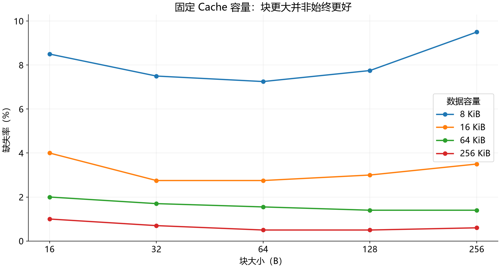

下表保留课件图表内嵌数据，单位为百分比。图表列出了 8 B 类别却没有相应数值，故只重绘有数据的 16～256 B；不能把缺失值当作 0。

| Cache 数据容量 | 16 B | 32 B | 64 B | 128 B | 256 B |
|---|---:|---:|---:|---:|---:|
| 8 KiB | 8.5 | 7.5 | 7.25 | 7.75 | 9.5 |
| 16 KiB | 4.0 | 2.75 | 2.75 | 3.0 | 3.5 |
| 64 KiB | 2.0 | 1.7 | 1.55 | 1.4 | 1.4 |
| 256 KiB | 1.0 | 0.7 | 0.5 | 0.5 | 0.6 |

例如 8 KiB Cache 从 16 B 增到 64 B 时 miss rate 下降，再增到 256 B 时升到 9.5%。这些是特定实验的数据，不能据此规定所有程序的最佳块大小。

## 13. 组相联解决 Ping-pong

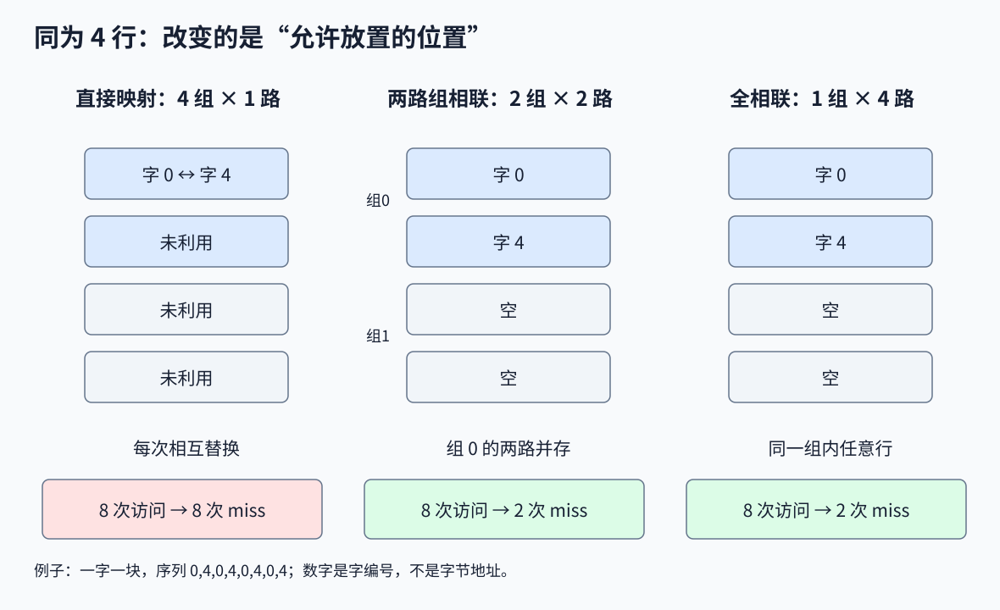

考虑 4 字容量、一字一块，访问 `0,4,0,4,0,4,0,4`。DM 中字 0 与字 4 都映射到行 0，每次都替换刚搬入的另一字，形成 **Ping-pong/抖动**：8 次全 miss，其余 3 行却没有被利用。

改为 2 路组相联（2-way Set Associative，SA），总行数仍为 4，但分为 2 组、每组 2 路。`q mod 2` 选组，同组块可以放在任意一路。字 0 与字 4 同在第 0 组，却可以各占一路：

| 访问 | 0 | 4 | 0 | 4 | 0 | 4 | 0 | 4 |
|---|---|---|---|---|---|---|---|---|
| 直接映射 | M | M | M | M | M | M | M | M |
| 2 路组相联 | M | M | H | H | H | H | H | H |

64 B 地址空间的这个例子里，地址拆为 Tag 3 位、组 Index 1 位、Byte Offset 2 位。字 0 的 Tag 为 `000`，字 4 的 Tag 为 `010`，二者 Index 均为 0。

组内各路通常并行比较 Tag，再把命中路的数据经多路选择器送出。**Index 选的是组，Tag 匹配确定的是路**；课件把后者的 mux 称为“set selection”，这里按实际功能区分。

## 14. DM、SA、FA 的统一比较

| 类型 | 组数 S | 每组路数 W | 一个块能放哪里 | 常规并行 Tag 比较数 |
|---|---:|---:|---|---:|
| 直接映射 DM | N | 1 | 唯一行 | 1 |
| W 路组相联 SA | N/W | W | 唯一组内任意一路 | W |
| 全相联 FA | 1 | N | 任意行 | N |

DM 和 FA 是 SA 的两个端点。FA 没有 Index 字段，地址除块偏移外都是 Tag。较大的全相联 Cache 需要大量比较器及选择逻辑，面积、功耗和时延成本高。

32 位地址、1K 字容量、一字一块的 4 路 Cache 有 `1024/4 = 256` 组，Index 8 位、Tag 22 位、Byte Offset 2 位。与同容量 DM 相比，组数少 4 倍，Index 少 2 位，Tag 多 2 位。

固定 C、B，相联度每翻倍一次，S 减半，Index 少 1 位，Tag 多 1 位，块偏移不变。若同时改变容量或块大小，就不能机械套用这一结论。

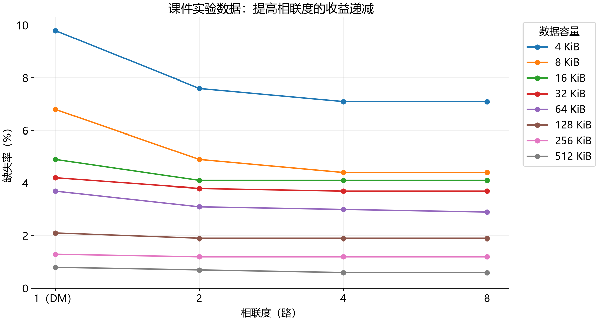

课件给出的 miss rate 数据如下，单位为百分比：

| Cache 容量 | 1 路 | 2 路 | 4 路 | 8 路 |
|---|---:|---:|---:|---:|
| 4 KiB | 9.8 | 7.6 | 7.1 | 7.1 |
| 8 KiB | 6.8 | 4.9 | 4.4 | 4.4 |
| 16 KiB | 4.9 | 4.1 | 4.1 | 4.1 |
| 32 KiB | 4.2 | 3.8 | 3.7 | 3.7 |
| 64 KiB | 3.7 | 3.1 | 3.0 | 2.9 |
| 128 KiB | 2.1 | 1.9 | 1.9 | 1.9 |
| 256 KiB | 1.3 | 1.2 | 1.2 | 1.2 |
| 512 KiB | 0.8 | 0.7 | 0.6 | 0.6 |

这组数据中 DM→2 路收益较大，再增路数的收益递减；课件以 2～16 路作为常见设计范围举例。最终选择要比较减少 miss 的收益与 Tag 比较、数据 mux、功耗和命中延迟的成本。

“路数越多一定越好”也不成立。固定容量时组数随之改变，映射和替换过程都会变化。例如 4 字容量、一字一块、LRU，序列 `0,2,4,0,2,4` 在 DM 中有 5 次 miss，在 2 路、2 组中三个块全挤到组 0，产生 6 次 miss。统计趋势不能替代对具体序列的分析。

## 15. 三类缺失：3Cs

| 类别 | 原因 | 典型缓解方法 |
|---|---|---|
| Compulsory，强制/冷缺失 | 某块第一次被需求访问，尚未在 Cache 中 | 合理增块、提前预取；不能假定从未取过的数据凭空存在 |
| Capacity，容量缺失 | 工作集/重用间隔超出 Cache 能容纳的范围，同容量全相联也会发生 | 增容量、改善数据和循环局部性 |
| Conflict，冲突缺失 | 块被限制到特定组，同容量全相联可容纳但当前映射反复排挤 | 增相联度、Victim Cache、改变布局 |

分类时先识别第一次访问；再结合常用的同容量全相联 LRU 参照分析容量与冲突。全相联消除了固定组映射带来的冲突，但不消除冷缺失和容量缺失。Valid 为 0 也不自动意味着“整个程序第一次访问该块”，因为行可能曾被清空或失效。

课件用只有 4 行的 Cache 画出 `0x1234`、`0x5670`、`0x91B1`、`0x1112`、`0x3113` 等访问示意三种原因。这些地址本身不足以确定映射；若要计算具体 H/M，还必须给出块大小、组数、初始状态与访问顺序。

## 16. 替换策略：只在允许的位置中选择

miss 后先看目标组是否有无效行；有则优先使用，否则选择 Victim。对于写回 Cache，脏 Victim 需要按协议写回，或先进入写回缓冲，再释放其空间。直接映射只有一个候选位置，无需运行多路替换算法。

| 策略 | 如何选择 | 主要特点 |
|---|---|---|
| Random | 随机/伪随机选一路 | 状态少，但不利用近期访问历史 |
| FIFO | 替换最早进入该组的块 | 命中通常不改变入队次序 |
| LRU | 替换最后一次访问距今最久的块 | 使用近期性，更新顺序有成本 |
| NRU / NMRU | 从非近期使用/非最近使用的候选中选 | 对 LRU 的简化，不保证精确次序 |
| Tree-PLRU | 二叉树近似记录各半区的新旧 | 状态少，可能与真 LRU 选择不同 |
| Clock | 用引用位和循环指针给“第二次机会” | 无需维护完整时间顺序 |

课件以 Itanium 2 的多级缓存使用 NRU 为历史实例，并非所有处理器都采用此策略。LRU 的“最久没用”依据**过去**，不等于知道未来哪块最晚再用；后者需要未来访问信息。

## 17. 精确 LRU 的硬件成本

2 路组相联只有 A、B 两路，记录 1 bit 即可：刚访问 A，则 B 成为 LRU；刚访问 B，则 A 成为 LRU。这时 LRU 与“选择非 MRU（NMRU）”等价。

大于 2 路时，只知道谁是 MRU 不足以确定其余块的次序。可用时间戳、顺序表或其他编码维护完整先后关系，但每次命中都可能需要更新多项状态。W 路共有 `W!` 种完整次序，仅从信息量看至少需要 `ceil(log2(W!))` 位；例如 4 路至少 5 位。实际实现还要考虑更新逻辑，而不只是状态位数。

## 18. Tree-PLRU：状态、更新与寻找 Victim

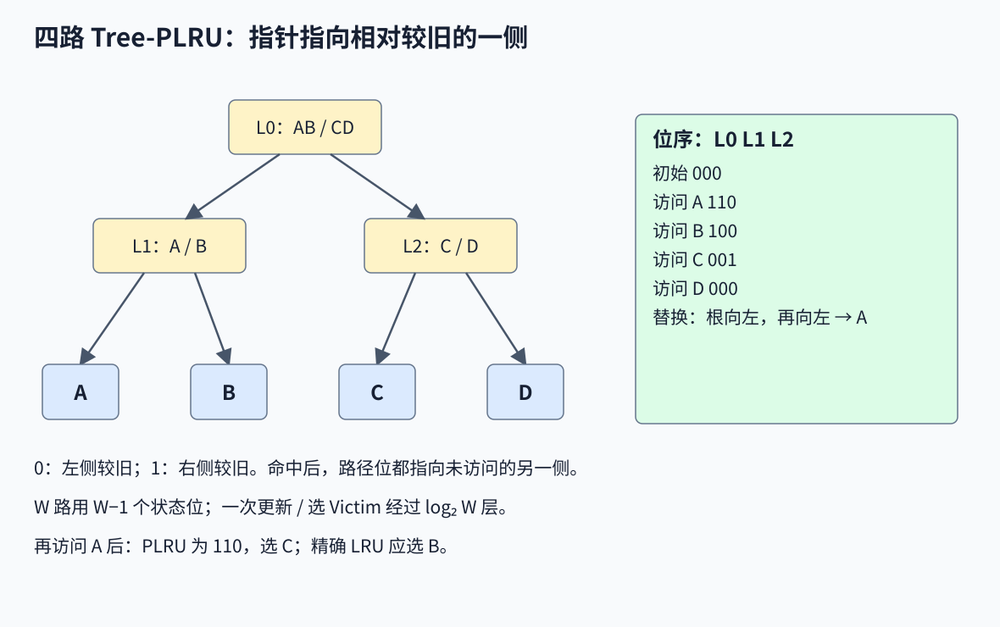

四路 A、B、C、D 为二叉树叶子，内部有三个方向位：L0 区分 AB/CD，L1 区分 A/B，L2 区分 C/D。采用课件约定：**0 指左半区较旧，1 指右半区较旧**；初始为 `L0 L1 L2 = 000`。

访问某一路后，只更新从根到该叶的路径，使这些指针都指向未被访问的另一侧，表示另一侧相对较旧。

| 操作后 | L0 | L1 | L2 | 更新解释 |
|---|---:|---:|---:|---|
| 初始 | 0 | 0 | 0 | 初始约定，不表示真实使用时间 |
| 访问 A | 1 | 1 | 0 | CD 比 AB 旧，B 比 A 旧 |
| 再访问 B | 1 | 0 | 0 | CD 比 AB 旧，A 比 B 旧 |
| 再访问 C | 0 | 0 | 1 | AB 比 CD 旧，D 比 C 旧 |
| 再访问 D | 0 | 0 | 0 | AB 比 CD 旧，C 比 D 旧 |

替换时从根沿“较旧”方向走：`L0=0 → AB`，`L1=0 → A`，所以最后选择 A。

对于 W 为 2 的幂的完整二叉树，状态共 **W−1 位**，一次更新或选择经过 `log2 W` 层。不能把 O(log W) 路径长度误写成总状态只有 O(log W) 位。

PLRU 不是精确 LRU。例如先访问 `A,B,C,D`，再访问 A，真 LRU 的顺序从旧到新是 `B,C,D,A`，应淘汰 B；PLRU 为 `110`，沿根指向 CD，再指向 C，选择 C。

## 19. Clock / Second Chance

每个候选块有引用位 R，另有一个循环移动的 Clock Hand：

1. 命中该块时置 R=1。
2. 需要替换时检查指针所在项；若 R=0，选它为 Victim。
3. 若 R=1，把它清为 0，指针前进，继续找。
4. 装入的新项通常置 R=1，指针移到下一位置。

最坏情况下会绕一整圈，将所有 R=1 的项清零后才找到可替换项。课件用 A～H 在 t=0、4、8、15、21、22、29、30 装入，t=32 再引用 A/B/C 并装入 J 的动画说明“近期引用得到第二次机会”。精确 Victim 还依赖当时指针与所有引用位，不能仅根据这些时间戳推出。Clock 可用于页替换等场景；讲它是为了说明近似近期性的机制，并不意味着每个硬件 Cache 都用 Clock。

## 20. 写命中：Write-through 与 Write-back

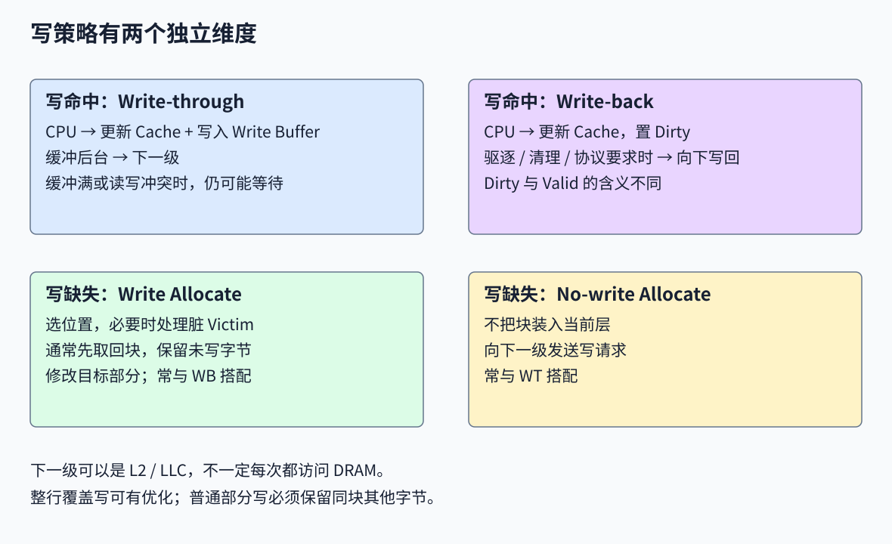

| 策略 | 写命中动作 | 需要的状态/代价 |
|---|---|---|
| Write-through，写直达 WT | 更新本层数据，并把写送往下一级 | 下行写流量较大，常用 Write Buffer 隐藏等待 |
| Write-back，写回 WB | 先更新本层，置 Dirty；在驱逐、清理或一致性协议要求时再向下传递 | 需要 Dirty 与相应协议，能合并同块多次写 |

Dirty 表示本层持有尚未向下传播的修改，与 Valid 是不同的位。写回时主存可能暂时保留旧值，但这并不等于系统语义错误；读取和多核一致性由整个存储协议保证。

课件画出一个 4 项 FIFO Write Buffer 作为示例。写入缓冲后 CPU 可继续，缓冲后台向下发送，但它**隐藏等待而非消灭开销**：缓冲满时仍可能停顿；后续读若与未完成写同地址，需要转发或等待，不能读到旧值。缓冲的容量、合并能力与顺序规则由实现决定。

## 21. 写缺失：Write Allocate 与 No-write Allocate

这与上一节是独立维度：上一节决定“命中后何时向下传播”，本节决定“miss 后是否把块放进当前 Cache”。

| 策略 | 写缺失流程 | 常见组合 |
|---|---|---|
| Write Allocate，写分配 WA | 选位置，通常从下一级取回整块，保留未写字节，再修改目标字节 | WB + WA |
| No-write Allocate，不写分配 NWA | 当前层不装入该块，直接向下一级发送写 | WT + NWA |

取回来源可能是 L2/LLC 或其他协议参与者，不必每次都到 DRAM。完整覆盖整行的写可有省去旧数据读取的优化；普通局部字节写不能丢弃同块其他字节。

课件的“直接写入 Tag 和数据，无需检查命中、无需停顿”不能作为普通 Cache 写操作的通则：仍要正确判断目标块、保留其余数据、处理 Victim 和冲突请求。四种 WT/WB 与 WA/NWA 的组合在逻辑上均可讨论，表中只是常见搭配。

## 22. 优化的三条路径与多级 AMAT

$$
AMAT=\underbrace{H}_{\text{命中时间}}+
\underbrace{m}_{\text{缺失率}}\times
\underbrace{P}_{\text{缺失惩罚}}
$$

优化可降低 H、m 或 P，但技术常影响多项，收益未必同向。L1 优先追求低命中延迟；更大的 L2/LLC 承接 L1 miss，减少直达主存的次数。课件还列出 eDRAM L3/L4、Storage-Class Memory 等可能的技术层次，属于设计举例，并非所有机器都有这些层。

两级串行查找的模型为：

$$
AMAT=H_1+m_1(H_2+m_2P_{mem})
$$

其中 `m1` 是 L1 的局部 miss rate；`m2` 的分母是**到达 L2 的访问**，不是所有 CPU 访问。原始请求最终去主存的全局比例为 `m1 × m2`。例如 L1 miss 10%、L2 局部 miss 20%，主存比例是 2%。式中 Pmem 是 L2 检查后附加的主存时间，不能重复计 H2。

## 23. Inclusive、Exclusive 与 Non-inclusive

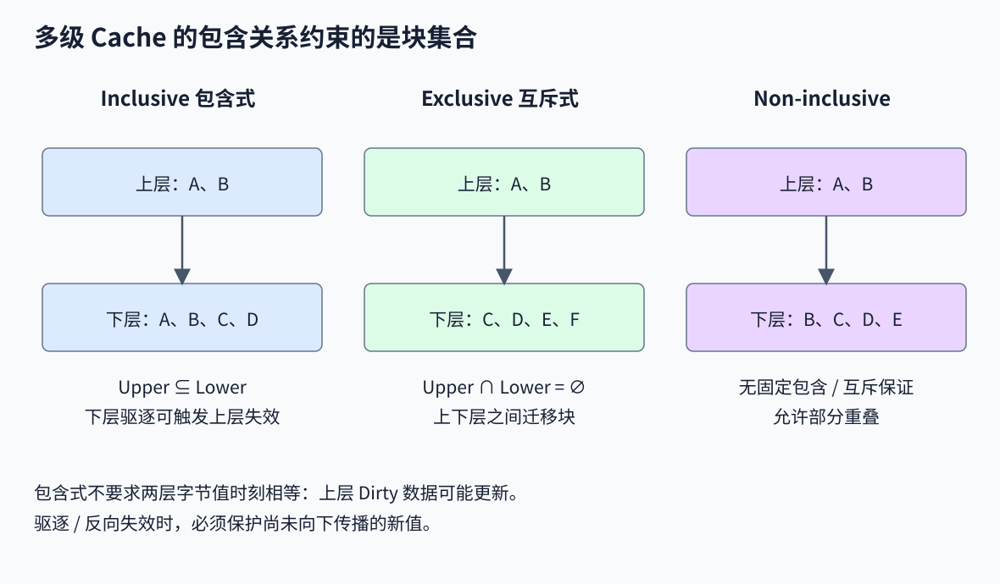

| 关系 | 对上下层块地址集合的约束 | 填充/替换影响 |
|---|---|---|
| Inclusive，包含式 | 上层有的块，下层一定也覆盖/记录，即 Upper ⊆ Lower | 下层驱逐可能需向上层 Back-invalidation，并正确收集脏数据 |
| Exclusive，互斥式 | 上下层不同时保有同一块，即 Upper ∩ Lower = ∅ | 上层填入与驱逐常伴随块在层间迁移，有效数据容量可接近两层之和 |
| Non-inclusive / Non-exclusive，非包含非互斥 | 不保证上述任一关系，允许部分重叠 | 是否保留副本由具体策略决定 |

包含关系主要约束块的存在与协议记录，**不意味着两层中每个字节永远相同**：上层脏块可能比下层数据更新。下层不能随意丢弃上层唯一的新值。

互斥也不能只凭“某层是 Victim Cache”就推广到整个处理器所有层次；实际产品可能只对特定层、特定缓存种类或目录实施某种关系。

## 24. Early Restart 与 Critical Word First

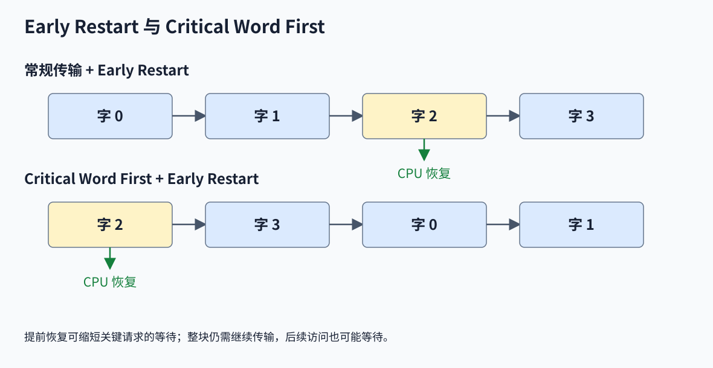

CPU 引发 miss 时通常急需块中的一个字，不一定要等整块回填完成才继续。

- **Early Restart**：传输仍可按常规顺序进行，一旦所需字到达便立即交给 CPU。
- **Critical Word First**：先请求/返回所需字，再传块的其余部分，通常与 Early Restart 配合。

例如一块 32 B、含 4 个 8 B 字，CPU 需要字 2。普通顺序是 `0,1,2,3`，Early Restart 在字 2 到达后恢复；关键字优先可按 `2,3,0,1` 等顺序返回，在第一个字到达时恢复。这里一字为 8 B，与前面一字 4 B 的 MIPS 教学例子是不同配置。

这种方法主要缩短 CPU 等待关键数据的时间，不一定减少取回整块的总流量或总完成时间；后续指令若立刻需要尚未到达的字仍可能等待。

## 25. Write Combining 与 x86 内存类型

Write Combining Buffer（WCB）先收集同一块/区域的多个小写，再合并为较大的总线事务，减少重复传输和事务开销。它需要跟踪哪些字节有效，填满、容量压力或顺序要求都可能触发发送。

若合并粒度为 32 B、区域从 `0x100` 对齐开始，连续 8 B 写到 `0x100, 0x108, 0x110, 0x118` 可以覆盖同一个区域。相距很远的写不能凭空合为同一块。课件以 `100,108,116,124` 和 `400,900` 作邻近/分散示意；具体是否同块仍取决于数制、块大小、对齐和写宽度。

在 x86 中，MTRR（Memory Type Range Register）等机制决定地址区域的缓存行为。课件列出的五类是：

| 类型 | 含义 |
|---|---|
| UC，Uncacheable | 不按普通可缓存内存的方式驻留 Cache，访问受 UC 规则约束 |
| WC，Write Combining，课件亦称 USWC | 允许缓冲、合并写，以较大事务向下发送 |
| WB，Write Back | 普通写回缓存行为 |
| WT，Write Through | 缓存读取，写按写直达规则向下传播 |
| WP，Write Protected | 读取可缓存；写向系统总线传播，并使相关缓存行失效 |

**WP 不是“仅 Supervisor 可访问”**。它描述缓存行为，不能替代页表的读写/特权权限。上表也不是所有 PAT 编码与有效内存类型组合的完整列表。WP 的准确语义见 [Intel SDM Volume 3A，第 13 章 Memory Cache Control](https://cdrdv2-public.intel.com/835754/253668-sdm-vol-3a.pdf)。

课件的 Linux `cat /proc/mtrr` 是查看部分配置的例子，不能仅据该文件认定整个系统的最终有效类型。非临时存储指令如 **MOVNTDQ** 可使用非临时/写合并行为；课件拼写 `moventdq` 应改为 `movntdq`。**MOVNTDQA** 是有特定内存类型语义的非临时加载提示。这些指令不是修改 MTRR 的命令，“只有显式 WC 区域才能涉及写合并”也过于绝对；具体行为与目标内存类型及架构规则共同决定，见同一 Intel 手册。

## 26. Non-blocking Cache 与 MSHR

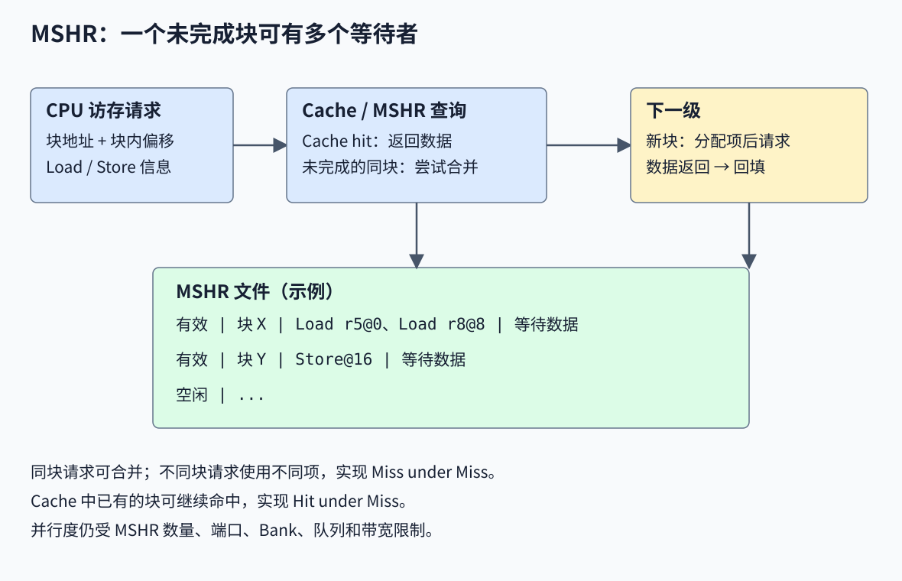

阻塞 Cache 在一次 miss 未完成时，可能连不相关的后续访问也不能接受。非阻塞 Cache 支持：

- **Hit under Miss**：某块 miss 尚未完成时，其他已在 Cache 中的块仍能命中。
- **Miss under Miss**：同时处理多个独立 miss，重叠下级访问延迟。

它需要 Miss Handling Architecture，其中 **MSHR，Miss Status Holding Register** 保存未完成缺失的状态，例如 Valid、块地址、请求类型、回填状态，以及等待该块的 Load/Store 目标与字节偏移。

请求到来时，除查询 Cache，也要检查是否已有同块 miss：若存在且协议允许，就合并到对应 MSHR 的等待者列表；若是新块，分配新项并向下请求。数据返回后按偏移唤醒相应等待者、完成回填和状态处理，最终释放 MSHR。同块多个 Load 不一定要发多个完整下级读取。

MSHR 不等于 ROB，也不等于 LSQ：ROB 保证指令提交顺序，LSQ 跟踪访存依赖，MSHR 跟踪缓存事务，三者需要协作。MSHR 全满时，新 miss 可能停顿，既有 hit 是否继续仍由端口、Bank 和控制实现决定。非阻塞也不能消除真数据依赖：依赖未返回 Load 的指令仍需等待。

因此它主要减少**暴露给 CPU 的停顿**，并不保证每个 miss 本身更短。Bank 冲突、下行带宽和队列容量也会限制并行度。可参考一个实际实现中关于 MSHR 分配、回填与请求合并的说明：[香山 CoupledL2 设计文档](https://docs.xiangshan.cc/projects/design/en/kunminghu-v2r2a/cache/l2cache/CoupledL2/)。

## 27. 硬件预取与 Stream Buffer

预取器监测历史访问，预测将来需要的数据，在需求访问发生前发起请求。课件以 Core 2 等历史结构图说明预取器可以部署在不同位置：

| 位置/方法 | 预测信息 |
|---|---|
| L1D 的 PC-localized stride | 同一 Load PC 多次产生地址的步长 |
| 短步长/下一块预取 | 当前块中的访问趋势，推测后续相邻块 |
| 指令预取 | 预测未来取指 PC/路径 |
| L2 stream / adjacent-line | 连续块流或相邻行 |

靠近核心容易看到访问 PC 和较完整的局部顺序；LLC 常被分 Bank、用 Hash 映射，多核请求混合后检测模式更复杂。因此不能假定所有层次使用相同预取器。

**Stream Buffer** 的顺序预取版本保存未来 N 个块。每项包含 Tag 和一整行数据，按 FIFO 消费；尾部根据前一块号 `b+1` 继续发起预取。CPU 需要的数据若已在缓冲中，可更快取得，再补充后续块。一个独立 Stream Buffer 不必把所有预取数据立即放进 L1。

预取要同时看准确性、及时性、覆盖率和带宽：取错会污染 Cache/缓冲、浪费传输，取太晚仍要等待，取太早可能在真正使用前被替换。它可把需求 miss 提前处理，但不意味着总流量或 AMAT 必然下降。

## 28. 编译器与数据布局如何改善局部性

**循环交换 Loop Interchange**：C 的普通二维数组为行主序，连续变化最后一个下标通常连续访问。课件把内层 `i` 的跨行访问换成内层 `j`：

```c
/* 原顺序 */
for (j = 0; j < N - 1; j++)
    for (i = 0; i < N - 1; i++)
        x[i][j] = 2 * x[i][j];

/* 交换后，按行连续访问 */
for (i = 0; i < N - 1; i++)
    for (j = 0; j < N - 1; j++)
        x[i][j] = 2 * x[i][j];
```

交换必须满足依赖与语言语义要求，不能仅为 Cache 任意改变有跨迭代依赖的循环。

**循环融合 Loop Fusion**：先做完整数组求倒数、再遍历求和，可能在第二遍前丢失早期数据。若合法，可在每个元素更新后立即使用：

```c
/* 融合前，假设 a 为浮点数组 */
for (i = 0; i < 10000; i++) a[i] = 1.0 / a[i];
for (i = 0; i < 10000; i++) sum += a[i];

/* 融合后 */
for (i = 0; i < 10000; i++) {
    a[i] = 1.0 / a[i];
    sum += a[i];
}
```

融合使同一元素更快重用，甚至可直接复用寄存器值。课件称第二行“hit all”表达这一意图；实际是否每次 Cache hit 仍取决于编译结果、其他访问、写策略等，融合也需检查异常、副作用和依赖。

**合并数组 Merging Arrays**：把分离数组（SoA）改为结构体数组（AoS），让一起使用的字段更靠近：

```c
int val[SIZE], key[SIZE];
/* 若总是成对使用 val[i] 与 key[i]，可考虑 */
struct Entry { int val; int key; } merged[SIZE];
```

它可能改善成对读取的空间局部性；若只扫描 `val`，AoS 反而会把无用 `key` 一起搬入。布局应根据访问模式选择。

## 29. 地址翻译与 Cache：PIPT、VIVT、VIPT

CPU 发出的虚拟地址 VA 通过 TLB/页表翻译成物理地址 PA。翻译、索引和 Tag 检查如何安排，影响命中路径。

| 结构 | Index 来自 | Tag 来自 | 主要特点 |
|---|---|---|---|
| PIPT | PA | PA | 常规流程先得到物理地址，再查 Cache |
| VIVT | VA | VA | 可先查虚拟地址，但要处理进程身份与别名 |
| VIPT | VA | PA | 用页内偏移并行索引，翻译后检查物理 Tag |

课件把这些问题统称为“Virtual Cache”，分析时需要区分。两个不同进程的相同 VA 对应不同 PA，称 **Homonym，同名问题**；可用进程/ASID 标签或适当失效处理。两个不同 VA 对应同一 PA，称 **Synonym/Aliasing，别名问题**；它可能产生同一物理数据的多个缓存副本，ASID 本身不能解决。

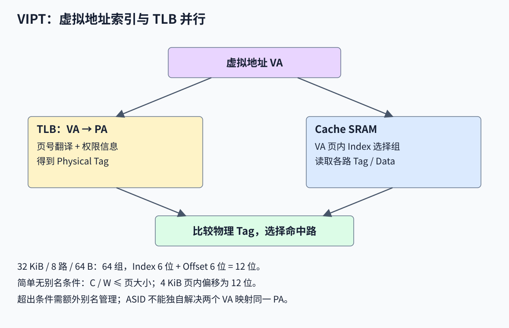

对于最简单的不需额外别名处理的 VIPT，Index 与 Block Offset 都放在翻译前后保持不变的页内偏移中。若页大小为 P：

$$
\log_2 S+\log_2 B\le\log_2 P
\quad\Longleftrightarrow\quad
\frac{C}{W}\le P
$$

例如 32 KiB、8 路、64 B 块、4 KiB 页：S=64，Index 6 位加 Offset 6 位，刚好等于页内 12 位。VA 可同时送 TLB 和 SRAM 索引，得到 PA Tag 后完成比较。

同容量改为 4 路时，S=128，需要 7+6=13 位，超过 4 KiB 页内偏移的 12 位。它不表示这种 Cache 无法实现，而是需要硬件别名管理、页着色等额外机制。这个上界是简化的无别名设计条件，不是所有 VIPT 产品不可突破的容量上限。实际超过该条件的处理可见[香山 CoupledL2 的 Cache aliasing 说明](https://docs.xiangshan.cc/projects/design/en/kunminghu-v2r2a/cache/l2cache/CoupledL2/#supports-hardware-handling-of-cache-aliasing)。

因此“进程切换一定要清空整个 Cache”只适用于某些缺少身份区分/别名机制的设计，不能推广到所有物理 Tag Cache。页表权限检查也必须正确完成，虚拟索引不会取消访问权限要求。

## 30. Way Prediction 与 Trace Cache

**Way Prediction** 预测组内命中的路，先读取预测路以缩短常见路径或降低能耗。预测错误时再检查/读取其他路，可能多花周期；这属于 way prediction miss，不一定是整个 Cache 的数据 miss。预测逻辑本身也占空间和时间。

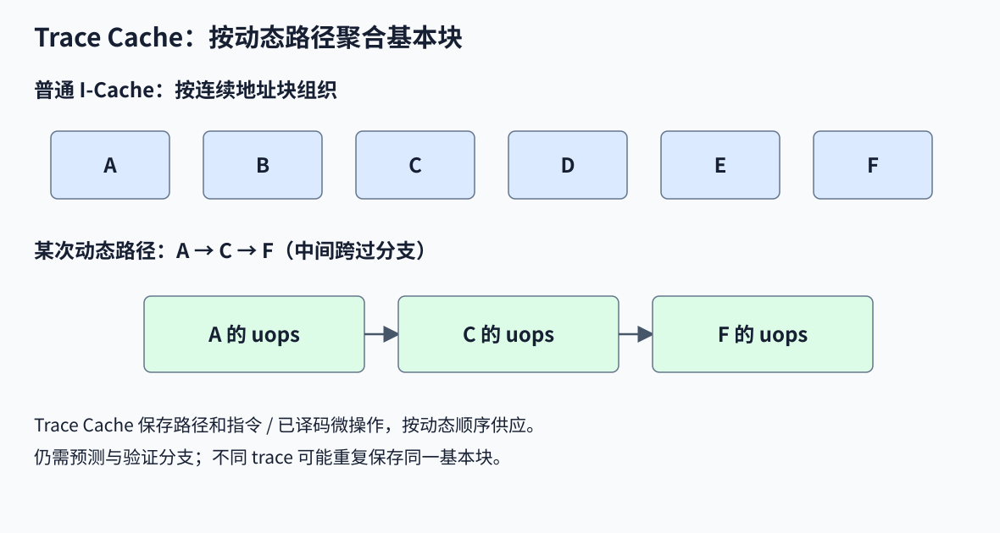

普通 I-Cache 按连续地址块保存指令，动态路径跨多个不连续基本块时，取指可能分散。**Trace Cache** 按已经选择的动态控制流，把路径中多个非连续基本块的指令/微操作聚合到一个 trace 中，命中后按执行顺序供应。

课件图用跨 A～J 基本块的路径示意普通 I-Cache 分 5 次/周期取到的内容，Trace Cache 可一次取得；这是图中条件下的示例，不代表任意程序必然有 5 倍加速。

Pentium 4 / NetBurst 是历史例子，其 Trace Cache 保存已译码、拆分的微操作（uops）。课件所写“每隔一个周期返回 6 uops”对应平均约 3 uops/周期，不能改写为持续每周期 6 uops。Trace Cache 仍需要路径识别、分支预测和验证，且不同路径可能重复保存相同基本块，消耗容量。

## 31. 课件优化总结表与未展开技术

下表保留课件的定性标记：`+` 表示改善该指标，`−` 表示可能使该指标变差，空白仅表示课件未标主效应；“改善 miss rate”指降低它。复杂度 0～3 是课件的相对等级，并非通用硬件成本公式。

| 技术 | Miss Rate | Miss Penalty | Hit Time | 硬件复杂度 |
|---|:---:|:---:|:---:|:---:|
| 增大块 | + | − |  | 0 |
| 提高相联度 | + |  | − | 1 |
| Victim Cache | + |  |  | 2 |
| Pseudo-associative | + |  |  | 2 |
| 硬件预取 | + |  |  | 2 |
| 编译器控制的预取 | + |  |  | 3 |
| 编译器局部性优化 | + |  |  | 0 |
| 读缺失优先 |  | + |  | 1 |
| Subblock Placement |  | + |  | 1 |
| Early Restart / Critical Word First |  | + |  | 2 |
| Non-blocking Cache |  | + |  | 3 |
| 增加二级 Cache |  | + |  | 2 |
| 小而简单的 Cache | − |  | + | 0 |
| 避免地址翻译串行阻塞索引 |  |  | + | 2 |
| 写操作流水化 |  |  | + | 1 |

表中的部分技术只在最后一页出现，可这样理解：

- **Victim Cache**：用一个小型全相联缓冲保存刚被主 Cache 驱逐的块，后续冲突访问可能从中取回。
- **Pseudo-associative**：第一次查找失败后，再探测备选位置，以额外探测时间换取部分相联效果。
- **软件/编译器预取**：插入预取提示，把数据请求提前；会增加指令和流量，且不能把普通有语义的 Load 随意变成无异常提示。
- **读缺失优先**：让阻塞 CPU 的读优先于部分缓冲写；必须处理地址冲突和内存顺序。
- **Subblock / Sector**：共享一个 Tag，但为子块设置独立 Valid 等状态，允许分部分有效/回填；要正确处理未到达子块。
- **写流水化**：把写处理分阶段，减轻关键路径或提高吞吐，不等于写可以无视依赖或无限缓冲。

## 32. 复习：MIPS 与 RISC-V 的分支目标

课件第 1 页对比的是不同 ISA 的 PC 基准与偏移单位：

| ISA | 目标计算 |
|---|---|
| 经典 MIPS 条件分支 | `PC + 4 + sign_extend(imm16) × 4` |
| RISC-V B 型条件分支 | `当前分支 PC + 有符号字节偏移` |

RISC-V 把编码中隐含的最低位 0 还原后，得到有符号 **13 位字节偏移**，范围 −4096～4094 B。若把未补最低位 0 的 12 位有效载荷叫 imm，可表述为“符号扩展后乘 2”；但如果 imm 已经是完整字节偏移，就不能再乘 2。它的 PC 基准是当前分支指令地址，不是 MIPS 的 PC+4。

课件配图混用了 MIPS 的 PC+4 说明与 RISC-V B 型字段。完整编码与例题见[第 2 讲](./02-性能与RISC-V-ISA.md)，使用时先确认 ISA 与 imm 的定义。

## 33. 复习：LR/SC 只能依赖最近一次 Reservation

LR.W 读取一个 4 B 字并建立 Reservation；SC.W 尝试条件写入，返回 0 表示成功、非零表示失败。RV64 的 LR.D/SC.D 是对应的 8 B 操作。一个 Hart 同时只保留一个 Reservation，SC 只能与程序顺序中最近的 LR 配对；**每次 SC 无论成功失败，都会使该 Hart 的 Reservation 失效**。

Reservation Set 的范围可大于 LR 读取的字。因此，SC 地址不同于 LR 地址，不足以在所有实现上断言必败：若 SC 字节在最近 LR 的 Reservation Set 内，且满足其他条件，仍可能成功；软件不能依赖不同地址必然被同一 Reservation 覆盖。SC 访问范围在集合之外时必须失败。规则见 [RISC-V A 扩展规范：Load-Reserved/Store-Conditional](https://docs.riscv.org/reference/isa/v20240411/unpriv/a-st-ext.html)。

课件三个例子如下，其中地址寄存器值之间未给出关系：

```asm
# Case 1
lr.w t0, (a0)
sc.w t1, a1, (a3)

# Case 2
lr.w t0, (a0)
sc.w t1, a1, (a0)
addi a1, a1, 1
sc.w t2, a1, (a0)

# Case 3
lr.w t0, (a0)
lr.w t1, (a2)
sc.w t2, a1, (a0)
sc.w t3, a1, (a2)
```

| 例子 | 可以确定什么 |
|---|---|
| Case 1 | 只有 a3 对应的写范围位于最近 LR 建立的 Reservation Set 内才有成功可能；不能仅凭寄存器名不同断言物理地址不同或必败 |
| Case 2 | 第一次 SC 可能成功或失败；无论如何它已消耗 Reservation，第二次 SC 没有新的 LR，所以失败 |
| Case 3 | 第二次 LR 替代第一次 Reservation。第一次 SC 只能检查第二次 LR 的 Reservation；若 a0 不在其集合内则失败。它随后使 Reservation 失效，因此最后的 SC 失败 |

即使是同地址的紧邻 LR/SC，也不要把“允许成功”当作“在所有执行中必定成功”；并发写入和实现允许的失败等条件仍需考虑，原子更新通常使用重试循环。

## 34. 做题时的计算顺序

1. 先统一单位：字节地址还是字编号，容量是数据还是含 Tag，块内一个字几 B。
2. 算块数 `N=C/B`、组数 `S=N/W`，再拆 Offset、Index、Tag。
3. 逐次求块号、组号、Tag；先查 Valid，再查 Tag，miss 后更新内容和替换状态。
4. 写题目分开讨论命中传播策略与 miss 分配策略，注意 Dirty、Write Buffer 和部分字节写。
5. 性能题区分每次访问的 AMAT、每条指令的停顿 CPI、总 CPI 和总执行时间；多级 miss rate 要注明分母。
6. 比较优化时同时看延迟、缺失率、缺失惩罚、带宽和并行重叠，不能只凭单一 miss rate 判定整机快慢。
