# 第 7 讲：DRAM 与内存系统

> 来源：教学网 `Lecture-7`，102 页，课件署名 Jie Zhang，DRAM 部分注明改编自 KAIST Myoungsoo Jung 的 EE488。页码按 PPT 中的实际顺序计数。第 1—8 页与旧 Cache 课件第 69—76 页文字一致，沿用[第六讲第 27—31 节](./06-Cache与存储层次.md)，不重复发布。本文整理第 9—102 页的新内容；第 12 页的 1T1C 基础与旧课件第 15 页相同，仅作为后续电路分析的前提。来源指纹、去重与勘误见[核对记录](./SOURCES-2026-11-memory-and-llm.md)。

## 1. 从 Cache 到 DRAM：容量、延迟与并行性

存储层次依靠时间和空间局部性，用小而快的层次服务大部分访问，同时提供大而便宜的容量。课件第 10 页以 CPU、L1、L2、主存和二级存储说明这种折中，搬运单位分别示意为字、Cache 块、若干块和磁盘扇区/页。图中的 `4—8 B`、`8—32 B`、`1—4 blocks`、`1024+ B` 是教学示例，并非所有机器的固定参数；磁盘扇区和操作系统页也不是同一个概念。

DRAM 的访问不只是“把地址送出去，等待一个延迟”：必须定位 Rank、Bank、行、列，激活和恢复一整行，再通过有限宽度的数据引脚传输。后续优化围绕三条路线展开：**扩大容量、利用组织结构提高吞吐、提高接口数据率**。

## 2. 1T1C 单元、Wordline 与 Bitline

DRAM 单元用一个访问晶体管和一个电容，即 **1T1C**。电容电荷表示状态；Wordline 控制晶体管是否导通，Bitline 负责读写。与通常需要多个晶体管维持状态的 SRAM 相比，它有较高密度，但需要感应放大、恢复和刷新。

平面电容会占用较大面积。课件第 13—14 页用 Trench Cell 展示把电容结构向垂直方向展开的思路：利用沟槽、绝缘层、存储节点和衬底，在有限平面面积中获得所需电容。这里展示的是一种实现，不能据此认为所有代际的 DRAM 都采用同一沟槽结构。

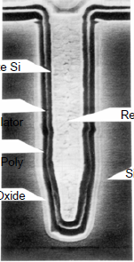

原图的材料标注包括Cell Plate Si、电容绝缘层、存储节点多晶硅、场氧化层、填充多晶硅和硅衬底；其作用是把电极、介质和周围隔离结构组合进垂直截面。

## 3. 为什么读操作会破坏电荷

读之前，Bitline 通常预充到约 $V_{DD}/2$。Wordline 打开后，单元电容与位线发生电荷共享，位线电压仅产生一个很小的正向或负向变化；Sense Amplifier 识别该变化，将其放大为完整逻辑电平，并把数据恢复到单元。

补充的理想电荷共享模型是：

$$
V_{\mathrm{share}}=
\frac{C_{BL}V_{DD}/2+C_{cell}V_{cell}}{C_{BL}+C_{cell}}.
$$

由于位线电容通常大于单元电容，共享后的电压接近中间值，不能把原电容电荷当作已被无损读取。课件第 17—19 页分别演示原状态为 1 和 0 的情况；“读后接近 1/2”是此过程的示意，不表示读出的数字必然错误。**感应放大和恢复是读过程的一部分**。

## 4. Row Buffer、恢复与周期刷新

Sense Amplifier 阵列也构成 Row Buffer。激活一行后，该行的数据暂存在放大器中，同一行内的列访问可以复用它，通常比重新激活另一行快。

需要区分：

| 操作 | 触发原因 | 作用 |
|---|---|---|
| 读后的恢复 | 电荷共享扰动了单元 | 把感应出的值写回原行 |
| 周期刷新 | 即使不访问，电荷也会泄漏 | 在保持时间限制内更新各行 |
| Precharge | 准备在同一 Bank 中打开别的行 | 关闭当前行并将位线恢复到预充状态 |

第 20 页给出一般示意值 **64 ms**，讲者备注又提及前课的 **8 ms**。这两个值不应合并成统一的器件规格：保持时间与器件、温度、刷新方式有关；全阵列刷新窗口、相邻刷新命令间隔和一次刷新占用时间也是不同量。应以所用芯片的数据手册为准。课件未交代 8 ms 所对应的器件条件，保留为待区分的来源差异。

[Kingston DDR3 模块数据手册](https://www.kingston.com/datasheets/KVR16N11_8.pdf)给出低于指定85°C温度条件下平均刷新间隔7.8µs、高温区间3.9µs的示例。若一个64ms窗口分成8192次刷新，则 $64\mathrm{ms}/8192=7.8125\mathrm{\mu s}$，可理解窗口与命令间隔的区别；这里不把刷新次数直接等同于芯片的物理行数。

## 5. MAT、Bank、Chip、Rank、Channel


- **MAT**：行译码选择 Wordline，列译码选择数据，局部 Sense Amps 连接数据通路。
- **Bank**：由多个 MAT 组成，有局部/全局字线、位线和感应放大等结构，是组织并行操作的重要单位。
- **Chip**：封装中的芯片/Die 包含多个 Bank 和外围 I/O。
- **Rank**：若干芯片在选中时共同提供完整数据总线宽度。例如不含 ECC 的 64-bit Rank 可以由八颗 x8 芯片组成；每颗贡献 8 bit。
- **DIMM**：物理内存模块，可以含一个或多个 Rank，不能把 DIMM、Rank 和 Chip 混为一谈。
- **Channel**：连接控制器与模块/Rank 的接口。一条 Channel 上可以有多个 Rank，但不会因此自动获得多个独立数据总线。

## 6. 为什么不做一个无限大的单元阵列

共享外围电路有利于面积效率，但过长的 Wordline/Bitline 会带来更大的电容、延迟、时序偏差、功耗和感应裕量问题。划分子阵列可以缩短局部连线、改善访问速度和功耗，但需要更多外围电路。

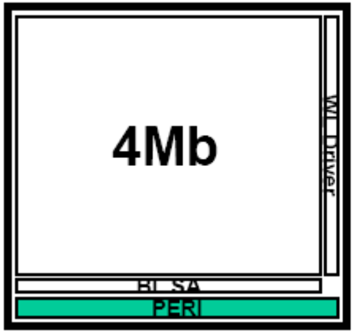
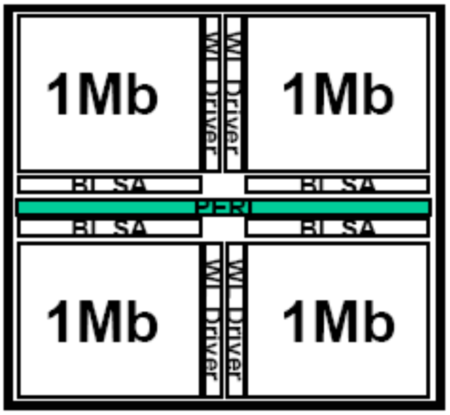

课件第 25 页用标称 **512 Mb** 的芯片举例：4 个 Bank，每 Bank 标 128 Mb；再标注 `26 × 30 MATs`、每 MAT `352 WL × 500 BL = 176,000 bit`。按这些图示数字直接相乘：

$$
4\times26\times30\times352\times500
=549{,}120{,}000\ \mathrm{bit}.
$$

它既不等于十进制 512 Mb，也不等于 $512\times2^{20}$ bit。该图可说明层次组成，**不能把其所有近似标注当作严格容量等式**。课件没有给出精确寻址阵列、冗余与外围布局的完整对应关系，不据此补造容量解释。

## 7. 异步 DRAM 到 DDR 的演进

| 接口 | 核心改进 | 仍存在的问题或边界 |
|---|---|---|
| 异步 DRAM | 用 RAS、CAS 选通信号指示行、列地址何时有效 | 基础示例中每次访问重复行列选择，接口时序需要明确约束 |
| Fast Page Mode | 保持同一行，连续送不同列地址 | 列地址捕获与数据输出仍较串行 |
| EDO | 在感应放大器与输出数据线间增加输出缓冲，使下一列捕获与前一数据输出重叠 | 这里的输出缓冲不同于 Row Buffer |
| Burst EDO | 对连续列使用计数/突发方式，减少逐个发送列地址 | 依赖访问模式与突发协议 |
| SDRAM | 引入时钟，按规定边沿采样命令与地址，定义同步时序 | 同步不等于每个命令只耗一个周期 |
| DDR SDRAM | 数据在时钟/数据选通信号的两个边沿传输 | 倍增的是数据接口传输机会，不是所有内部操作和命令都变成两倍 |

RAS 是 Row Address Strobe，CAS 是 Column Address Strobe；Strobe 是**选通信号**。早期命名继续出现在后来的时序参数中，不要将所有 DDR 的命令过程机械理解成早期独立 RAS/CAS 脉冲。

## 8. 芯片功能框图应当看什么

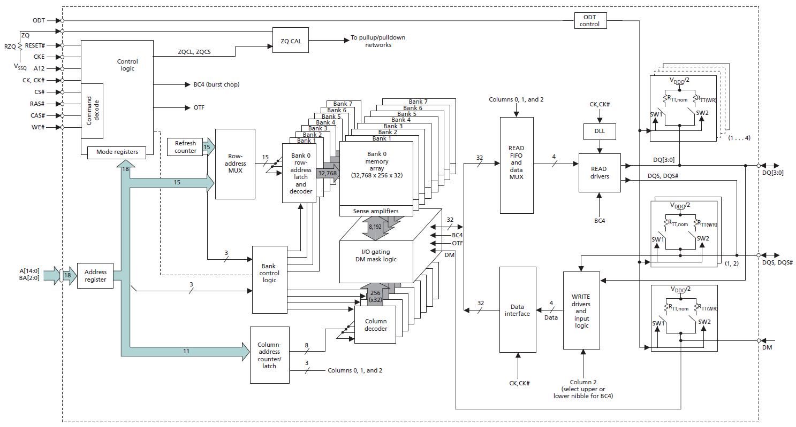

框图把此前的概念连接起来：多个 Bank、行译码与感应放大器、列地址计数器、I/O 缓冲、Refresh Counter、终端匹配及控制逻辑。Burst 模式可以让列计数器产生后续地址，不必每个数据都由控制器重新提供列地址。

`CKE` 控制相关时钟使能状态；`CS#` 用于片选/Rank 选择；命令译码结合地址与控制信号决定激活、读写、预充和刷新。`#` 表示低有效。具体引脚和命令编码须按器件代际理解。

## 9. ACTIVATE：打开一行

课件备注把激活过程分成五步：**Wordline 拉高 → 电荷共享 → 感应放大器检测 → 放大 → 数据恢复**。

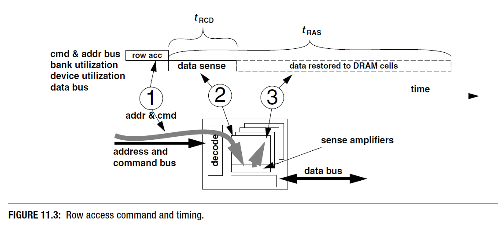

- $t_{RCD}$：发出行激活到允许相关列命令之间的最小间隔。
- $t_{RAS}$：该行激活后保持活动、完成必要恢复所需的最小时间；不能在它满足前随意预充。

命令总线、内部阵列和数据总线可以重叠工作，但每项操作都必须满足时序约束。因此“当前总线正在发送哪条命令”和“当前数据属于哪次请求”未必对应同一时间点。

## 10. READ、列流水线和突发传输

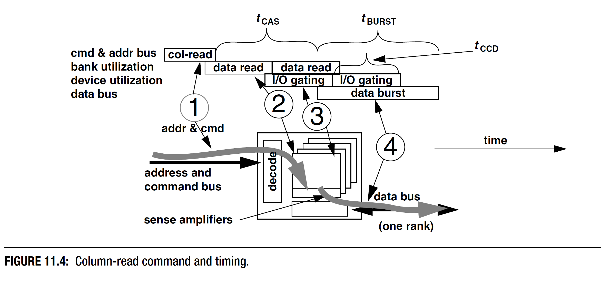

| 参数 | 含义 |
|---|---|
| $t_{CAS}$ / $t_{CL}$ | 从列读命令到首个返回数据之间的延迟 |
| $t_{CCD}$ | 连续列命令之间必须保持的最小间隔 |
| $t_{BURST}$ | 一次突发占用数据总线的持续时间 |

图中的 `data read → I/O gating → data burst` 说明内部数据搬运与外部传输。一次 READ 可能返回多个 beat；图中背靠背的内部方块不意味着每个方块都一定对应一条新的外部命令。Burst 长度、内部预取和 Bank/Bank Group 的约束必须结合器件手册判断。

**首次数据延迟与持续带宽不同**：流水线可以每隔较短间隔产生下一批数据，而单次请求从命令到首个数据仍需更长时间。

## 11. PRECHARGE、行周期与完整读取

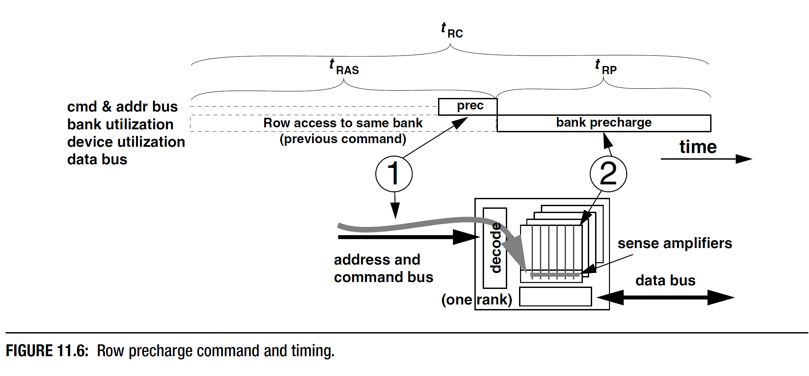

$t_{RP}$ 是预充所需的最小间隔；课件采用：

$$
t_{RC}=t_{RAS}+t_{RP}.
$$

它表达同一 Bank 的完整行周期约束。实际排程还必须满足读写恢复、总线转换及其他时序要求。

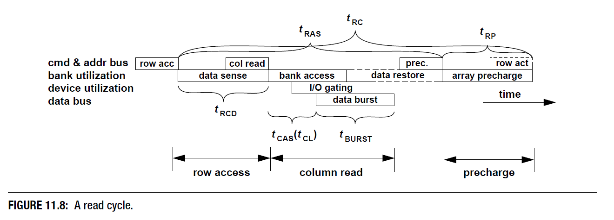

区分三种访问情况：

| 到达时的 Bank 状态 | 首个数据前的主要过程 |
|---|---|
| 目标行已打开，Row Hit | READ → 等待 CL |
| Bank 已预充，Row Empty | ACT → 等待 RCD → READ → 等待 CL |
| 打开的是另一行，Row Conflict | 满足原行关闭条件 → PRE → 等待 RP → ACT → 等待 RCD → READ → 等待 CL |

忽略排队、命令总线竞争和尚未满足的其他约束，若示意取 RCD、CL、RP 都为 15 ns，Burst 为 5 ns，则传完整批数据分别约需 **20、35、50 ns**。这是补充算例，不是某款内存的规格，也不能用于绕过 tRAS、tWR 等约束。

## 12. 其他时序参数与初始化

课件第 42 页引用 Bruce Jacob 等《Memory Systems: Cache, DRAM, Disk》的参数表，除上述参数还包括：

| 参数 | 所限制的事件 |
|---|---|
| $t_{AL}$ | Posted CAS 使用的附加列访问延迟 |
| $t_{CMD}$ | 命令在命令总线上的传输占用 |
| $t_{CWD}$ | 写命令到写数据出现的间隔 |
| $t_{FAW}$ | 滚动窗口内最多允许若干次行激活，限制瞬时电流；表中为四次激活窗口 |
| $t_{OST}$ | 终端匹配控制在 Rank 间切换的时间 |
| $t_{RFC}$ | 刷新命令执行后到允许后续相关操作的恢复时间 |
| $t_{RRD}$ | 不同行激活命令之间的最小间隔 |
| $t_{RTP}$ | READ 到 PRECHARGE 的最小间隔 |
| $t_{RTRS}$ | Rank 间切换所需间隔；适用范围随接口不同 |
| $t_{WR}$ | 写数据突发结束后到允许预充的写恢复时间 |
| $t_{WTR}$ | 写后转读所需间隔 |

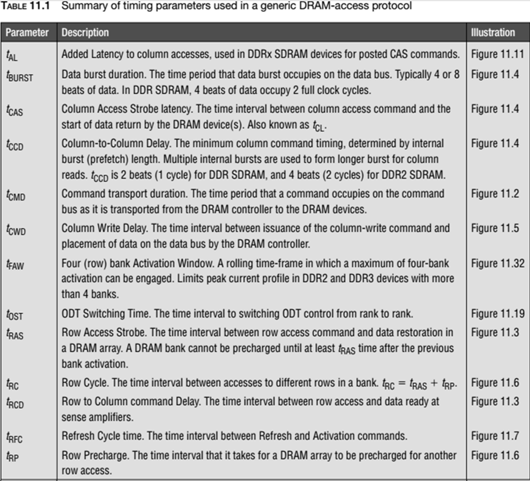
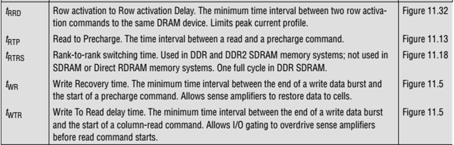

这些是不同事件间的约束，不是可以全部相加的一串独立延迟。初始化还涉及模式寄存器设置、校准和训练等过程。讲者备注提及启动时使用 NOR Flash：在 DRAM 尚未可用时，固件需依赖其他可用存储和执行环境；具体启动链与系统实现有关。

## 13. 增加容量：堆叠与共享 Channel

课件展示 Die-on-Die、PCB-on-PCB 等堆叠方式，以提高相同面积或模块条件下的容量。另一条路线是在一条 Channel 上连接更多 DIMM，减少对处理器引脚数量的要求。

但容量扩展增加了电气负载。第 46 页假设一条 Channel 上有 3 个 DIMM，每个对应 8 颗 x8 芯片：一根数据线面对约 3 个芯片负载，而广播的地址/命令线面对 **$3\times8=24$** 个芯片负载。该计数依赖这个示例组织，不是所有模块的普遍值。

更多负载电容会使信号衰减、边沿变缓；不同距离又增加到达时间差。因此“插更多内存条”不只是容量加法。

## 14. RDIMM、FB-DIMM 与 LRDIMM

| 方案 | 课件强调的结构 | 收益与代价 |
|---|---|---|
| RDIMM | 在地址/命令路径增加寄存/缓冲再分发 | 减少控制器直接驱动的负载，增加相应缓冲延迟 |
| FB-DIMM | AMB 同时处理数据和地址/命令，模块通过缓冲链路连接 | 提高可扩展性，但 AMB 功耗、温度和散热成本较高 |
| LRDIMM | 对信号、特别是数据路径做负载隔离 | 降低控制器看到的负载；不是不含任何控制逻辑的被动元件 |

第 102 页所说 LRDIMM “without additional control logic” 是相对 FB-DIMM 的 AMB 结构进行的简化比较，不能解释成 LRDIMM 完全没有寄存/控制器件。上述不同缓冲思想也不能与芯片内部 Row Buffer 混为一谈。

## 15. 控制器放在片外还是片内

旧式片外 MC 常位于北桥，CPU 经 FSB 与其通信。优点是处理器和内存控制器实现较解耦；代价包括互连延迟和 FSB 带宽限制。课件给出 `128-bit、100 MHz` 的教学总线示意。

集成 MC 减少 CPU 到控制器的互连开销，并更紧密地管理内存访问；同时内存接口兼容性与 CPU/平台设计绑定。课件“可按 CPU 速度运行”强调减少 FSB 限制，**不表示 MC、DRAM 与 CPU 核心必须采用相同的时钟频率**。

## 16. MC 的六阶段职责

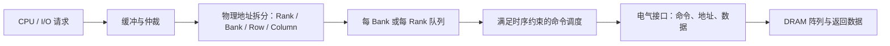

事务调度决定先服务哪个请求；命令调度将事务拆成 ACT、READ/WRITE、PRE 等合法序列。地址映射、请求队列和信号接口共同决定最终性能。

PCB 上的蛇形走线用于控制相关信号的传播时间差，课件以“等长”解释。工程上控制的是各信号组允许的 skew，结合走线环境和训练进行设计，并不是要求系统中所有线一律具有完全相同的物理长度。

## 17. Open-page 与 Closed-page

访问有行局部性时，Open-page 保持当前行打开，后续同一行的列访问命中 Row Buffer。若下一个请求属于另一行，就需先关闭原行，Precharge 进入关键路径。

Closed-page 较早关闭行、准备下次激活，适合较弱行局部性的访问，但可能错失后续行命中。Row Buffer Miss 还要区分“没有行打开”和“打开的是错误的行”，不能把每个 Miss 都视为相同的冲突代价。

## 18. Bank-level Parallelism 不等于多条数据总线

不同 Bank 可以把内部预充、激活和列访问交错起来。例如 Bank 0 在外部传数据时，控制器可以为 Bank 1 准备下一次访问，从而隐藏部分内部等待。

同一 Channel 的相关 Bank 仍共享外部引脚，不能同时把多份数据任意叠加到同一数据总线上。调度还受 tRRD、tFAW、总线转换和刷新等全局或局部约束；“Bank 独立”并非完全没有相互限制。

## 19. 物理地址如何变成 DRAM 位置

第 67 页使用 RaBaRoCo，即从高到低依次安排 Rank、Bank、Row、Column。图中的 32-bit 示例是：

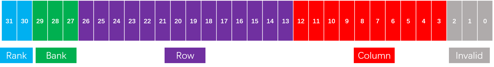

| 位段 | 宽度 | 含义 |
|---|---:|---|
| `[31:30]` | 2 | Rank：4 个 |
| `[29:27]` | 3 | Bank：每 Rank 8 个 |
| `[26:13]` | 14 | Row：每 Bank 16384 行 |
| `[12:3]` | 10 | Column：每行 1024 个数据位置 |
| `[2:0]` | 3 | 64-bit 数据单位内的字节偏移 |

最后三位被图标为 `Invalid`，并非物理地址真的无效，而是在以 8 B 为单位选择 DRAM 列时不参与 Rank/Bank/行/列选择，仍可用于字节定位。该组织容量为：

$$
4\times8\times2^{14}\times2^{10}\times8\ \mathrm B=2^{32}\ \mathrm B=4\ \mathrm{GiB}.
$$

例如地址 `0xABCDEF18` 拆成 Rank=2、Bank=5、Row=7791、Column=483、Byte offset=0。映射方式改变哪些访问成为 Row Hit、哪些请求分布到不同 Bank，因此也改变局部性与并行性。

## 20. 最优地址映射与访问图

课件序列为：

```text
0, 1, 2, 3, 4, 5, 6, 7, 0, 4, 1, 5, 2, 6, 3, 7
```

可把应用访问的地址集合记为 $V$，访问序列记为 $S$，构建访问图 $G_S$，用边及权重表达访问关系。课件要求分配到 $R$ 个集合，满足：

$$
V=V_1\cup\cdots\cup V_R,\qquad |V_i|\le C.
$$

相应的 **minimum C-bounded R-cut** 是 NP-hard 问题。图说明寻找利用访问关系的最优分区并不简单；课件没有展开精确求解器和完整代价函数，不能把该问题名称当作现成的地址映射实现。

原图给出的构图算法是：对非空序列，先取顶点集 $V=\{s_1\}$、边集为空；依次加入 $s_i$，再加入连接 $s_{i-1}$ 与 $s_i$ 的边。结果是多重图；也可以将重复边合并为相应访问转移次数的权重。

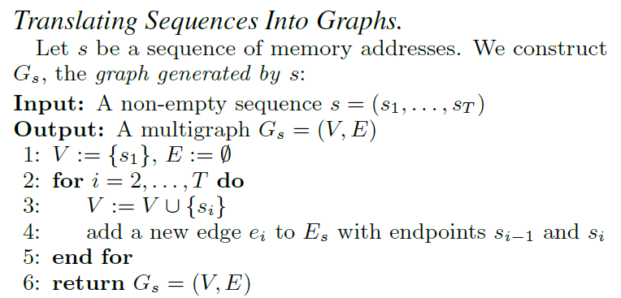

## 21. BIM：用可逆二进制变换实现一一映射

**Binary Invertible Matrix** 用二进制可逆矩阵变换地址位。补充写法为：

$$
\boldsymbol y=M\boldsymbol x\pmod2.
$$

矩阵在 GF(2) 上可逆，才保证不同输入地址不会被这种变换本身合并。随后从变换后的位中取出 Bank、Row、Column。课件比较 Bank-Row-Column、Row-Bank-Column、位反转和置换映射，目的是在局部性与并行性之间选择不同的位分布。

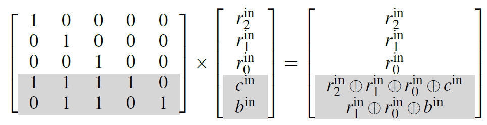

图中的五位例子保留三个位 $r_2,r_1,r_0$，将另外两位变成 $c'=r_2\oplus r_1\oplus r_0\oplus c$、$b'=r_1\oplus r_0\oplus b$。因为保留了各行位，可以反向异或恢复原来的 $c,b$，所以是可逆变换。

## 22. 基于熵的映射

对某地址位，设观察窗口内 1 出现的比例为 $p$，其二元 Shannon 熵为：

$$
H(p)=-p\log_2p-(1-p)\log_2(1-p).
$$

课件的启发式是：变化较少、低熵的位倾向用于 Row，以利用行局部性；高熵位倾向用于 Bank，使请求更分散、提高并行性。备注引用 ISCA 2018 的 *Get Out of the Valley: Power-Efficient Address Mapping for GPUs*。

单个位的边际熵不能完整描述时间顺序和位间相关性，因此该规则不是对所有工作负载都最优的证明。映射评价还要结合 Row Hit、Bank 冲突、带宽、功耗和实际访问轨迹。

## 23. 内存调度的三条原则

课件第 71—73 页递进给出：

1. 优先 Row-buffer Hit，利用已打开行，提高内存带宽；引用 Rixner 等 ISCA 2000。
2. 优先延迟敏感的应用，减少其关键等待，提高系统总体吞吐；引用 Kim 等 HPCA 2010。
3. 保证没有应用长期饥饿，约束不公平性；引用 Mutlu 等 MICRO 2007。

第一条不能被实现成“只要一直有行命中就永不服务其他请求”。局部命中率、吞吐、尾延迟和公平性是不同目标，需要优先级、老化或配额等策略折中。

## 24. 多通道、Lock-step 与独立控制

一条 Channel 上可以有多个 DIMM/Rank，共享命令和数据资源，只有选中的 Rank 响应。“DIMMs in series”是课件的连接示意，不表示普通 DIMM 的数据必然经每个模块串行转发。

| 方案 | 两条 64-bit 通道如何使用 | 特点 |
|---|---|---|
| Lock-step | 作为更宽的 128-bit 接口协同访问 | 宽请求共同调度，行为更耦合 |
| Independent | 各自控制和调度 | 可以并发服务不同请求，需要相应独立控制资源 |

理论总位宽相同不表示排队行为、并发粒度和应用性能相同。课件用同色插槽示意双通道安装；实际插槽分组须以主板手册为准，颜色不是普遍规范。

## 25. 多 CPU 与 NUMA

共享片外控制器的旧式示例中，多 CPU 竞争相同内存资源，容量和带宽难随 CPU 数量增长。分布式集成 MC 让每个 CPU 拥有本地内存通道，使总容量和带宽更易扩展，但引入 **Non-uniform Memory Access**。

访问本地 CPU 连接的内存通常少一次跨 CPU 通信；访问远端内存需经过互连，课件使用 Intel UPI 示意。UPI 是特定平台互连，不是所有 NUMA 系统的通用协议。程序的线程放置、数据首次触碰和内存亲和性因此会影响性能。

## 26. 核心频率、I/O 时钟、MT/s 与 Prefetch

主存可分成单元阵列和 I/O 缓冲。电容和阵列操作的物理约束使内部核心频率难以无限提高；预取结构用较宽的内部数据搬运，配合外部串行化，提高引脚传输率。

课件第 83—84 页以 133 MHz SDR 示意：每根数据线约 133 Mbit/s；若总数据宽度 64 bit，则理论峰值约 **1.064 GB/s**，而非整条总线只有 133 Mbit/s。

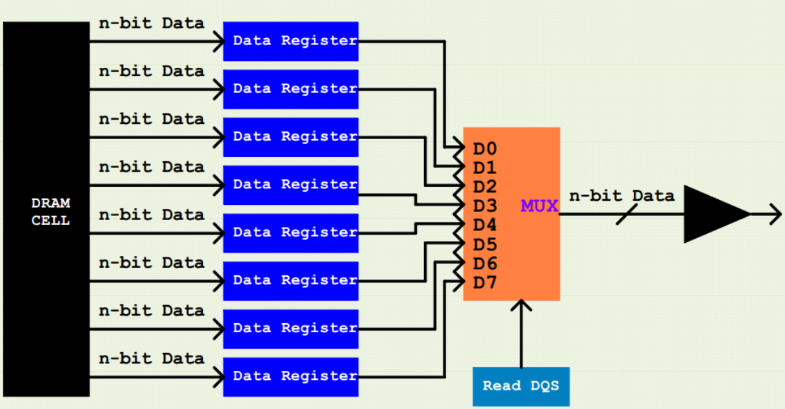

以阵列侧 200 MHz、单个外部数据单位宽度为 $W$ 的简化模型为例：

| 结构 | 一次内部预取宽度 | 外部 CK 示例 | 每引脚数据率 |
|---|---:|---:|---:|
| DDR，2n-prefetch | $2W$ | 200 MHz | 400 MT/s |
| DDR2，4n-prefetch | $4W$ | 400 MHz | 800 MT/s |
| DDR3，8n-prefetch | $8W$ | 800 MHz | 1600 MT/s |

课件第 86 页的 400/800/1600 标成 MHz，按图中预取关系应理解为上述**有效传输率**；不能同时将这些数当作 CK 频率再乘二。第 87 页“外部总线比内部宽”的文字也与并行预取原理方向相反：阵列侧一次提供更多数据，外部在多个边沿分批传输。

对于 64-bit、1600 MT/s 的示意接口：

$$
B_{\mathrm{peak}}=1600\times10^6\times64/8
=12.8\times10^9\ \mathrm{B/s}=12.8\ \mathrm{GB/s}.
$$

这是理想数据引脚带宽，尚未扣除命令、刷新、行切换等损失。Burst 长度为 BL 时，DDR 数据突发占用约 BL/2 个 CK 周期。

## 27. 高速接口挑战一：功耗与模块不兼容

动态功耗的补充近似式为 $P_{dyn}\approx\alpha C V^2f$。提高工作频率、驱动更多电容负载会增加功耗；降低电压是重要方向，但还需考虑保持时间、噪声裕量、泄漏和时序条件。

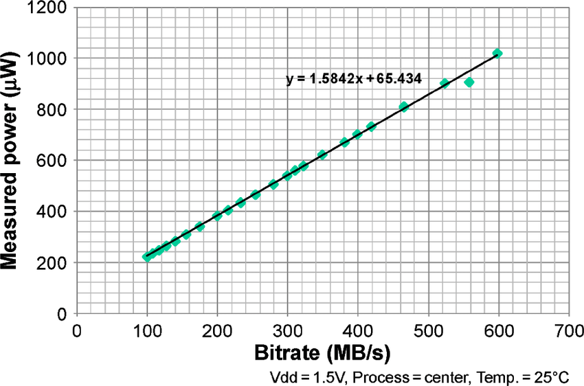

该图在Vdd=1.5V、工艺center、25°C条件下给出拟合 $P(\mathrm{mW})=1.5842R(\mathrm{MB/s})+65.434$。这是该测量范围的经验直线，不是可以跨代际、跨电压任意外推的通用功耗公式。

不同代际模块使用不同电压、缺口和电气定义，不能仅凭“都能插入一条内存”判断兼容性。课件第 91 页针对桌面长 DIMM 的针脚比较，应为：DDR 184、DDR2 240、DDR3 240、**DDR4 288**。原文 DDR4 的 `284` 是笔误；SO-DIMM 等外形的针脚数另算。[Kingston 官方说明](https://www.kingston.com/unitedkingdom/en/memory/ddr4-overview)明确给出 DDR4 长 DIMM 的 288-pin。

第 88 页把 DDR5 2020/6400 MT/s 标为预计值，是原素材的历史快照，不作为当前所有 DDR5 产品的上限。

## 28. 高速接口挑战二：Skew 与 DQS

Skew 是相关信号边沿的时间偏移。数据率越高，一个 bit 的有效时间窗口越短，相同传播差异造成的相对影响越大。

源同步接口让发送端同时提供数据 DQ 和数据选通信号 DQS，使接收端依据与数据共同传播的参考进行采样，而不是只依赖远处的中央时钟。读时的数据发送方是 DRAM，写时是控制器；具体接口还需要训练、延迟调整和规定的时序裕量。

## 29. 高速接口挑战三、四：反射、噪声与拓扑

传输线上的阻抗不连续和末端反射可能使前一个信号返回并干扰后续数据。Termination 通过阻抗匹配降低反射。第 95 页的 `terminator (register)` 应理解为终端匹配电阻/阻抗网络，**不是数据寄存器**；主板、模块或芯片片上终端匹配均是可能的实现位置。

反射、Skew、串扰和其他噪声会缩小数据采样窗口。课件的 DDR1 波形说明低速接口也可能存在明显噪声，不能认为某一代际天然没有信号完整性问题。

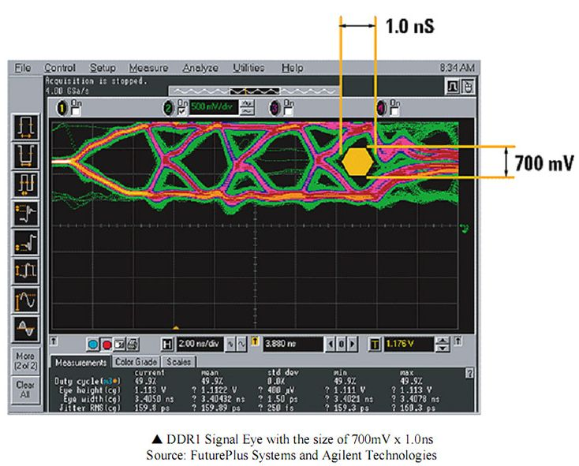

图中眼图标出约1.0ns眼宽、700mV眼高，属于这一次波形的读图数据；眼图用于观察采样的时间和电压裕量。

拓扑也影响可预测性：课件以 DDR2 对称 T 分支与 DDR3 Fly-by 作比较。T 分支尝试使各器件路径对称；Fly-by 简化走线、减少分支，使不同器件的传播延迟更规律，再结合训练进行补偿。Fly-by 并不是让所有器件同时收到完全同相的边沿。

## 30. 把一次访问连成完整数据流

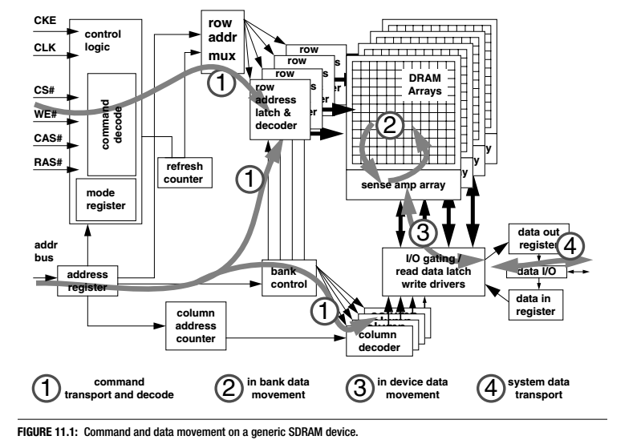

图中四个编号分别表示：

1. **命令传输与译码**：控制信号、地址寄存器、行/列地址和 Bank 控制确定目标操作。
2. **Bank 内数据搬运**：单元阵列与 Sense Amplifier 交换数据，完成感应和恢复。
3. **器件内数据搬运**：列译码、I/O gating、读数据锁存与写驱动连接阵列和数据寄存器。
4. **系统数据传输**：通过数据 I/O 把数据送到或接收自控制器。

读请求中的一次 Cache Miss，背后可能同时受命令排队、行状态、内部阵列操作、数据引脚和其他请求影响。解题时先写组织和地址映射，再判断行状态与可并行资源，最后应用相应时序约束；不能仅以“DRAM 比 SRAM 慢”代替过程分析。
