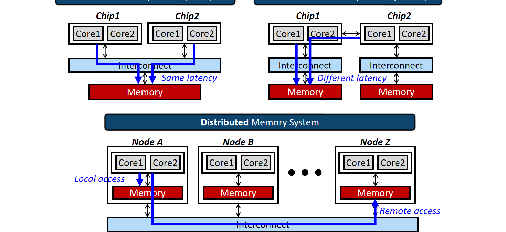
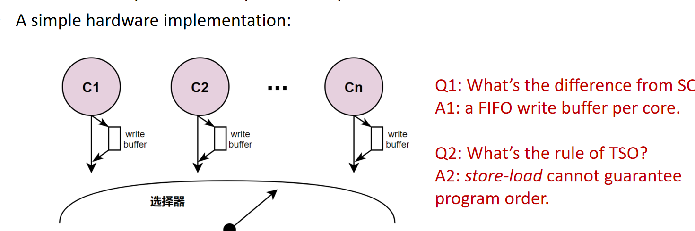
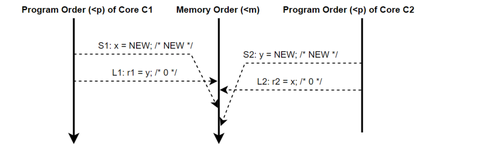
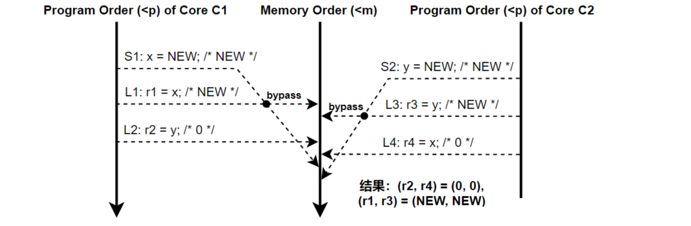
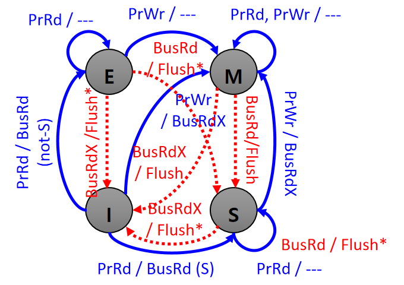
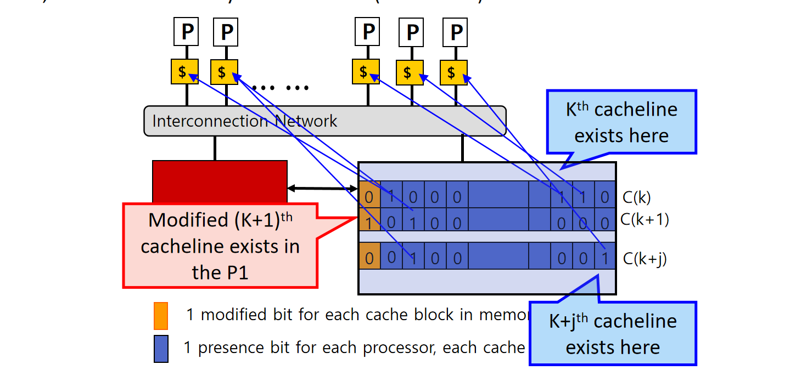
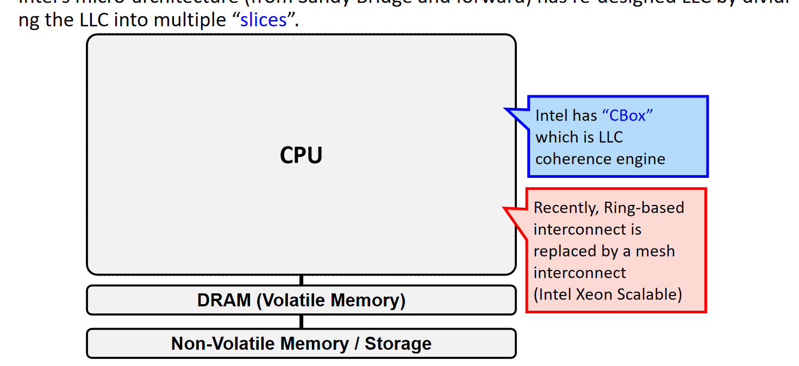
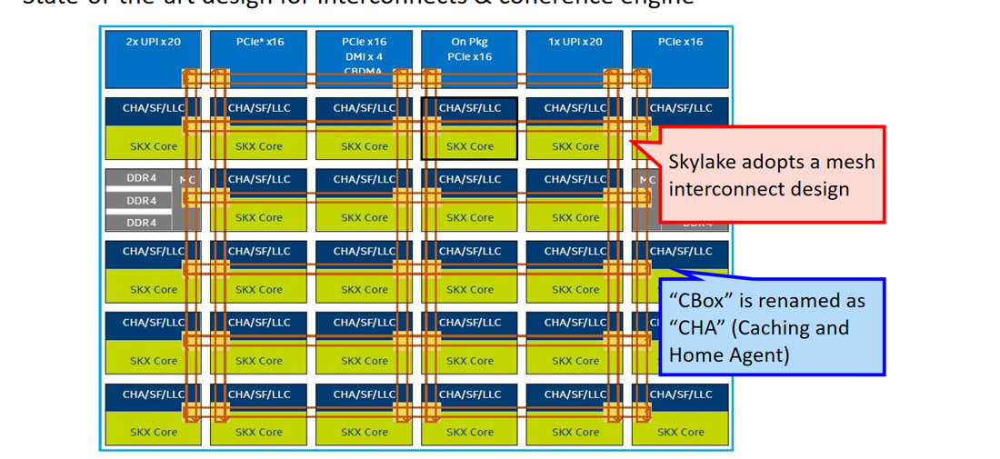

# 第 8 讲：多处理器、内存一致性与 Cache 一致性

> 来源：教学网 Lecture-8，共 83 页，Jie Zhang，改编自 KAIST Myoungsoo Jung 的 EE488。页码均指 PPT 实际页序，合并动画重复页。承接[第六讲 Cache](./06-Cache与存储层次.md)与[第七讲 DRAM](./07-DRAM与内存系统.md)。来源指纹、覆盖范围和勘误见[核对记录](./SOURCES-2026-11-lecture8.md)。

## 1. 并行计算与 Flynn 分类（第 2—17 页）

串行模型把程序拆成有序指令；并行计算把可并行的部分分配给多个计算资源。课件“任何时刻只执行一条指令”是串行抽象，不应理解为现代单核内部不能流水、超标量或乱序执行。单线程的指令级并行与多核执行多个线程也不是同一层次。

Flynn 按**指令流数量、数据流数量**分成四类：

| 类别 | 指令流 | 数据流 | 理解 |
|---|---|---|---|
| SISD | 单 | 单 | 传统顺序程序的执行抽象 |
| SIMD | 单 | 多 | 相同操作作用于多个数据元素，适合规则数据并行 |
| MISD | 多 | 单 | 多条指令流处理同一数据流，实际分类实例较少 |
| MIMD | 多 | 多 | 多核各自运行指令流和数据流，本讲重点 |

一个现代 CPU 可以同时具有 MIMD 多核和 SIMD 向量指令。GPU 的 SIMT 将线程组织成执行组，不应简单认为所有线程始终执行相同指令、没有分支分歧。课件列举的历史机器用于说明分类，不作为每一款产品全部微结构的定义；特别是把 C.mmp 列为 MISD 不宜作为确定考据，其多处理器组织通常按 MIMD 理解。

## 2. UMA、NUMA 与分布式内存（第 18 页）

- **UMA**：共享内存组织中，各处理器访问相同层级主存的名义延迟近似均匀；实际延迟仍受 Cache、排队、竞争影响。
- **NUMA**：共享地址空间，但内存分布在不同节点。本地与远端内存访问代价不同。NUMA 不等于软件只能通过显式消息访问远端数据。
- **分布式内存系统**：各节点拥有本地内存，通过互连通信。是否向程序提供统一共享地址空间，需要区分具体系统。
- **ccNUMA / 分布式共享内存**：物理分布与逻辑共享可以共存；目录协议负责跨节点 Cache 一致性。

“内存共享”不保证“访问同样快”，也不保证“所有处理器立即看到每次写入”。

## 3. Coherence 与 Consistency：两个不同的问题（第 19—26 页）

| 概念 | 关注对象 | 要回答的问题 |
|---|---|---|
| Cache coherence，Cache 一致性 | 同一位置及其 Cache 行副本 | 多个核如何就该位置写入顺序和最新合法值达成一致？ |
| Memory consistency，内存一致性模型 | 所有位置的读写与程序顺序 | 跨地址的访问可以怎样重排，某组读取结果是否合法？ |

Cache 行是常见的协议管理单位，而程序的值通常以字节或字为访问单位。保证每条 Cache 行的副本一致，不自动提供跨行访问的顺序一致性。

**写穿也会有一致性问题**：P1 把 X 从 -100 写成 505，即使内存立即更新，P2 的 Cache 仍可能保存 -100。写回更进一步：内存也可能暂时是旧值，最新值在某个核的脏行中。因此“每次未命中都直接读主存”并不总能读到应有数据。

### 例 1：先数据、后标志

初始 A=0、Flag=0：

~~~text
P1                     P2
A = 1                  while (Flag == 0) {}
Flag = 1               print A
~~~

在 SC 的抽象中，如果 P2 已读到 Flag=1，随后 A 应为 1；弱序系统若没有适当同步，不能仅凭源代码顺序推出这个结果。真实 C/C++ 中应使用适当原子操作和 release/acquire 等同步，不能把有数据竞争的普通变量程序直接当成硬件 litmus test。

### 例 2：两个地址

初始 A=B=0，P1 依次写 A=1、B=1；P2 依次读 B、A。在 SC 下，P2 若先看到 B=1，后读 A 不能为 0。推理链为：

$$
W(A{=}1)<W(B{=}1)<R(B{=}1)<R(A).
$$

不能把这个结论无条件套到任何弱序机器与任意语言程序。

### 例 3：传播链

P1 写 A=1；P2 看到 A=1 后写 B=1；P3 看到 B=1 后读 A。课件用环形互连说明写入传播时间不同可能导致直觉失效。在 SC 下此时 A 必须为 1；在更弱的传播和排序模型下，要结合具体屏障与模型判断。**“有物理传播延迟”本身并不意味着实现允许违反其承诺的内存模型**。

课件还用同一 A 的两次写 A=1、A=2 与两个观察者说明：不能让不同观察者把同一组写看成互相矛盾的先后次序，例如一个依次读 1、2，另一个依次读 2、1（排除其他写及不适用的访问条件）。

## 4. SC：保持各核程序顺序的全局交错（第 27—29 页）

顺序一致性 SC 要求：执行结果等价于所有处理器操作的某个单一顺序；该顺序保留每个处理器内部的程序顺序。可想象一个开关，每次挑一个核的下一次访存送到共享内存。

这不是要求硬件内部完全不推测、不重排，而是要求**可观察结果**满足该顺序模型。

若模型 A 允许的行为集合是模型 B 的子集，则 A 更强；“更强”是对行为的约束更多，不是速度更快。

### Store Buffering 例题

初始 x=y=0，NEW 是不同于 0 的新值：

~~~text
C1                     C2
S1: x = NEW            S2: y = NEW
L1: r1 = y             L2: r2 = x
~~~

SC 允许 (r1,r2) 为 (NEW,NEW)、(0,NEW)、(NEW,0)，不允许 (0,0)。证明：若两次都读 0，则必须有

$$
S1<L1<S2<L2<S1,
$$

形成顺序环。这里 S1<L1、S2<L2 来自程序顺序；L1<S2、L2<S1 来自读取旧值。课件第 28 页示意图应按这一约束理解，不能只凭箭头位置猜读取结果。

## 5. TSO：FIFO Store Buffer 与转发（第 30—35 页）

TSO 的教学模型为每核增加 FIFO Store Buffer：

1. Store 可先进入本核缓冲，稍后进入全局可见的内存顺序。
2. 同核 Store 保持 FIFO 顺序。
3. 后续对不同地址的 Load 可以先读取，而较早的 Store 尚未对其他核可见。
4. Load 若命中本核尚未排空的同地址 Store，可通过 **store-to-load forwarding** 得到本核最新写值。

| 原程序先后 | SC | 课件 TSO 抽象 |
|---|---|---|
| Load → Load | 保持 | 保持 |
| Load → Store | 保持 | 保持 |
| Store → Store | 保持 | 保持 |
| Store → Load | 保持 | 对不同地址可放松 |
| RMW / 完整屏障相关顺序 | 按模型保证 | 课件以强约束表示，真实 ISA 要检查指令语义 |

这里的“重排”是可观察顺序的模型描述，不一定指流水线真的把两条机器指令交换了位置。

### 例 4：为什么 TSO 允许双方读 0

前述 C1、C2 各自把写送入自己的缓冲，然后在对方的写尚未全局可见时读另一个地址，因此 (r1,r2)=(0,0) 合法。其他三种组合也可能出现。不能由 FIFO 推出 Store→Load 必然保持；FIFO 首先约束的是缓冲中的 Store 顺序。

### 例 5：本核读新值，别核仍读旧值

~~~text
C1                      C2
x = NEW                 y = NEW
r1 = x                  r3 = y
r2 = y                  r4 = x
~~~

课件第 32 页结果为：

$$
(r1,r3)=(NEW,NEW),\qquad(r2,r4)=(0,0).
$$

r1、r3 可以通过本核写缓冲转发获得新值；r2、r4 读取另一个核尚未排空的写，因此仍可为 0。**本核读到自己的新值，不表示这个写已全局可见**。

## 6. 更弱模型与同步边界（第 33 页）

| 模型 | 课件概括 | 使用时的注意点 |
|---|---|---|
| PSO | 在 TSO 基础上还可放松不同地址 Store→Store | 发布数据和标志时尤其要关注写写顺序 |
| RMO | 进一步放松多类访存顺序 | 不是完全没有地址依赖、原子性与同步规则 |
| Weak Consistency | 以同步操作建立所需一致性 | “同步之间可重排”不等于可以任意产生值 |

Fence 的作用是建立规定范围的前后访问顺序，而不是一个普遍的“立即清空所有缓存”指令。不同 ISA 的 Fence 可约束不同访问类型，程序语言原子内存序与硬件指令之间还隔着编译器映射。

## 7. 写穿 Cache 的监听协议（第 36—42 页）

Bus snooper 监听其他核在互连上的一致性事务，并据此更新本地行状态。最简单的写穿示意使用 V/I：

- V：副本有效，可服务本地读。
- I：副本不可用于读取；**不表示数据位一定与内存不同**，也可能从未装入或已经被替换。
- 一个核写 Hi→Bye，同时更新内存；其他命中该行的监听器使自己的行无效。
- 另一个核随后读该行时发生未命中，从当前有效的数据来源重新获得 Bye，状态回到 V。

写穿解决内存更新路径，不会自动解决其他 Cache 的旧副本。写失效与写更新是两种不同策略；本例采用失效。

## 8. MESI 状态与事务（第 43—46、62 页）

| 状态 | 含义 | 其他核能否持有有效副本 | 内存是否最新 |
|---|---|---|---|
| M：Modified | 本核持有可写的脏行 | 本讲 MESI 稳态中不能 | 不保证 |
| E：Exclusive | 本核独占的干净行 | 不能 | 是 |
| S：Shared | 干净、可共享的行 | 可以，但不保证确实还有别的副本 | 是 |
| I：Invalid | 无有效副本 | 不限制其他核 | 本核不能据此判断 |

重要不变量：单写者或多读者。M/E 的独占性使本核获得权限；S 状态下不能不通知其他核便直接写。

| 记号 | 含义 |
|---|---|
| PrRd / PrWr | 本地处理器发起读 / 写 |
| BusRd | 读缺失，获取数据并检测其他副本 |
| BusRdX | 读并取得独占写权限，其他副本失效 |
| BusWB | 脏块被替换等原因触发的写回 |
| Flush | 本讲约定：把数据送上总线，请求者与内存接收 |
| Flush* | 本讲约定：指定供应者送数据，请求者接收，内存无需更新 |

图中蓝色为本核事件，红色为监听到的其他核事务。现实协议还需要请求中、等待确认等瞬态状态；四个字母不是完整实现的全部状态。

## 9. MESI：本核事件完整表（第 47—54 页）

| 原状态 | 本核读 PrRd | 本核写 PrWr |
|---|---|---|
| I | 发 BusRd；无其他副本→E，有其他副本→S | 发 BusRdX，取得数据与独占权限→M |
| E | 本地命中，仍 E | 本地修改→M，无需总线失效 |
| S | 本地命中，仍 S | 让其他副本失效，获得写权限→M |
| M | 本地命中，仍 M | 本地更新，仍 M |

本讲用 BusRdX 表示 S→M。实现可以用 **BusUpgr / upgrade** 只请求失效与权限，不重传已经持有的数据；这属于实现优化，不能因此删掉课件的 BusRdX 记法。

E 的价值正在于“读后只由自己写”的常见模式：首次读确认没有其他副本后处于 E，随后 E→M 不必再广播。只有 I→M 或 S→M 才需要向外取得写权限。

## 10. MESI：监听其他核事件（第 55—60 页）

| 本核原状态 | 监听 BusRd | 监听 BusRdX |
|---|---|---|
| I | 无有效副本可供，不变 | 不变 |
| S | 仍 S；按供应仲裁可 Flush* | →I；按协议供应数据 |
| E | →S，课件用 Flush* 供数 | →I，课件用 Flush* |
| M | →S；Flush 最新值，内存和请求者获得它 | →I；Flush 最新值，写权限转交请求者 |

当 M 持有者响应另一个读者时，不能让请求者使用陈旧内存值。这里的 MESI 教学路径将最新值写回内存，双方成为干净 S；MOESI 则允许下文的脏共享。

多个 S 持有者不应都不加仲裁地驱动同一总线。Flush* 的“供应者”有选择机制；图示状态转换不意味着全部共享者同时复制同一数据响应。

干净的 E/S 被替换通常不必写回数据；M 被替换必须保证最新数据移交给协议规定的数据来源。S 不一定自动变 E：其他共享者静默丢弃后，本核未必知道自己已是唯一持有者。

### 例 6：手工跟踪两个核

假设 X 初值 0，开始两个 Cache 都 I；采用本讲 MESI 写回路径：

| 步骤 | 操作 | P1 | P2 | 内存 X | 原因 |
|---|---|---|---|---:|---|
| 1 | P1 读 X | E,0 | I | 0 | BusRd 无其他副本 |
| 2 | P1 写 X=1 | M,1 | I | 0 | E→M 静默写 |
| 3 | P2 读 X | S,1 | S,1 | 1 | P1 Flush 后降级 |
| 4 | P2 写 X=2 | I | M,2 | 1 | P1 失效，P2 独占 |
| 5 | P1 读 X | S,2 | S,2 | 2 | P2 Flush 后降级 |

这是依据课件转换规则展开的复习算例，不是新增的硬件实验数据。

## 11. MEI、MSI、MOESI、MESIF（第 63—66 页）

| 协议变化 | 要解决/造成的差异 |
|---|---|
| MEI 不含 S | 无法按 S 状态共同保留读副本；课件中另一个核读会使旧持有者失效，读共享通信增多 |
| MSI 不含 E | 即使首次读只有自己，也记 S；随后写需发失效/升级请求，不能利用 E→M 静默写 |
| MOESI 增加 O | M 被别核读时可→O，自己负责脏数据，读者得到 S；内存可继续过期 |
| MESIF 增加 F | 在干净共享者中指定转发者，减少多份重复响应与供应选择开销 |

**O 与 F 不同**：O 管理脏数据责任，内存可能旧；F 是干净共享数据的指定供应者。课件第 65 页 M→O 图上的“BusRd/--”应理解为不需写回主存，不能理解成无需向请求者传输数据。

课件以 AMD Opteron/UltraSPARC、Intel Nehalem 等作历史例子，不把协议名认作厂商所有产品的终身规格。第 64 页“MSI — RISC-V”只宜看作某类实现示例：RISC-V 是 ISA，**不强制所有微架构使用 MSI**。

## 12. 多级 Cache 与 Snoop Filter（第 67 页）

若每个外部请求都检查每一级私有 Cache，会增加查询和能耗。Snoop filter 用目录/包含信息判断哪些地方可能持有副本，避免无意义广播。

课件示例使用 L2 包含 L1：L2 驱逐某行时需要反向使 L1 对应行失效，否则不能再根据 L2 缺席推出 L1 缺席。

需要区分：

- **包含的是地址集合**，不一定要求每一级数据位时刻完全相同。
- L1 可以是写回，只要上层/下层协议跟踪脏数据位置并在必要时召回。
- 所以“为了一致性 L1 必须写穿”仅适用于课件的简化方案，不是通用硬件规则。
- Filter 元数据必须安全反映可能的持有者；误报会多发查询，漏报可能破坏一致性。

## 13. 为什么需要目录（第 68—72 页）

监听方案让所有 Cache 观察每次相关事务，随着核数增长，总线广播、查询次数与带宽成为瓶颈。Directory 记录 **who has what**，只向相关持有者发送请求。

课件简单目录为每个内存块保留：

- 每节点一个 presence bit；
- 一个 modified bit；
- 必要的所属状态或由位图定位的 owner 信息。

补充容量推导：N 个节点、B 个内存块，若只算 N 个 presence 位和 1 个 modified 位：

$$
D=B(N+1)\ {\rm bit}.
$$

若 Cache 行大小 L 字节、内存容量 C 字节，B=C/L，裸位图相对数据容量比例约为：

$$
\frac{D/8}{C}=\frac{N+1}{8L}.
$$

例如 N=64、L=64 B，比例为 65/512≈12.70%。这是未计算 ECC、标签、瞬态状态及压缩优化的示例，不是某款产品的实际开销。

集中目录仍可能形成竞争热点；分布式目录把每个地址映射到一个 **home node**，home 保存该地址的目录并协调请求。数据的 home 与当前脏数据 owner 可以不同。

## 14. 目录协议的三条关键路径（第 73—76 页）

### 14.1 干净共享行读缺失

1. 请求者向地址的 home 发读请求。
2. home 的内存值有效，返回数据。
3. 目录加入新共享者；旧共享者继续有效。

### 14.2 脏行读缺失

1. 请求者找到 home。
2. home 定位当前 owner，返回 owner 信息或转发请求。
3. owner 发送最新数据；本讲路径同时使 home 内存更新。
4. 目录更新为干净共享状态，记录新共享者。

课件第 74 页从“shared but dirty”转到“clean and shared”。应按其示意的 owner 和写回路径理解，不强行把这个中间条件等同于纯 MESI 的稳态 S；采用 O 状态的协议也可选择不立即更新内存。

### 14.3 写缺失 / 获取独占权

1. 向 home 请求可写副本。
2. 读取目录，定位 sharers / owner；数据需要来自有效来源，不能盲取过期内存。
3. 让所有冲突副本失效，并收集协议要求的 ACK。
4. 在权限转换被安全完成后，允许写者修改；目录登记新 owner。

~~~mermaid
sequenceDiagram
    participant R as 请求者
    participant H as Home目录
    participant S as 旧共享者/Owner
    R->>H: 请求独占写权限
    H->>S: 失效/召回
    S-->>R: ACK（必要时带最新数据）
    H-->>R: 数据/权限协调
    Note over R,H: 满足全部确认条件后才能写
    R->>R: 修改，成为新的Owner
~~~

实际协议可把 ACK 汇总在 home 或请求者，图示不规定所有系统都采用相同消息路由。课件“invalidate home's data block”也不表示删除物理主存：要理解为撤销相关可用副本/更新协议状态。**目录先登记一个请求，不等于写者已取得最终独占权限**。

## 15. 实际互连：Ring、LLC Slice、CBox 与 CHA（第 77—79 页）

课件以 Xeon E5 v3 / Haswell 说明：LLC 分成多个 slice，各 slice 配有一致性控制单元 CBox，经双向 Ring 连接私有 Cache、LLC 和其他代理。共享 LLC 是逻辑关系，并非一整块集中物理阵列。

Skylake Xeon Scalable 示例采用 Mesh，控制单元称 **CHA（Caching and Home Agent）**。其作用与 home/一致性协调联系起来理解：访问一个地址不仅需要查数据，也需要路由至负责地址与目录状态的代理。

Ring→Mesh 是课件所述服务器产品路线，不能推广为所有 Skylake 客户端处理器或所有 Intel 产品。NUMA、互连拓扑、LLC 包含策略、协议状态数是不同设计维度。

## 16. Peterson 互斥：不要与 SC 的定义混淆（第 83 页）

课件附录给出两个线程的 flags 与 turn：

~~~text
flag[i] = true
turn = j
while (flag[j] && turn == j) {}
    critical section
flag[i] = false
~~~

它展示的是 **Peterson 双线程互斥**：有竞争时 turn 决定谁等待；无人竞争时可以进入临界区。不能把它写成“用两面旗子实现整个处理器的 SC 内存模型”。

在顺序一致的共享变量访问假设下，可分析互斥性质；在真实弱序硬件和语言中，需要合适原子访问/同步保证，不能直接使用普通变量，更不能凭 volatile 就宣称满足语言内存模型。标题同时列 Dekker，但所示代码是 Peterson，不补造课件没有展开的 Dekker 实现。

## 17. 复习时的统一检查顺序（第 80—81 页）

1. 先判断问题问的是同地址 coherence，还是跨地址 consistency。
2. 若为内存模型题，列每核程序顺序、读取来源，再检查能否形成合法全局顺序。
3. 若为 Cache 题，先写每核状态和内存是否最新，再区分本地事件与监听事件。
4. 区分得到数据、得到写权限和完成失效确认，不能拿到数据就直接写。
5. 看到脏行必须寻找 owner；不能默认内存总有最新值。
6. 比较协议时问新增/删除一个状态减少了哪次通信：E 减升级，O 减立即写回，F 减重复供数。
7. 比较系统时分别检查 WT/WB、包含策略、snoop/directory、失效/更新、互连拓扑。

**核心结论：Cache 一致性协议维护副本和所有权，内存一致性模型规定程序可观察的访问顺序，两者缺一不可，也不能互相替代。**
