# 专题：突破内存瓶颈的大模型推理优化

> 来源：体系结构课程 `Guest lecture-1`，李萌，PDF 共 41 页。页码均按 PDF 实际顺序，封面页脚的“2”不作为起始页码。合并重复目录与演示页，保留架构、机制、公式、比较和实验记录；删除联系方式、宣传与获奖介绍。本文中的“课件报告”表示讲座给出的结果，不表示本笔记重新运行过实验。来源版本、页码覆盖、图片及主要校正见[核对记录](./SOURCES-2026-11-memory-and-llm.md)。

## 1. 问题：计算变快后，为什么仍然等内存

大模型推理需要在计算单元与存储层次之间搬运权重、激活和状态。自回归解码逐个生成 Token；低 Batch 的单步计算可能没有充分复用加载的数据，因此即使算术单元很强，也可能受带宽、容量或数据搬运延迟限制。

课件以 Transformer 主干、多模态表示、推理和 Agent 工作流为背景，提出三类相互关联的问题：

- **容量**：权重与长期状态是否能放进近端存储？
- **带宽**：每一步要读写多少数据，能否按目标速率搬完？
- **调度与计算**：计算、加载、验证、通信是否能重叠，是否存在负载不均和长尾？

Transformer 在这些模型中广泛使用，但不意味着卷积、RNN 或状态空间模型已经不存在，也不意味着所有模型都具有相同的 KV Cache 结构。

## 2. 先把容量、流量和速率的单位写清楚

课件写出“存储容量 = KV 缓存 + 模型参数量”“访存带宽 = 存储容量 × Tokens/s”。理解这些式子时，必须先把参数个数转成字节，并区分**驻留容量**与**实际搬运流量**。

更明确的补充记法是：

$$
M_{resident}=M_{weights}+M_{states}+M_{workspace},
\qquad
B_{required}\approx D_{step}\,R_{step}.
$$

其中 $D_{step}$ 是一次迭代的实际读写字节数，$R_{step}$ 是每秒迭代数。在“一次迭代输出一个 Token，数据复用有限”的假设下，才近似转成每 Token 流量乘 Tokens/s。Batch、权重精度、缓存命中、跨层共享、专家激活、并行解码接受长度都会改变这个估算。

对于常见的逐层 Transformer KV 缓存，可用下式估算一个请求的容量：

$$
M_{KV}\approx2LNH_{KV}d_hs,
$$

$L$ 为保存缓存的层数，$N$ 为上下文长度，$H_{KV}$ 为 KV 头数，$d_h$ 为每头维度，$s$ 为每元素字节数；系数 2 对应 K 和 V。该公式不应直接套到跨层共享缓存、MLA 压缩状态或循环状态模型上。

## 3. 架构与使用方式如何扩大内存需求

| 课件中的发展方向 | 主要机制 | 内存系统面临的问题 |
|---|---|---|
| 自回归 Decoder | 逐步生成，重复访问参数和历史状态 | 单步数据复用不足、解码带宽受限 |
| 模型规模增长 | 增加深度、宽度与参数量 | 计算量、权重容量和加载需求增加 |
| MoE | 每个 Token 只激活部分专家 | 总参数仍很大，专家加载和路由变成动态问题 |
| CoT / ToT | 延长推理链，或并行探索多个分支 | 更长或更多状态、同步与负载不均 |
| Agent / 多 Agent | 推理、工具调用、观察反复交替 | 工作流从一次 Prefill 后持续 Decode，变成反复 Prefill/Decode，状态长期保留 |
| 长上下文、多模态 | 加入更多历史 Token 或视觉表示 | KV 或其他状态的容量、带宽与访问复杂度上升 |

课件用 Llama-7B/13B/70B 与 Mixtral-8×7B 的 47B 总参数作历史对照，说明“总参数量”和“每 Token 激活量”不能互换。MoE 是重要设计路线，但不是所有大模型必须采用的唯一架构。

## 4. 两个模型样例：记录架构，也保留估算口径

下表保留第 12—13 页的模型案例，作为课件时点的架构记录，不当作持续更新的模型规格表。

| 项目 | DeepSeek-V4.1-Flash：课件记录 | Kimi-K3：课件记录 |
|---|---|---|
| 主体规模 | 552B 主干参数，Engram 另列 196B | 总参数 2.78T，激活参数 104.2B |
| 上下文 | 1M Token | 1M Token |
| 注意力/主干 | 20 层因果 Encoder 用于 Prefill，20 层 Decoder；CSA2 | 69 层 KDA + 24 层门控 MLA |
| 专家 | 384 个路由专家中选 6 | 896 个路由专家中选 16，另有 2 个共享专家 |
| 其他机制 | mHC、Engram、原生 DSpark 推测解码 | MoonViT-V2、Stable LatentMoE、AttnRes |
| 单 Token 计算估计 | 0.032 TFLOPs | 0.866 TFLOPs |
| 单 Token 访存估计 | 约 11 GB | 约 140 GB |
| 新增缓存估计 | 890 B/Token | 13.5 KB/Token |

[DeepSeek 官方模型卡](https://huggingface.co/deepseek-ai/DeepSeek-V4.1-Flash)支持主干、CED、CSA2、Engram 和压缩 KV 的结构说明；“552B”不能直接当作含所有附加模块后的完整总参数数目。[Kimi 官方模型卡](https://huggingface.co/moonshotai/Kimi-K3)以 2.8T/104B 的舍入数介绍规模，并列出 KDA/MLA、专家和视觉结构。

**口径限制**：课件没有给出全部计算/流量估计所用的 Batch、上下文、量化精度、读写复用和算子计数。因此不能仅用 $2\times$ 激活参数量反推出表中每个 FLOPs 数，也不能把缓存的每 Token 增量当作该 Token 解码时全部历史 KV 的读取量。官方结构核对不等于这些流量估计已经被独立复算。

## 5. 端侧 VLM 的带宽预算

第 15 页以 `Qwen3-14B VLM、32K context、50 Tokens/s、约 1200 GB/s` 示意端侧 VLM 的带宽压力，并与图中的 Orin、Thor 平台带宽位置比较。

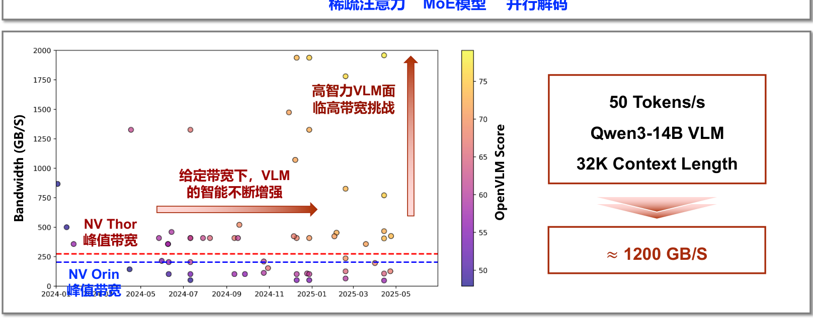

补充算例：若每个输出 Token 实际搬运 24 GB 数据，则每秒生成 50 Token 需要约 $24\times50=1200$ GB/s。这个算例解释量纲，**不表示课件已经证明上述模型恰好具有 24 GB/Token 的固定访存量**。

图还表达了另一个方向：在固定带宽预算下，可以靠并行解码、稀疏专家和稀疏注意力改善可达到的模型能力，而不是只等待更高带宽的芯片。

## 6. 为什么需要算法—系统—硬件协同

芯片迭代周期相对较长，模型架构、上下文和推理工作流则快速变化。只固定一个算法再让通用硬件被动适配，可能无法持续解决效率问题。

两条方向相互补充：

- **芯片感知的算法与调度**：根据容量、带宽、低精度计算和数据布局约束设计推理方法。
- **算法感知的芯片架构**：根据模型实际状态更新、稀疏性和访问规律组织计算与存储。

优化前先定位瓶颈。如果瓶颈已经转为验证计算或通信，继续只压缩权重读流量可能无法获得相同比例的端到端加速。

## 7. 并行解码与推测解码

普通自回归解码逐步运行目标模型。并行解码尝试一次迭代生成多个 Token；推测解码通常由草稿生成候选，再由目标模型验证，接受一段结果后继续。

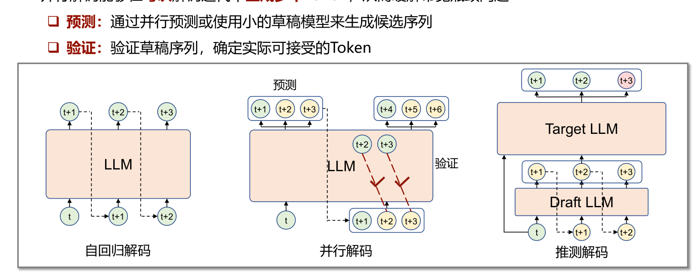

草稿来源可以是小模型，也可以来自目标模型内部的预测机制。需要区分“候选生成得快”和“最终接受得多”；错误候选不会自动变成有效输出。

补充成本模型：设草稿、验证和状态管理耗时分别为 $T_D,T_V,T_S$，每轮实际输出 $a$ 个接受 Token，另有实现规定的 $\delta$ 个额外目标 Token，则：

$$
T_{token}\approx\frac{T_D+T_V+T_S}{a+\delta}.
$$

增大候选树并非一定更快，因为验证、缓存和回滚成本也会增长。若要保持原目标模型的采样分布，需要相应的接受/修正算法；不能把任意草稿筛选都当作无损推测解码。

## 8. 并行解码的三类挑战与课件研究谱系

| 挑战 | 课件工作 | 课件强调的方法 | 课件报告的结果 |
|---|---|---|---|
| 验证开销随草稿规模增长，MoE 验证尤其昂贵 | ProPD，ICCAD 2024 | 自适应生成与剪枝 | 1.5× 吞吐 |
| 同上 | S2-MoE，arXiv 2026 | 自推测草稿、共享 KV | 最高 5.3× 吞吐 |
| 草稿仍需自回归生成，形成新瓶颈 | SpecASR，DAC 2025 | 草稿序列复用、两阶段稀疏树生成 | 3.79× 吞吐 |
| 同上 | RecGuide，arXiv 2026 | 融合草稿生成与验证阶段 | 1.8× 吞吐 |
| 算法不兼容循环/线性状态或其他生成机制 | SpecMamba，ICCAD 2025 | 解决 Mamba 状态回溯和树验证兼容性 | 约 2.3× 吞吐 |
| 同上 | ODB-dLLM，DAC 2026 | 面向扩散语言模型的推测解码 | 超过 2.6× 吞吐 |

以上倍率来自不同工作，基线、平台和任务并不相同，不可横向排列成同一排行榜，也不能直接相乘。

## 9. SpecMamba：缓存裁剪为什么不足以实现回滚

课件把 Mamba 放在“线性 Transformer”标题下。更准确地说，**Mamba 是选择性状态空间模型**，不应与标准 Transformer 或所有线性注意力模型画等号。

循环状态将历史输入聚合到当前状态。一个简化示意是 $h_t=A_t h_{t-1}+B_t x_t$。草稿某处被拒绝后，不能只删除一段显式 KV 列表就认为内部状态恢复；树状验证的不同分支也需要彼此一致而独立的状态历史。

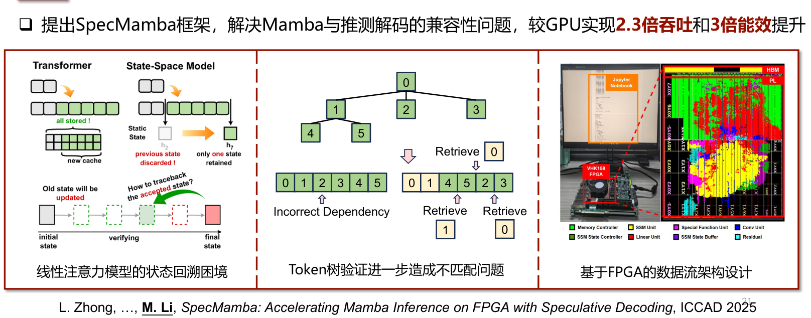

[SpecMamba 原论文](https://arxiv.org/abs/2509.19873)补充了三层机制：内存感知的混合回溯、FIFO 与分块的树验证，以及线性层并行/SSM 层串行的数据流重叠。论文摘要报告在 AMD VHK158、VCK190 FPGA 上，相对 GPU 约 2.27× 加速、5.41× 能效；相对先前 FPGA 方案约 2.85× 加速、1.26× 能效。

课件的演示另列 `4090：138 Tokens/s、约300 W`，以及两组 `220/313 Tokens/s、约100 W`，并在正文写“约2.3倍吞吐、3倍能效”。应分开保留这些口径：313/138≈2.27；按演示中的近似功耗直接算能效比会得到约6.80，而不是3。**功耗降低倍数、能效提升和不同评测集合的汇总数不是同一指标**；不把演示值强行改写为论文汇总结果。

## 10. MoE：稀疏计算不等于低存储成本

Router 为当前 Token 选择专家，输出由被选专家组合；共享专家则可在路由专家之外持续参与计算。

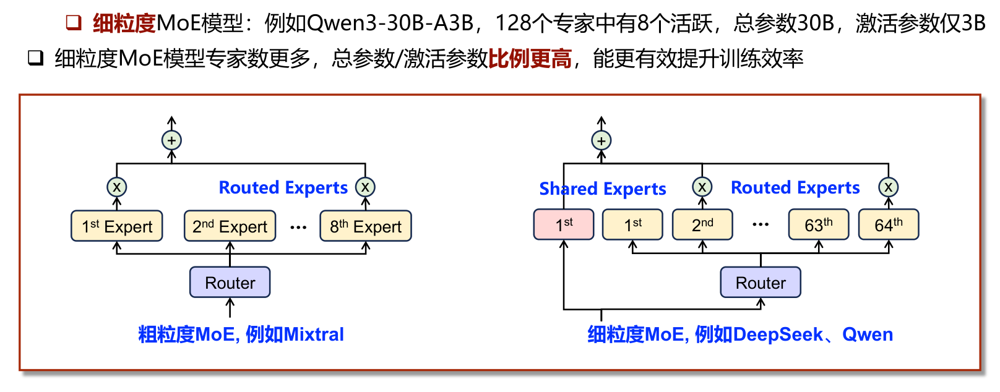

课件比较 Mixtral-8×7B 的 8 选 2、总参数约47B/激活约13B，以及 Qwen3-30B-A3B 的 128 选 8、总参数30B/激活约3B。细粒度专家提高了总参数与激活参数的分离程度，但仍要保存所有专家，并处理 Token 间不同的动态加载需求。

两个系统瓶颈是：

1. 参数放不进近端设备，需要卸载到 Host 或更远存储；动态图造成按需加载，关键路径变长。
2. 专家访问存在“冷热”和负载不均，计算/访存比例随解码变化，静态配置难以始终高效。

## 11. AdapMoE、HybriMoE 与 MatMoE

| 工作 | 主要场景与机制 | 课件结果 |
|---|---|---|
| AdapMoE，ICCAD 2024 | GPU 卸载场景；动态门控、预取、缓存和自适应调度，减少 Host 访问 | 约 1.35× 延迟加速比 |
| HybriMoE，DAC 2025 | GPU/CPU 异构计算分配和动态调度 | 约 1.3× 延迟加速比 |
| MatMoE，ICCAD 2026 | 专家动态混合精度量化与位宽分配 | 最高约 3.7×，具体平台见下节 |

“延迟降低1.35倍”按这里的加速比应读为 $T_{base}/T_{new}=1.35$，不是降低135%。每种结果均须保留自己的比较基线。

## 12. MatMoE：把静态专家精度变成 Token 相关的预算

同一个专家对不同 Token 的重要性会变化。固定专家位宽虽然简单，却可能给当前重要专家分配过低精度，或给不重要专家浪费带宽。

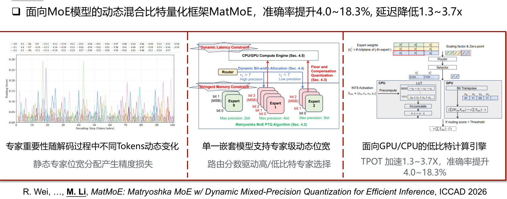

课件核心链条是：**单一嵌套模型支持多精度 → 根据路由分数选择专家位宽 → 满足内存与动态时延预算 → 使用相应低比特计算引擎**。这不是每一步临时保留多套完整模型，否则会抵消内存收益。

[MatMoE 原论文](https://arxiv.org/abs/2611.01704)进一步说明 Matryoshka PTQ、floor-and-compensation 以及按路由分数分配位宽。其实现基于 llama.cpp；摘要将树莓派5的 1.3—3.7× 与 RTX4090、Jetson AGX Orin 的 1.2—1.3× 分开报告。因此不能把3.7×直接写成所有GPU平台的收益。

课件和论文还给出相对静态混合精度方法4.0%—18.3%的准确率改善。此处保留原百分比口径，不在缺少逐任务分数时擅自改成百分点。优化评价需要同时看准确率、TPOT、内存预算和系统利用率。

第26页的演示另有可识别条件：OLMoE、Raspberry Pi 5、4线程、4-bit内存预算、3-bit目标；静态混合精度PMQ+llama.cpp显示80.3ms/Token，MatMoE显示27.6ms/Token，界面标为2.91×。复算 $80.3/27.6\approx2.91$，与该演示标注一致；它不是前述跨模型和跨平台的最大值。

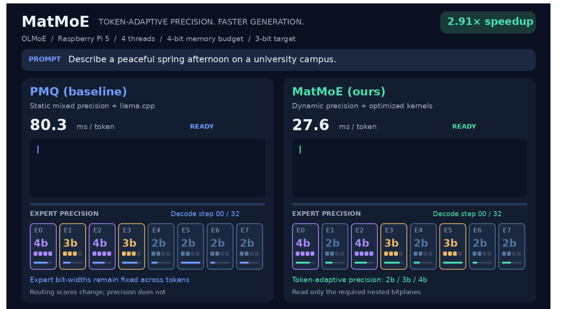

## 13. 稀疏注意力：压缩存储与减少加载不是一件事

长上下文让 KV 状态的保存、读取和计算变得昂贵。标准多头注意力可能需要访问长历史，但并非所有历史 Token 对当前输出同样重要。

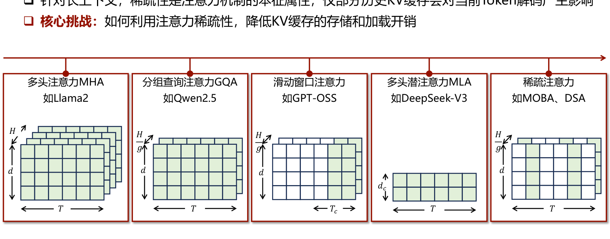

| 设计 | 主要降低的开销 | 不能直接等同的事项 |
|---|---|---|
| GQA | 多个查询头共享较少 KV 头 | 不是只保留局部时间窗口 |
| 滑动窗口 | 将部分层/头的访问限制在局部历史 | 是否仍有全局路径取决于模型结构 |
| MLA | 压缩表示与状态存储 | 压缩表示不自动等于跳过历史 Token |
| 稀疏注意力 | 选择一部分历史位置参与计算/加载 | 选择器本身也有成本，且要保证关键历史被召回 |

课件给出的挑战是：把注意力的稀疏性转化为真正的缓存容量、带宽和计算收益，而不是只在算法层写出较少的非零项。

该页分别用Llama2、Qwen2.5、GPT-OSS、DeepSeek-V3、MoBA/DSA对应上述MHA、GQA、滑动窗口、MLA和稀疏注意力示例；这是说明机制的课件对比，不将一个模型内所有层都默认成完全相同的模式。

## 14. ArkVale、MPCache 与注意力负载不均

- **ArkVale，NeurIPS 2024**：动态识别并召回关键 Token，并适配分页注意力组织；课件报告平均约1.7×速度提升。
- **MPCache，NeurIPS 2025**：结合静态与动态的 KV 缓存压缩，课件报告超过70%的容量与带宽优化。若按“减少70%”解释，则保留量约为原来的30%，而不是还剩70%；具体指标仍以对应论文为准。
- **课件所列 Z. Fu 等 ICML 2026 工作**：研究注意力汇聚现象及其与 MoE 的相似性，指出负载不均挑战，并报告准确率改善方向。该页未提供完整题名和数值，不补造量化结论。

优化要兼顾选择器开销、分页/数据布局、压缩误差和召回失误。减少逻辑上访问的 Token 后，如果访问仍非常离散或产生大量冗余搬运，端到端收益可能有限。

## 15. CoT、粗粒度 ToT 与细粒度并行 ToT

CoT 将推理过程展开为一条序列；ToT 扩大探索范围，保留多个候选分支。粗粒度方式以较长的思维链作为单元，细粒度方式在更小的步骤上分支、评价和选择。

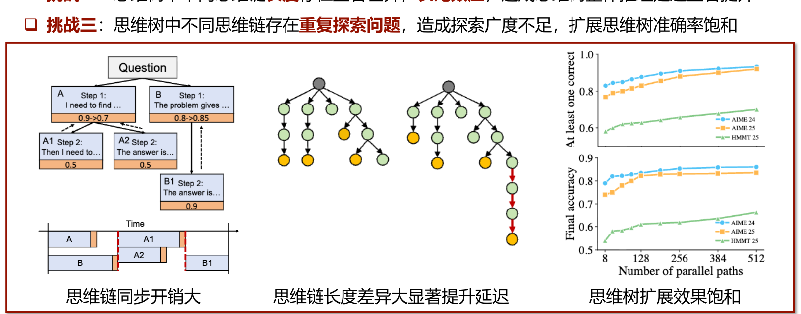

三类系统挑战：

1. 分支之间存在同步，部分计算资源等待，利用率降低。
2. 分支长度不同，较长分支形成长尾，影响整体结束时间。
3. 多个分支重复探索相同方向，增加计算量却没有相应扩大有效搜索范围，准确率随搜索规模增长而饱和。

因此不能用“生成更多推理 Token”替代对有效探索量和时延的分析。

## 16. SPEX 与 Hyper

课件第32页给出两条方向：

- **SPEX，OSDI 2026**：在不同思维链之间及其内部进行推测执行，课件报告最高约4.1×延迟加速。第33页引用 *Breaking the Reward Barrier: Accelerating ToT Reasoning via Speculative Exploration*。
- **Hyper，ICML 2026**：在细粒度分支生成中平衡探索与利用，课件报告准确率提升超过8%。未给出逐任务绝对分数时，不把该百分比擅自改写为百分点。

前者主要谈执行效率，后者强调搜索分配与准确率，两个数不是同一性能指标。课件中的视频演示截图只说明展示过对应系统，PDF 未包含的完整演示过程不补造。

## 17. 存算分离、近存计算与存内计算

核心目标是缩短数据搬运距离，利用更高内部带宽，降低搬运能耗与延迟。但计算精度、阵列可编程性、外围电路和调度复杂度也会影响可用性。

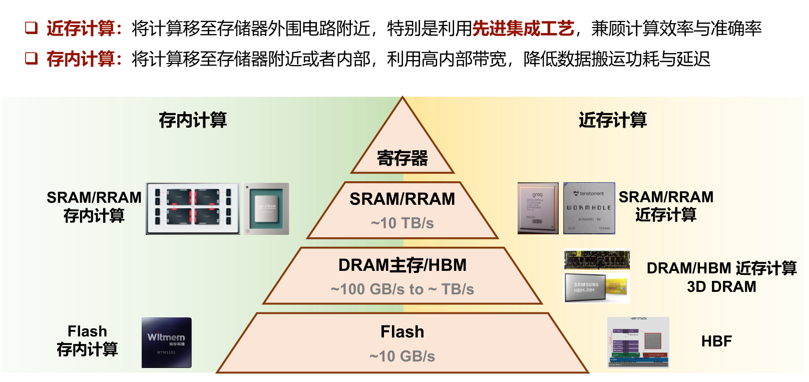

第35页以 SRAM/RRAM 约10TB/s、DRAM/HBM约100GB/s到TB/s、Flash约10GB/s示意层次差异。它们不是统一测量口径下的产品规格，也不表示同一范围内所有器件带宽都相同。课件还讨论3D DRAM、高带宽闪存HBF等先进集成带来的近存计算机会。

## 18. 存内计算三类研究案例

| 工作 | 课件中的机制 | 课件报告 |
|---|---|---|
| UniCAIM，DAC 2025 | 利用铁电存储，原位计算静态/动态稀疏注意力 | 约8×计算能效 |
| NASiC，DAC 2026 | 利用3D NAND存内计算服务MoE推理 | 最高约70×能效 |
| NICE，ISEDA 2026 | 面向3D NAND存内计算误差的算法校正 | 超过30%的准确率改善 |

这些结果涉及不同器件、实现和基线。“能效”和“吞吐”应分别给出，不将它们写成普遍的真实部署收益；准确率百分比也保留课件口径。

## 19. HD-MoE：分布式近存资源如何调度

混合键合的 DRAM 近存架构提供较高本地带宽，但存储与计算分布在多个单元上：

- 专家并行 EP 可能因专家访问冷热而负载不均。
- 张量并行 TP 将单个计算分散出去，可能产生较多通信。
- 只平衡算术量，也可能留下内存容量、带宽或通信上的不均衡。

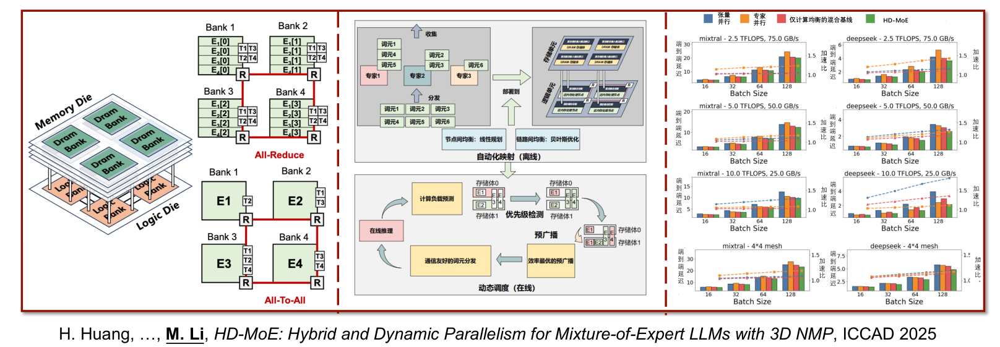

课件引用 H. Huang 等 *HD-MoE: Hybrid and Dynamic Parallelism for Mixture-of-Expert LLMs with 3D NMP*，ICCAD 2025。通过混合并行和动态调度，报告约1.4—1.8×加速。它说明高内部带宽仍需合适的数据与任务分配才能转化为端到端收益。

## 20. H²EAL：注意力稀疏度本身也不均衡

不同注意力头可能需要全注意力、动态稀疏注意力或静态稀疏模式。课件用0%、约50%、大于95%的稀疏度作例子。把它们分配到分布式DRAM计算资源后，负载差异可能造成空闲与等待。

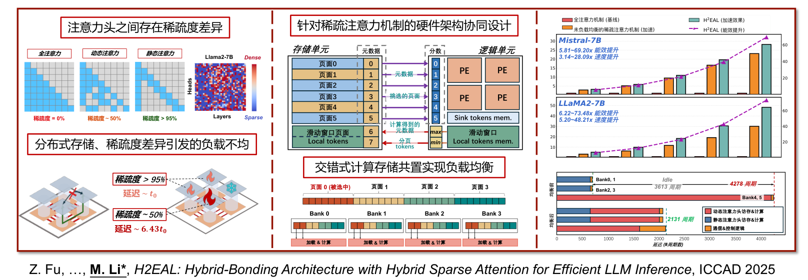

课件机制包括混合静态/动态稀疏注意力、计算与存储交错共置、关键页/元数据组织以及负载均衡。其示例把未均衡的若干Bank等待压缩为更均衡的执行过程；图中列出4278、3613、2131周期等不同阶段/方案示意，不能不看图例就当作三个完全相同测量边界的端到端时间。

第38页报告的范围为：

| 图中方案 | 速度提升范围 | 能效提升范围 |
|---|---:|---:|
| 未负载均衡的稀疏注意力加速 | 3.14—28.09× | 5.81—69.20× |
| 课件的协同与均衡方案 | 5.20—48.21× | 6.22—73.48× |

正文的“最高48倍速度、73倍能效”是上述范围的概括，不能写成每个任务都达到该值。引用工作为 Z. Fu 等 *H²EAL: Hybrid-Bonding Architecture with Hybrid Sparse Attention for Efficient LLM Inference*，ICCAD 2025。

## 21. HBFlex：细粒度 KV 状态遇到粗粒度 Flash

HBF 有较大容量与较高并行带宽，但读写粒度较大、写延迟较高、擦除约束较强。KV状态则频繁产生细粒度写入，多个对话的激活和结束也会改变数据在Plane间的分布。

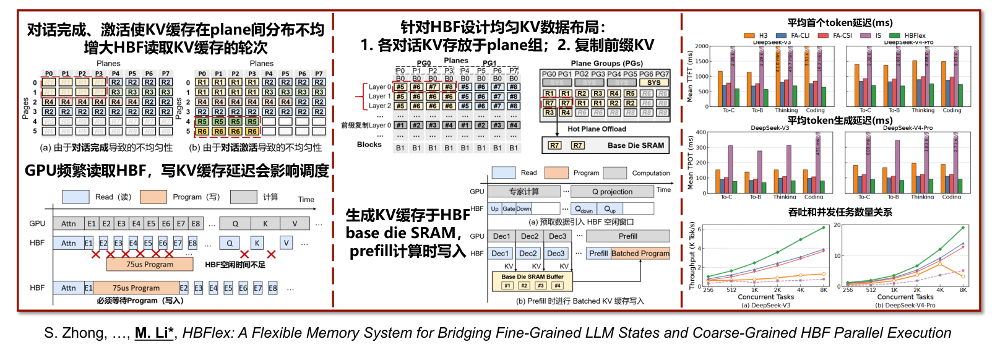

课件第39页给出三类协同方向：

1. **读**：按Plane组组织对话KV，并考虑前缀复制，使并行访问更均衡。
2. **写**：利用Base-die SRAM等缓冲组织新增KV，配合Prefill和后续写入调度，缓解频繁细粒度更新与粗粒度介质的冲突。
3. **回收**：结合对话生命周期组织回收，减少不灵活擦除带来的代价。

课件报告约1.58—3.30×加速，并分别展示首Token延迟、每输出Token延迟与并发吞吐。优化这些指标所需的数据布局和调度条件可能不同，不能只保留一个最大加速数。

## 22. 如何统一阅读这些优化结果

评估一个方案时至少写清：模型/结构、精度、上下文、Batch与并发、硬件、基线、测量边界，以及准确率是否可比。

| 指标 | 说明 |
|---|---|
| TTFT | 从请求开始到首个输出Token，容易受Prefill、排队和加载影响 |
| TPOT | 连续输出的每Token时间，容易受解码带宽、验证接受率等影响 |
| 吞吐 | 单位时间完成的有效Token或任务，须说明并发及统计方式 |
| 能效 | 有效工作量/能量，例如Token/J；不能只比较瞬时功率 |
| 容量/带宽 | 驻留字节数和实际搬运字节数，须说明压缩、精度与复用 |
| 准确率 | 任务、评测集、百分比/百分点和容许误差须明确 |

相同机制在不同瓶颈下可能收益不同。本文保留讲座记录，并对已核对的模型卡、SpecMamba和MatMoE作明确补充；其他课件工作可从[作者发表目录](https://mengli.me/publication/)继续定位原文，不把“课件列举”改写成“本地已经复现”。
